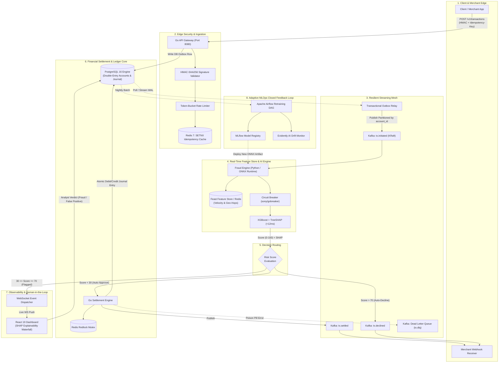

<div align="center">

<!-- High-Definition Native Static Banner -->
<p align="center">
  
</p>

<p align="center">
  <strong>An industrial-grade, event-driven financial engine engineering sub-40ms P99 settlement, zero-drift double-entry ledgers, and real-time sub-12ms adaptive ML fraud scoring.</strong>
</p>

<!-- Metric Badges -->
<p align="center">
  
  
  
  
  
</p>

<!-- Core Tech Stack Badges -->
<p align="center">
  
  
  
  
  
  
  
  
</p>

---

</div>

## 📌 Executive Overview

**NOVARIS** is an enterprise-grade distributed payment settlement and adaptive fraud intelligence platform. It resolves the classic FinTech paradox: **how to authorize and clear payments in sub-second timeframes without ever dropping money, executing double-charges, or letting adversarial fraud pass through.**

Unlike typical CRUD payment demos, NOVARIS operates as a true **fault-tolerant, event-driven banking core**. It combines mathematical ledger safety (debits always balance credits) with an ultra-fast streaming machine learning inference pipeline (scoring every payment in under 12ms with explainable SHAP vectors).

### 🎯 Key Performance Targets & SLAs

| Metric | Target SLA | Engineering Mechanism |
| :--- | :--- | :--- |
| **Sustained Throughput** | `> 3,500 TPS` | Non-blocking Go Gateway, partitioned Kafka event streaming |
| **End-to-End P99 Latency** | `< 40 ms` | Asynchronous feature store caching & CQRS read/write separation |
| **Fraud Model Inference** | `< 12 ms` | Compiled ONNX Runtime execution over pre-warmed Redis feature tensors |
| **Ledger Integrity** | `100.00%` | Double-entry journal entries + PostgreSQL ACID transactions |
| **Double-Spending Rate** | `0.00%` | Redis Redlock distributed mutex + Optimistic Concurrency Control (`version`) |
| **Fault Recovery** | `Zero Loss` | Transactional Outbox pattern + Dead Letter Queue with exponential backoff |

---

## 🏛️ End-to-End System Architecture

The following diagram illustrates the lifecycle of a transaction through NOVARIS—from external ingestion to distributed validation, real-time ML scoring, transactional ledger settlement, and closed-loop retraining:



---

## 💡 How NOVARIS Works (In Simple Terms)

For engineers, recruiters, and technical leaders, here is what happens when someone clicks **"Pay Now"**:

```
[1. The Handshake]  ──►  [2. The Memory Lock]  ──►  [3. The Ingestion Stream]
   HMAC Check               Idempotency Guard           Kafka KRaft Topic
        │                           │                           │
        ▼                           ▼                           ▼
[4. The 12ms Brain] ──►  [5. The Double Vault] ──►  [6. The Self-Learning Loop]
   ONNX Risk Scoring        Double-Entry Ledger         Nightly MLOps Retrain
```

1. **The Handshake & Gatekeeper:** The incoming request is cryptographically verified using an HMAC-SHA256 signature to guarantee payload integrity. A token-bucket rate limiter immediately throttles burst attacks.
2. **The Memory Lock (No Double Charging):** A unique `Idempotency-Key` is locked into Redis using atomic `SETNX`. If an unstable mobile network drops and resends the exact same charge, NOVARIS returns the original state without executing another transaction.
3. **The Reliable Publisher (Outbox Pattern):** Rather than blindly sending to Kafka (which could fail mid-way), the event is committed to a PostgreSQL `outbox` table in the exact same transaction. A background relay guarantees at-least-once delivery to Kafka.
4. **The Sub-12ms Brain (Fraud Detection):** While the payment is in flight, the fraud service pulls real-time behavioral features from Redis (e.g. *5 purchases in 60 seconds*, *geo-hop impossible velocity*). An ONNX-compiled XGBoost model scores the transaction (0-100) in under 12ms, generating SHAP attribution factors.
5. **The Double Vault (Financial Settlement):** If approved, the settlement worker acquires a distributed **Redis Redlock** mutex on the payer's account and updates balances using a **PostgreSQL double-entry journal entry** (every credit strictly matches a debit) with an optimistic locking `version` check.
6. **The Human-in-the-Loop Cockpit:** Borderline cases (scores 30–70) are piped over WebSockets into a React 19 analyst dashboard. The analyst inspects the SHAP waterfall graph explaining exactly *why* the transaction was flagged, and submits a verdict.
7. **The Adaptive Feedback Loop:** Confirmed verdicts are compiled into a training dataset. Nightly Airflow DAGs retrain the model, test for drift with Evidently AI, and publish new model checkpoints to MLflow.

---

## ⚙️ Core Technical Pillars

### 1. Zero-Drift Double-Entry Accounting
In NOVARIS, **an account balance is never modified with a naive `UPDATE balance = balance - amount` query**. A direct balance update destroys the audit trail and invites silent race conditions under concurrent load. 

Every financial event creates balanced ledger rows in `journal_entries`:
$$\sum \text{Debits} = \sum \text{Credits}$$

```sql
-- Atomic Journal Entry Creation
BEGIN;
  INSERT INTO journal_entries (transaction_id, account_id, entry_type, amount_cents)
  VALUES ('tx_123', 'sender_acc_uuid', 'DEBIT', 5000);

  INSERT INTO journal_entries (transaction_id, account_id, entry_type, amount_cents)
  VALUES ('tx_123', 'receiver_acc_uuid', 'CREDIT', 5000);

  -- Balance cache updated under Optimistic Concurrency Control
  UPDATE accounts 
  SET balance_cents = balance_cents - 5000, version = version + 1 
  WHERE id = 'sender_acc_uuid' AND version = 3;
COMMIT;
```

### 2. Concurrency Safety: Distributed Redlock + OCC
To guarantee 100% prevention of double-spending under high-concurrency spikes:
- **Redis Redlock Mutex:** Distributed locks are held across independent Redis nodes during critical settlement operations.
- **Optimistic Concurrency Control (OCC):** Each account contains a strictly incrementing `version` column. If two concurrent transactions read version 3, the first to commit updates to version 4; the second write fails atomically and is safely retried.

### 3. Dual-Write Elimination via Transactional Outbox
Writing to a database and publishing to an Apache Kafka message broker in two independent application calls creates an impossible failure mode: if the network breaks between steps, money is charged without notifying downstream systems.

NOVARIS implements the **Transactional Outbox Pattern**:
- The transaction record and an `outbox` event record are committed inside the **exact same ACID PostgreSQL transaction**.
- A decoupled worker reads unpublished events from `outbox` and publishes them to Kafka with delivery acknowledgments (`acks=all`), marking them `PUBLISHED`.

### 4. Circuit Breaker on Real-Time Inference
If the Machine Learning inference pod experiences an unexpected crash or network partition, checkouts should not grind to a halt. NOVARIS integrates `sony/gobreaker`:
- **Closed State:** Normal traffic routes to the ONNX model.
- **Open State (Error Rate > 5%):** Instant fallback to fast, heuristic velocity rules (e.g. maximum transaction size thresholds) so payment authorization latency remains low.
- **Half-Open State:** Periodically tests the ML service with trial canary requests to safely close the circuit upon recovery.

---

## 🗂️ Monorepo Structure

```text
novaris/
├── .github/
│   └── workflows/              # GitHub Actions CI/CD (Lint, Test, Docker Build)
├── deployments/
│   ├── docker-compose.yml      # Local dev mesh (Postgres 16, Redis 7, Kafka KRaft)
│   ├── helm/                   # Kubernetes production Helm charts
│   └── k8s/                    # Core k8s manifests (Deployments, Services, ConfigMaps)
├── frontend/                   # Analyst & Operations Dashboard (React 19 + Vite)
│   ├── src/
│   │   ├── components/         # Shadcn UI, ECharts SHAP waterfall components
│   │   ├── hooks/              # WebSocket & real-time live event listeners
│   │   └── pages/              # Real-time triage queue, audit trail, metrics
│   └── package.json
├── services/
│   ├── gateway/                # Ingestion API (Go 1.22+, HMAC, Token-Bucket, Redis)
│   │   ├── cmd/server/         # Main entry point
│   │   ├── internal/auth/      # HMAC-SHA256 signature verification
│   │   ├── internal/ratelimit/ # Token-bucket distributed algorithm
│   │   └── internal/outbox/    # Transactional outbox writer
│   ├── settlement/             # Ledger & Bookkeeping Engine (Go 1.22+)
│   │   ├── cmd/worker/         # Kafka consumer entry point
│   │   ├── internal/ledger/    # Double-entry balance & journal engine
│   │   └── internal/lock/      # Redis Redlock distributed mutex
│   └── fraud-ml/               # Adaptive ML Risk Engine (Python 3.11+)
│       ├── app/                # FastAPI / ONNX Runtime scoring server
│       ├── models/             # XGBoost & PyTorch Geometric ONNX weights
│       ├── explainability/     # TreeSHAP factor extraction
│       └── pipelines/          # Airflow DAGs for automated nightly retraining
├── tests/
│   ├── concurrency/            # 100+ goroutine race-condition stress harness
│   ├── k6/                     # Sustained 3,500 TPS load test scripts
│   └── chaos/                  # Litmus Chaos network delay & pod-kill scenarios
└── README.md
```

---

## 🚀 Quickstart & Local Setup

### Prerequisites
Ensure your local development machine has:
- **Go:** `v1.22` or later
- **Python:** `v3.10` or later
- **Node.js:** `v20+` or `v24+`
- **Docker Desktop & Docker Compose** (running)

### 1. Clone the Repository
```bash
git clone https://github.com/charan21042005/novaris.git
cd novaris
```

### 2. Boot Up the Local Infrastructure Mesh
Launch PostgreSQL 16, Redis 7, and Apache Kafka (KRaft mode) in Docker:
```bash
docker compose -f deployments/docker-compose.yml up -d
```

### 3. Verify System Health
```bash
# Check PostgreSQL
docker exec -it novaris-postgres pg_isready -U novaris_admin

# Check Redis
docker exec -it novaris-redis redis-cli ping

# Check Go API Gateway Health Endpoint
curl -X GET http://localhost:8080/healthz
```

---

## 📚 Daily Implementation & Theory Action Logs

Every milestone across the 84-day curriculum is documented with textbook-grade depth in [`bin/Daily_Actions/`](bin/Daily_Actions/README.md), covering first-principles computer science theory, line-by-line code masterclasses, and live verification matrices:

| Day | Milestone Focus | Security / Architectural Guarantee | Theory & Action Log | Status |
| :---: | :--- | :--- | :---: | :---: |
| **Day 01** | **Monorepo Layout & Ledger Schema** | PostgreSQL 16 Double-Entry Ledger & Docker Infrastructure | [Day 01 Action Log](bin/Daily_Actions/Day_01_Action_Log.md) | ✅ *Completed* |
| **Day 02** | **JWT Authentication & Middleware** | RFC 7519 Stateless Identity & `alg: none` Defense | [Day 02 Action Log](bin/Daily_Actions/Day_02_Action_Log.md) | ✅ *Completed* |
| **Day 03** | **HMAC Request Signing & Replay Defense** | RFC 2104 Payload Integrity, Replay Window & Constant-Time Verification | [Day 03 Action Log](bin/Daily_Actions/Day_03_Action_Log.md) | ✅ *Completed* |
| **Day 04** | **Token-Bucket Rate Limiter & Concurrency Defense** | Burst-Tolerant Lazy Mathematical Refill, sync.RWMutex & RFC 6585 HTTP 429 | [Day 04 Action Log](bin/Daily_Actions/Day_04_Action_Log.md) | ✅ *Completed* |
| **Day 05** | **Full Ledger Schema, Composite Indexes & JSONB** | Human Fraud Reviews, Feature Snapshots, GIN & Hierarchical B-Trees | [Day 05 Action Log](bin/Daily_Actions/Day_05_Action_Log.md) | ✅ *Completed* |
| **Day 06** | **Atomic Settlement Logic & Double-Entry Ledger Writes** | Multi-Table ACID Transactions, `defer tx.Rollback()`, Invariant Balance | [Day 06 Action Log](bin/Daily_Actions/Day_06_Action_Log.md) | ✅ *Completed* |
| **Day 07** | **Testing Discipline & Table-Driven Safety Nets** | Table-Driven Unit Tests, 100% Core Statement Coverage & In-Memory Benchmarks | [Day 07 Action Log](bin/Daily_Actions/Day_07_Action_Log.md) | ✅ *Completed* |
| **Day 08** | **Concurrency Testing & The Race Detector** | Nanosecond Start Barriers, Atomic Invariants & Memory Isolation | [Day 08 Action Log](bin/Daily_Actions/Day_08_Action_Log.md) | ✅ *Completed* |
| **Day 09** | **Optimistic Concurrency Control & Version Columns** | Atomic SQL Conditional Updates, CAS & Database Collision Resilience | *Pending* | ⏳ *Up Next* |

---

## 📊 12-Week Roadmap & Implementation Milestones

```
Phase 1: Design & Ledger (Weeks 1-2)  ──►  Phase 2: Streaming Core (Weeks 3-4)
Postgres Double-Entry, Go Gateway,           Kafka KRaft Ingestion, DLQ,
HMAC & Rate Limiting                         Outbox Relay, Partitioning
                 │                                        │
                 ▼                                        ▼
Phase 3: Concurrency Safety (Weeks 5-6)  Phase 4: Fraud AI Engine (Weeks 7-8)
Redis Redlock, Optimistic Locking,           XGBoost + ONNX (<12ms), Feast
Race Condition Stress Testing                Feature Store, TreeSHAP
                 │                                        │
                 ▼                                        ▼
Phase 5: Frontend & MLOps (Weeks 9-10) ──► Phase 6: Cloud & SRE (Weeks 11-12)
React 19 WebSockets, Triage UI,              K8s, ArgoCD GitOps, k6 Load Test,
Airflow Automated Retraining DAG             Litmus Chaos Engineering
```

---

## 📄 License & Attribution

This project is licensed under the **MIT License** — see the [LICENSE](LICENSE) file for complete details.

<div align="center">

<!-- High-Definition Native Static Footer -->
<p align="center">
  
</p>

<p align="center">
  <strong>Engineered by <a href="https://github.com/charan21042005">Tokachichu Sri Charan</a></strong><br>
  <em>Distributed Systems • FinTech Engineering • Applied Machine Learning • SRE</em>
</p>

</div>
