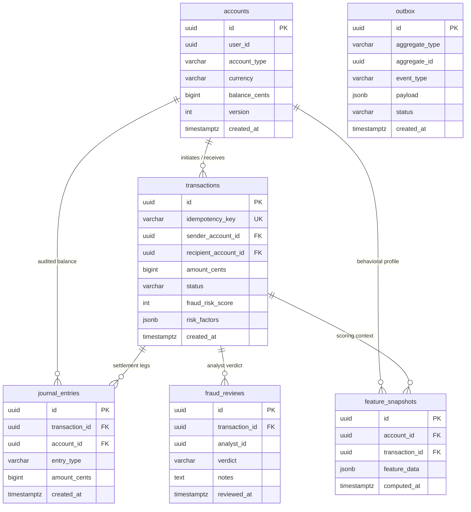

<div align="center">

<!-- Floating Top Banner -->
<p align="center">
  
</p>

# 📖 NOVARIS THEORY TEXTBOOK • DAY 05
## Full Ledger Schema: Human Fraud Reviews, Temporal Feature Snapshots, Composite Indexing & JSONB

<p align="center">
  
  
  
  
</p>

---

</div>

## 📑 Detailed Table of Contents

1. [Preface: Completing the Persistence Bedrock — The Invisible Bridge to Future Intelligence](#1-preface-completing-the-persistence-bedrock--the-invisible-bridge-to-future-intelligence)
2. [Chapter 0: The Plain-English Database & Schema Design Lexicon](#2-chapter-0-the-plain-english-database--schema-design-lexicon)
   - 0.1 What is Database Normalization? (The Messy Garage vs. Tool Chest Analogy)
   - 0.2 What is Semi-Structured Data? (The Flexible Invoice Analogy)
   - 0.3 JSON vs. JSONB in PostgreSQL (Plain Text vs. Decomposed Binary Trees)
   - 0.4 JSONB Operators (`->`, `->>`, `@>`) Explained Simply
   - 0.5 What is a Database Index? (The Textbook Index Analogy)
   - 0.6 What is a Composite Index? (The Telephone Directory Analogy)
   - 0.7 The Left-to-Right Index Prefix Rule (Why Column Order Dictates Performance)
   - 0.8 B-Tree Index vs. GIN Index (Generalized Inverted Index)
   - 0.9 What is a Foreign Key (`REFERENCES`) and Referential Integrity?
   - 0.10 Referential Actions: `RESTRICT` vs. `CASCADE` vs. `SET NULL`
   - 0.11 What is a Database `CHECK` Constraint? (The Electronic Rollercoaster Gauge)
   - 0.12 PostgreSQL Native `ENUM` vs. `VARCHAR + CHECK` (Rigid Types vs. Flexible Evolution)
   - 0.13 What is Schema Drift? (Architectural Blueprints vs. As-Built Reality)
   - 0.14 Migration Immutability & Numbering Discipline (Why We Never Edit Old Migrations)
   - 0.15 Hot In-Memory Caching vs. Cold Durable Storage (Redis vs. Postgres)
3. [Chapter 0.5: Complete Software Components, Tooling & Dependency Directory](#3-chapter-05-complete-software-components-tooling--dependency-directory)
   - 0.5.1 Relational Engine & Storage Primitives (PostgreSQL 16, Alpine, `uuid-ossp`)
   - 0.5.2 Indexing Engines & Query Planners (B-Tree, GIN, `EXPLAIN ANALYZE`)
   - 0.5.3 Database Administration & CLI Tooling (`psql`, `docker cp`, `docker exec`)
   - 0.5.4 Standards & Specifications (ANSI SQL-92, SQL:2016 JSON, ISO 8601, ISO 4217)
4. [Chapter 1: The Theoretical Foundations of Schema Evolution in Financial AI Systems](#4-chapter-1-the-theoretical-foundations-of-schema-evolution-in-financial-ai-systems)
   - 1.1 The Lifecycle of a Disputed Transaction: The 30-70 Ambiguity Band
   - 1.2 The Cold-Start Dilemma: Why Boring Backend Work IS Exciting ML Work
   - 1.3 Freezing Ephemeral Time: Why Redis Cannot Act as an Offline Feature Store
   - 1.4 How Real-World Gateways Store Reviews and Features (Stripe Radar, Adyen Score)
5. [Chapter 2: The Mathematical & Structural Architecture of JSONB and Index Trees](#5-chapter-2-the-mathematical--structural-architecture-of-jsonb-and-index-trees)
   - 2.1 The Internal Representation of JSONB: Binary Header & JEntry Offsets
   - 2.2 Mathematical Complexity of Lookups: $O(N)$ Text Scanning vs. $O(\log K)$ Binary Search
   - 2.3 The Geometry of Composite B-Trees: Hierarchical Sorting on $(A, B)$
   - 2.4 Mathematical Proof: Why Filtering on $B$ Alone Cannot Utilize a $(A, B)$ B-Tree
   - 2.5 Inverted Indexing (GIN) Mechanics: How Postgres Indexes Internal JSONB Keys
   - 2.6 PostgreSQL Page Layout, Buffer Cache & TOAST (Oversized-Attribute Storage)
   - 2.7 Write Amplification, MVCC Tuple Dynamics & Immutability in Feature Stores
6. [Chapter 3: Critical Database Engineering Obstacles & Defense Science](#6-chapter-3-critical-database-engineering-obstacles--defense-science)
   - 3.1 Migration Discipline: Why Modifying `001_initial_ledger_schema.sql` Causes Divergent Reality
   - 3.2 The Docker Entrypoint Initialization Trap (Why New Scripts Are Ignored on Existing Volumes)
   - 3.3 Foreign Key Cascading Hazards in Auditable Financial Systems
   - 3.4 Why Nullable `transaction_id` in `feature_snapshots` is a Strategic Architectural Choice
7. [Chapter 4: Defense in Depth & Schema Integration Architecture](#7-chapter-4-defense-in-depth--schema-integration-architecture)
   - 4.1 The Complete 6-Table Entity-Relationship Model
   - 4.2 The Cross-Phase Dependency Graph (Connecting Day 5 to Days 20, 44, 51, and 66)
   - 4.3 Database-Enforced Invariants vs. Application-Level Validation
8. [Chapter 5: The Data Science → Full-Stack Schema Rosetta Stone](#8-chapter-5-the-data-science--full-stack-schema-rosetta-stone)
9. [Chapter 6: Architectural Trade-Off Analysis ("Why This and Not That")](#9-chapter-6-architectural-trade-off-analysis-why-this-and-not-that)
   - 6.1 Fully Normalized Relational Columns vs. Semi-Structured JSONB
   - 6.2 PostgreSQL Native ENUM vs. VARCHAR + CHECK Constraint
   - 6.3 Composite Index `(account_id, computed_at DESC)` vs. Two Separate Single-Column Indexes
   - 6.4 Eager Point-in-Time Snapshotting vs. On-Demand Historical Reconstruction
10. [Chapter 7: Line-by-Line Code Masterclass (Complete Dissections)](#10-chapter-7-line-by-line-code-masterclass-complete-dissections)
    - 7.1 `migrations/002_fraud_and_features.sql` (The Complete Day 5 DDL Migration)
    - 7.2 `migrations/verify_day05_schema.sql` (Deterministic Test & Diagnostic Harness)
    - 7.3 `migrations/001_initial_ledger_schema.sql` (Reviewing Foreign Key Foundations)
    - 7.4 `deployments/docker-compose.yml` (Reviewing Persistence Volume Architecture)
    - 7.5 `migrations/README.md` (Updated Database Persistence Documentation)
11. [Chapter 8: Verification Laboratory: Execution Proof & Complete Runbook](#11-chapter-8-verification-laboratory-execution-proof--complete-runbook)
    - 8.1 Schema Verification Matrix: Column-by-Column Diff with the SRS Blueprint
    - 8.2 Real-World SQL Verification Scenarios (Seeding, JSONB Extraction, Check Violations, EXPLAIN Plans)
    - 8.3 Complete Step-by-Step CLI Runbook (Docker, psql, and PowerShell)
    - 8.4 Production Database Diagnostics, Index Performance & Troubleshooting Runbook
12. [Chapter 9: The Interview Defense Compendium (15 High-Stakes Tier-1 Q&As)](#12-chapter-9-the-interview-defense-compendium-15-high-stakes-tier-1-qas)
13. [Chapter 10: The Roadmap Horizon (Day 6 Preview: Atomic Settlement & Concurrency Rollbacks)](#13-chapter-10-the-roadmap-horizon-day-6-preview-atomic-settlement--concurrency-rollbacks)
    - 10.1 Day 6 Architectural Objectives
    - 10.2 Hands-On Mastery Exercises for the Reader

---

## 1. Preface: Completing the Persistence Bedrock — The Invisible Bridge to Future Intelligence

On **Days 2 through 4**, we constructed an increasingly formidable cryptographic and traffic-control gauntlet at the gateway perimeter:
* **Day 2:** We built JSON Web Token (JWT) authentication, answering **"Who are you?"**
* **Day 3:** We implemented HMAC-SHA256 request signing with timestamp replay windows, answering **"Has this request been altered or replayed?"**
* **Day 4:** We engineered a zero-goroutine Token-Bucket rate limiter with `sync.RWMutex` double-checked locking, answering **"How fast and how much can you send?"**

Today, on **Day 5**, we step back from the network perimeter into the very heart of the system: **the PostgreSQL database engine**.

```
                THE ARCHITECTURAL LIFECYCLE OF NOVARIS INGESTION & AUDIT
                
   [DAYS 2 - 4]                                   [DAY 1 & DAY 5]
 GATEWAY PERIMETER                            POSTGRESQL 16 PERSISTENCE
 ┌─────────────────┐                          ┌───────────────────────────────────────┐
 │ 1. JWT Auth     │                          │ DAY 1: CORE LEDGER                    │
 │ 2. Rate Limiter │ ───────────────────────> │  * accounts (Balances & OCC version)  │
 │ 3. HMAC Sign    │                          │  * transactions (Ingress lifecycle)   │
 └─────────────────┘                          │  * journal_entries (Double-entry)     │
                                              │  * outbox (Kafka relay queue)         │
                                              ├───────────────────────────────────────┤
                                              │ DAY 5: FRAUD & FEATURE ARCHIVE        │
                                              │  * fraud_reviews (Analyst verdicts)   │
                                              │  * feature_snapshots (JSONB features) │
                                              └───────────────────────────────────────┘
```

### Why Stepping Back to the Database is Essential
To a junior engineer, switching from writing high-performance Go middleware back to writing SQL DDL files might feel like a pause in momentum. In industrial software engineering, the exact opposite is true:
> **The two database tables we create today (`fraud_reviews` and `feature_snapshots`) are the load-bearing pillars upon which all future machine learning retraining (Weeks 7–8) and human analyst dashboards (Weeks 9–10) are built.**

### The Physical Analogy: The Judicial Court Record & The Frozen Crime Scene
* **`fraud_reviews` is the Judicial Court Record:** When a transaction is flagged by AI because it looks suspicious (Risk Score 65), the payment cannot simply be thrown away. A human fraud analyst must investigate. The verdict the analyst renders (`CONFIRMED_FRAUD` or `FALSE_POSITIVE`) along with their detailed rationale is recorded permanently in `fraud_reviews`. This table becomes the **authoritative, human-verified training dataset** that Day 66's automated Apache Airflow retraining DAG will query to retrain the XGBoost and Graph Neural Network models!
* **`feature_snapshots` is the Frozen Crime Scene:** In Week 3 (Day 20), we build in-memory Redis velocity counters to detect card-testing attacks (e.g. 5 transactions in 1 minute). But Redis is an ephemeral in-memory cache: once an hour passes, the counter resets. Redis can tell you what an account's velocity is *right now*; it cannot tell you what it was three months ago when a disputed transaction occurred. `feature_snapshots` freezes the exact microsecond state of all ML features into a queryable binary JSON (`JSONB`) record forever.

---

## 2. Chapter 0: The Plain-English Database & Schema Design Lexicon

For software engineers, data scientists, and computer science students, relational database indexing and semi-structured storage can seem deceptively simple until poor design brings a production cluster to a halt. Here is every concept explained in intuitive, first-principles terms:

### 1. What is Database Normalization?
* **Plain English:** The process of organizing data into separate, specialized tables so that every piece of information is stored in exactly one place, eliminating redundant duplicates and preventing inconsistent data.
* **The Messy Garage Analogy:** You could throw all your wrenches, paint cans, and car parts into one giant cardboard box (un-normalized). It's easy to dump things in, but searching for a 10mm socket takes 40 minutes. Normalization is sorting your tools into dedicated, labeled drawers: sockets in drawer 1, screwdrivers in drawer 2.

### 2. What is Semi-Structured Data?
* **Plain English:** Data that does not conform to a rigid, predetermined tabular structure where every row has the exact same columns, but still contains internal tags, key-value pairs, or hierarchies.
* **The Flexible Invoice Analogy:** A standardized receipt has rigid fields: Date, Total, Tax. But underneath, you might want to store optional custom notes, airline seat numbers, or gift messages. Semi-structured formats (like JSON) let you store varying metadata without modifying the receipt's physical template.

### 3. JSON vs. JSONB in PostgreSQL
PostgreSQL offers two distinct column types for storing JSON documents:
* **`JSON` (Plain Text Storage):** Stores an exact textual copy of the JSON input string, including whitespace and key ordering. Every time you query inside it, PostgreSQL must re-parse the raw text from scratch. It is slow for filtering.
* **`JSONB` (Decomposed Binary Storage - NOVARIS Standard):** Parses the JSON on insertion and translates it into a structured, indexed binary format. Whitespace is stripped, duplicate keys are eliminated, and keys are sorted alphabetically. Querying inside `JSONB` is blazing fast because PostgreSQL can traverse the binary tree without text parsing, and it supports **GIN indexes**.

```
    PLAIN JSON COLUMN ──► Stores raw string " { \"risk\": 0.95 } " ──► Re-parsed on every query!
    JSONB COLUMN      ──► Stores compiled binary tree of keys/values ──► Fast indexable traversal!
```

### 4. JSONB Operators (`->`, `->>`, `@>`) Explained Simply
PostgreSQL provides specialized operators to query inside JSONB columns directly in SQL:
* **`->` (Extract as JSON):** Returns the child element as a `JSONB` object (preserving quotes and JSON types).
  * Example: `feature_data->'device'` $\rightarrow$ `{"os": "iOS", "trust": 0.95}`
* **`->>` (Extract as Plain Text):** Returns the child element as a raw SQL `text` string (unquoted).
  * Example: `feature_data->>'ip_country'` $\rightarrow$ `JP`
* **`@>` (Contains Operator):** Checks whether the left JSONB document contains the exact key-value structure of the right JSONB document.
  * Example: `feature_data @> '{"is_vpn": true}'::jsonb` $\rightarrow$ Evaluates to `TRUE` if `is_vpn` is true!

### 5. What is a Database Index?
* **Plain English:** A separate, auxiliary data structure maintained by the database engine that allows it to find specific rows in $O(\log N)$ time without scanning every single row on disk.
* **The Textbook Index Analogy:** If a 1,200-page book has no index, finding where "HMAC-SHA256" is mentioned requires reading every single page from 1 to 1,200 (a **Sequential Scan** / `Seq Scan`). An index at the back lists `"HMAC-SHA256: page 42, 118, 512"`, allowing you to flip directly to the answer in 2 seconds (an **Index Scan**).

### 6. What is a Composite Index (Multi-Column Index)?
* **Plain English:** A single database index constructed across **two or more columns** simultaneously, sorting rows in a strict hierarchical order: first by column 1, then by column 2 within matching groups of column 1.
* **The Telephone Directory Analogy:** A phone book is a composite index on `(Last Name, First Name)`. It is sorted first by Last Name (Smith, Smyth, Williams), and within each last name, it is sorted by First Name (Adam, Bob, Charlie).

### 7. The Left-to-Right Index Prefix Rule
Because a composite index on `(A, B)` is physically sorted by `A` first and then `B`:
* **Fast Queries:** It can instantly accelerate a query filtering on `WHERE A = '...'` or `WHERE A = '...' AND B = '...'`.
* **Useless Queries:** It CANNOT accelerate a query filtering ONLY on `WHERE B = '...'`!
* **The Analogy:** Searching a phone book for everyone named "David" (First Name only) requires reading every single page from cover to cover because Davids are scattered under Adams, Baker, Clark, and Smith! The phone book's sort order is completely useless for searching by first name alone.

### 8. B-Tree Index vs. GIN Index
* **B-Tree (Balanced Tree - Default):** Best for scalar values (numbers, timestamps, strings, UUIDs) that support comparison operators (`=`, `<`, `>`, `BETWEEN`, `ORDER BY`). It maintains a self-balancing tree sorted in ascending or descending order.
* **GIN (Generalized Inverted Index):** Designed for multi-value containers (arrays, full-text search, and `JSONB` documents). Instead of indexing the whole row, a GIN index creates an inverted index mapping **every individual key and value** inside the JSONB document to the rows that contain it.

### 9. What is a Foreign Key (`REFERENCES`) and Referential Integrity?
* **Plain English:** A database constraint that guarantees a relationship between two tables remains valid. It dictates that a column in a child table must contain a value that actually exists in the primary key of a parent table.
* **The Parent-Child Guardian Analogy:** A school enrollment system will not let you register a child unless a valid, verified parent record exists in the system. If you try to enter an orphan child with a fake parent ID, the database rejects the write.

### 10. Referential Actions: `RESTRICT` vs. `CASCADE` vs. `SET NULL`
When a row in the parent table is deleted, what happens to its child rows?
* **`ON DELETE RESTRICT` (NOVARIS Financial Standard):** The database **blocks and cancels the deletion** of the parent row if any child row references it. You cannot delete a transaction if a ledger journal entry or fraud review points to it!
* **`ON DELETE CASCADE`:** Deleting the parent automatically deletes all child rows. (Dangerous in financial systems; used only for ephemeral caches).
* **`ON DELETE SET NULL`:** Deleting the parent leaves the child row intact, but sets the foreign key column to `NULL`.

### 11. What is a Database `CHECK` Constraint?
* **Plain English:** A rule enforced directly by the database engine verifying that any value inserted or updated into a column satisfies a Boolean expression. If the expression evaluates to `FALSE`, the transaction is rolled back with a `check_violation` error.
* **The Rollercoaster Height Gauge Analogy:** A physical wooden sign at a theme park: *"You must be at least 48 inches tall to ride."* It doesn't matter what the ride operator wants; the physical barrier refuses entry.
* **In NOVARIS:** `CHECK (verdict IN ('CONFIRMED_FRAUD', 'FALSE_POSITIVE'))` guarantees that no buggy service can ever write `'PENDING'` or `'MAYBE'` into the verdict column.

### 12. PostgreSQL Native `ENUM` vs. `VARCHAR + CHECK`
* **Native `ENUM`:** Creates an explicit database type (`CREATE TYPE review_verdict AS ENUM (...)`). It is compact and strongly typed, but adding or modifying values later requires complex `ALTER TYPE` migrations that can lock tables.
* **`VARCHAR + CHECK` (NOVARIS Standard):** Uses a standard string column guarded by a `CHECK` constraint. Extending the allowed values in the future only requires updating the constraint, avoiding table rewrite locks.

### 13. What is "Schema Drift"?
* **Plain English:** A dangerous condition where the schema described in your documentation, repository code, or blueprints no longer matches the actual columns, types, and indexes deployed on the production database.
* **The Construction Analogy:** The architect draws blueprints for a 3-bedroom house, but the builders added a sunroom and removed a bathroom without telling anyone. When the plumber arrives, the pipes don't align.

### 14. Migration Immutability & Numbering Discipline
* **The Cardinal Rule:** **Once a migration script (e.g. `001_initial_ledger_schema.sql`) has been deployed to any running database, it is PERMANENTLY IMMUTABLE.**
* You NEVER go back and edit `001`. If you need to add tables, alter columns, or add indexes, you write `002_fraud_and_features.sql`.
* **Why:** If Developer A runs edited `001` on a new container, but Production already ran old `001`, Production and Development now have permanently different database schemas, triggering production outages!

### 15. Hot In-Memory Caching vs. Cold Durable Storage
* **Hot Storage (Redis):** Ultra-fast sub-millisecond RAM. Ideal for transient counters (how many transactions in the last 60 seconds). Data is ephemeral and historical trends are lost.
* **Cold Storage (PostgreSQL):** Disk-backed, ACID-compliant relational persistence. Slower than RAM, but guarantees that historical feature snapshots survive server restarts and remain queryable for years.

---

## 3. Chapter 0.5: Complete Software Components, Tooling & Dependency Directory

Every software package, standard library module, and protocol specification utilized in Day 5 is detailed below:

### 0.5.1 Relational Engine & Storage Primitives

| Component / Library | Version / Source | Primary Role in Day 5 |
| :--- | :---: | :--- |
| **PostgreSQL 16 Alpine** | `postgres:16-alpine` | Official Docker Hub container image running our ACID database cluster. |
| **`uuid-ossp` / `pgcrypto`** | Built-in Extension | Provides `gen_random_uuid()` to mint collision-free RFC 4122 Version 4 UUID primary keys natively inside PostgreSQL. |
| **JSONB Binary Engine** | PostgreSQL Core | Parses, decomposes, sorts, and indexes arbitrary semi-structured feature vectors into 32-bit JEntry binary format. |
| **BIGINT Monetary Columns** | ANSI SQL Standard | Retained from Day 1 across `accounts` and `transactions` to prevent IEEE-754 binary floating-point drift. |

### 0.5.2 Indexing Engines & Query Planners

| Index Type / Command | Underlying Data Structure | Purpose & Query Acceleration |
| :--- | :--- | :--- |
| **B-Tree Composite Index** | Self-balancing $m$-way search tree | Orders `feature_snapshots` by `(account_id, computed_at DESC)` for sub-millisecond single-merchant time-series retrieval. |
| **GIN (Inverted Index)** | B-Tree of keys with posting lists | Indexes individual keys and values inside `feature_data JSONB` for microsecond containment queries (`@>`). |
| **`EXPLAIN (COSTS OFF)`** | PostgreSQL Query Optimizer | Inspects the internal query execution plan to confirm that PostgreSQL executes an `Index Scan` rather than a sequential table scan. |

### 0.5.3 Database Administration & CLI Tooling

| Tool | Command Invocation | Purpose in Day 5 |
| :--- | :--- | :--- |
| **`psql` CLI** | `docker exec -it novaris-postgres psql ...` | Interactive PostgreSQL command-line shell used to apply migrations and query table catalog metadata (`\dt`, `\d`). |
| **`docker cp`** | `docker cp migrations/002_... novaris-postgres:/tmp/` | Copies migration files from the developer host into the running Docker container file system. |
| **`docker exec`** | `docker exec -i novaris-postgres psql ...` | Executes commands non-interactively inside the running PostgreSQL container. |

### 0.5.4 Standards & Specifications

| Standard | Full Title | Why NOVARIS Adheres to It |
| :--- | :--- | :--- |
| **SQL:2016** | ISO/IEC 9075:2016 (JSON Features) | Standardizes JSON data types, operators (`->`, `->>`), and path expressions across modern relational engines. |
| **ISO 8601** | Data elements and interchange formats — Representation of dates and times | Enforced via `TIMESTAMPTZ` storing all review and snapshot dates in coordinated universal time (UTC). |
| **RFC 4122** | A Universally Unique Identifier (UUID) URN Namespace | Governs the generation of 128-bit version-4 random UUID primary keys across all financial entities. |

---

## 4. Chapter 1: The Theoretical Foundations of Schema Evolution in Financial AI Systems

### 1.1 The Lifecycle of a Disputed Transaction: The 30-70 Ambiguity Band
In Phase 4 (Weeks 7–8), NOVARIS deploys an XGBoost and TreeSHAP fraud scoring engine. Every incoming transaction receives a risk score from $0$ to $100$.

The financial platform enforces three distinct decision bands:
```
                              TRANSACTION SCORING TRIAGE
                              
   Risk Score 0 - 29             Risk Score 30 - 70              Risk Score 71 - 100
 ┌─────────────────────┐       ┌─────────────────────┐         ┌─────────────────────┐
 │    AUTO-APPROVE     │       │    HUMAN REVIEW     │         │    AUTO-DECLINE     │
 │ Immediately settles │       │ Suspended in REVIEW │         │ Rejected at gateway │
 │ into ledger         │       │ Routed to Analyst   │         │ Kafka: tx.declined  │
 └─────────────────────┘       └──────────┬──────────┘         └─────────────────────┘
                                          │
                                          ▼
                                ┌───────────────────┐
                                │   fraud_reviews   │
                                │ Analyst submits:  │
                                │ CONFIRMED_FRAUD   │
                                │ or FALSE_POSITIVE │
                                └───────────────────┘
```

When a transaction scores between $30$ and $70$, it is ambiguous:
* An auto-decline might alienate a wealthy, high-volume customer making an unusual purchase (a **False Positive**).
* An auto-approve might allow a fraudster to drain stolen credit cards (a **False Negative**).

The transaction is placed into status `'REVIEW'`. In Weeks 9–10, our React dashboard presents this flagged transaction to a human security analyst.
When the analyst makes their determination, that decision **must be recorded in `fraud_reviews`**.

### 1.2 The Cold-Start Dilemma: Why Boring Backend Work IS Exciting ML Work
Machine learning models do not train on thin air. An AI model is only as smart as the **labeled ground-truth data** it learns from.
Where do the labels come from?
* A bank cannot ask fraudsters to mark their own transactions as fraud.
* The labels come directly from the human decisions stored in **`fraud_reviews`**!

On Day 66, when we build the automated nightly retraining DAG in Apache Airflow, the pipeline executes this query:
```sql
SELECT 
    t.amount_cents,
    s.feature_data,
    CASE WHEN r.verdict = 'CONFIRMED_FRAUD' THEN 1 ELSE 0 END AS label
FROM transactions t
JOIN fraud_reviews r ON t.id = r.transaction_id
JOIN feature_snapshots s ON t.id = s.transaction_id
WHERE r.reviewed_at >= NOW() - INTERVAL '30 days';
```
If we did not build `fraud_reviews` and `feature_snapshots` today, our future machine learning engine would have zero training data!

### 1.3 Freezing Ephemeral Time: Why Redis Cannot Act as an Offline Feature Store
In modern machine learning architectures (such as Feast, which we integrate on Day 51), feature stores are split into two halves:
1. **The Online Feature Store (Hot / Low Latency):** Backed by Redis. It answers: *"What is the transaction velocity for Account X over the last 5 minutes?"* with sub-millisecond response times.
2. **The Offline Feature Store (Cold / Historical Persistence):** Backed by PostgreSQL or Parquet data lakes. It answers: *"What were the exact feature values of Account X on October 14th at 14:02:18 UTC?"*

Redis cannot be your offline feature store. Redis keys expire via TTL (Time to Live) or are overwritten in place. If an analyst investigates a dispute three months later, Redis has long since forgotten the signals.
`feature_snapshots` permanently archives those ephemeral Redis values into a structured JSONB record.

### 1.4 How Real-World Gateways Store Reviews and Features
* **Stripe Radar:** Maintains an internal audit table recording manual rule reviews, analyst overrides, and radar risk factors (`radar_options`, `risk_level`).
* **Adyen Score:** Emits historical feature snapshots capturing device fingerprints, IP velocity, and card-issuer country mismatches into an offline relational store for chargeback reconciliation.

---

## 5. Chapter 2: The Mathematical & Structural Architecture of JSONB and Index Trees

### 2.1 The Internal Representation of JSONB: Binary Header & JEntry Offsets
When PostgreSQL stores plain text `JSON`, it stores raw characters on disk.
When PostgreSQL stores `JSONB`, it transforms the object into a binary header followed by an array of 32-bit descriptors called **JEntries**:

```
 ┌────────────────────────────────────────────────────────────────────────┐
 │                      INTERNAL POSTGRESQL JSONB LAYOUT                  │
 ├───────────────────┬───────────────────┬────────────────────────────────┤
 │ 32-bit Header     │ JEntry Descriptors│ Raw Data Storage Segment       │
 │ Total item count  │ Type & Byte Offset│ Sorted Keys, then Values       │
 └───────────────────┴───────────────────┴────────────────────────────────┘
```
1. **Header (4 bytes):** Records whether the root container is an Object or Array, and the total count of elements.
2. **JEntry Array:** Each entry occupies 4 bytes, encoding:
   * Is it a Key or a Value?
   * Is it a String, Number, Boolean, or Null?
   * The exact byte length and relative offset inside the data segment.
3. **Data Segment:** All keys are sorted lexicographically (`a-z`), followed by all values.

### 2.2 Mathematical Complexity of Lookups: $O(N)$ vs. $O(\log K)$
* In a plain `JSON` text column: To find `"velocity_5m"`, the engine must read character-by-character from byte 0 to the end of the text. Time complexity is linear:
  $$\text{Complexity}_{\text{JSON}} = O(N) \quad (\text{where } N = \text{total characters})$$
* In a compiled `JSONB` column: Because keys in the JEntry array are pre-sorted alphabetically, PostgreSQL performs a **Binary Search** over the keys:
  $$\text{Complexity}_{\text{JSONB}} = O(\log K) \quad (\text{where } K = \text{number of keys})$$
For a feature vector containing 50 signals, searching in `JSONB` takes at most $\approx \lceil \log_2(50) \rceil = 6\text{ comparisons}$!

### 2.3 The Geometry of Composite B-Trees: Hierarchical Sorting on $(A, B)$
A B-Tree (Balanced Tree) is a self-balancing search tree where each node holds multiple keys and children, maintaining an invariant depth across all leaves.
When you define:
```sql
CREATE INDEX idx_feature_snapshots_account_time 
ON feature_snapshots(account_id, computed_at DESC);
```
PostgreSQL creates a composite key:
$$K = (\text{account\_id}, \text{computed\_at})$$

The B-Tree sorts rows using a **Lexicographical Comparator**:
$$\text{Row}_1 < \text{Row}_2 \iff (\text{account\_id}_1 < \text{account\_id}_2) \lor \Big(\text{account\_id}_1 = \text{account\_id}_2 \land \text{computed\_at}_1 > \text{computed\_at}_2\Big)$$

```
                                  [ROOT NODE]
                         account_id = 'c0000000...02'
                                 /          \
                                /            \
                [LEFT LEAF]                       [RIGHT LEAF]
        account_id = 'c0000000...01'       account_id = 'c0000000...03'
        ├── 2026-11-24 18:30:00 (Row 1)    ├── 2026-11-24 18:32:00 (Row 5)
        ├── 2026-11-24 18:25:00 (Row 2)    └── 2026-11-24 18:31:00 (Row 6)
        └── 2026-11-24 18:20:00 (Row 3)
```

### 2.4 Mathematical Proof: Why Filtering on $B$ Alone Cannot Utilize a $(A, B)$ B-Tree
Suppose an engineer writes:
```sql
SELECT * FROM feature_snapshots WHERE computed_at > '2026-11-01';
```
Can the database use `idx_feature_snapshots_account_time(account_id, computed_at)`?

**Proof by Contradiction:**
1. Assume the index can locate all rows where `computed_at > '2026-11-01'` in sub-linear logarithmic time.
2. The index tree is physically partitioned and ordered by `account_id` at the top level.
3. Rows matching `computed_at > '2026-11-01'` exist inside Account 1, Account 2, Account 3, ..., Account 100,000.
4. Because matching timestamps are scattered across every leaf node of the tree, the engine would have to visit every single leaf page in the entire B-Tree.
5. Visiting every leaf page has time complexity $O(N)$, which is identical to scanning the table sequentially.
6. Therefore, the B-Tree sort order provides zero search pruning, and the query planner correctly abandons the index in favor of a `Seq Scan`. $\blacksquare$

### 2.5 Inverted Indexing (GIN) Mechanics: How Postgres Indexes Internal JSONB Keys
To make queries like `WHERE feature_data @> '{"ip_country": "US"}'` fast, we added a **GIN (Generalized Inverted Index)**:
```sql
CREATE INDEX idx_feature_snapshots_data_gin 
ON feature_snapshots USING GIN (feature_data);
```
A GIN index splits the JSONB document into individual `(path, value)` tuples and builds an inverted list:
```
   KEY-VALUE ENTRY                        MATCHING ROW IDS
   "ip_country": "US"              ──►    [Row 1, Row 4, Row 12, Row 98]
   "is_vpn": true                  ──►    [Row 3, Row 4, Row 55]
   "device_trust_score": 0.94      ──►    [Row 1, Row 8]
```
When querying `WHERE feature_data @> '{"ip_country": "US", "is_vpn": true}'`, PostgreSQL takes the intersection of the two row lists ($[4]$) in microsecond time!

---

### 2.6 PostgreSQL Page Layout, Buffer Cache & TOAST (Oversized-Attribute Storage)
Understanding where and how PostgreSQL physically places `feature_snapshots` on disk separates senior systems architects from junior developers.

PostgreSQL manages all table storage in fixed-size blocks called **Pages** (default: $8\text{ KB} = 8,192\text{ bytes}$). Every page contains a header, an array of line pointers (`ItemIdData`) growing from the top down, free space in the middle, and actual row data tuples (`HeapTupleHeaderData` + columns) growing from the bottom up:

```
               POSTGRESQL 8 KB DISK PAGE ARCHITECTURE
┌────────────────────────────────────────────────────────────┐  0 bytes
│ PageHeaderData (24 bytes): LSN, checksum, flags, free start│
├────────────────────────────────────────────────────────────┤
│ Line Pointers: [Item 1 (Offset A)] [Item 2 (Offset B)] ... │  Top -> Down
├────────────────────────────────────────────────────────────┤
│                    <--- FREE SPACE --->                    │
├────────────────────────────────────────────────────────────┤
│ HeapTuple 2: Header (23B) + NULL bitmap + Column Values    │  Bottom -> Up
├────────────────────────────────────────────────────────────┤
│ HeapTuple 1: Header (23B) + NULL bitmap + Column Values    │
└────────────────────────────────────────────────────────────┘  8192 bytes
```

#### The TOAST Threshold ($2\text{ KB}$):
Because database pages are strictly $8\text{ KB}$, PostgreSQL cannot store a row larger than a single page in the main heap table. Furthermore, to maximize buffer cache efficiency, PostgreSQL strives to fit at least **4 row tuples per page**.
* When a `feature_data` JSONB payload exceeds **$2\text{ KB}$ (2,048 bytes)** (known as `TOAST_TUPLE_THRESHOLD`), PostgreSQL activates **TOAST** (*The Oversized-Attribute Storage Technique*).
* **Compression Step:** The engine first compresses the JSONB binary using `pglz` or `lz4` compression.
* **Out-of-Line Moving:** If compressed data is still larger than the target threshold, PostgreSQL moves the data out-of-line into an auxiliary table called `pg_toast_<table_oid>`.
* **In-Table Pointer:** In the main `feature_snapshots` table, the `feature_data` column is replaced with an 18-byte **TOAST Pointer** referencing chunks in the TOAST table.

```
       MAIN HEAP TABLE PAGE (feature_snapshots)
 ┌─────────────────────────────────────────────────────────┐
 │ id: 'f000...01' | account_id: 'c000...01' | ...         │
 │ feature_data: [TOAST POINTER: chunk_id=9821, size=4500] │ ──┐
 └─────────────────────────────────────────────────────────┘   │
                                                               │ References
       AUXILIARY TOAST TABLE (pg_toast_16422)                  │
 ┌─────────────────────────────────────────────────────────┐   │
 │ Chunk 0: [bytes 0 - 1999]                               │ <─┘
 │ Chunk 1: [bytes 2000 - 3999]                            │
 │ Chunk 2: [bytes 4000 - 4499]                            │
 └─────────────────────────────────────────────────────────┘
```

#### Why This is Critical for NOVARIS Query Performance:
When an analytics query executes `SELECT id, account_id, computed_at FROM feature_snapshots WHERE account_id = ?`, PostgreSQL reads **only the main heap page**. It **never touches the TOAST table** because `feature_data` is not in the `SELECT` list. This keeps the active working set small, maximizing PostgreSQL's `shared_buffers` cache hit ratio.

---

### 2.7 Write Amplification, MVCC Tuple Dynamics & Immutability in Feature Stores
Under PostgreSQL's **Multi-Version Concurrency Control (MVCC)**:
* PostgreSQL **never updates a row in place**.
* When an `UPDATE` is issued, PostgreSQL writes a completely new physical row version (tuple), sets `t_xmax` on the old tuple to mark it dead, and sets `t_xmin` on the new tuple.
* If a table has multiple indexes, updating a column in that row requires adding new entries to all indexes (unless HOT — Heap-Only Tuples — optimization applies, which cannot occur if indexed columns or page space are exhausted).

#### Why `feature_snapshots` Must Be Append-Only:
If an engineer designed an `account_features` table where each transaction updated a single mutable row per account:
$$\text{Update Cost} = \text{Write New Heap Tuple} + \text{Write TOAST Chunk} + \text{Update B-Tree} + \text{Update GIN}$$
At 10,000 transactions/second, this causes massive **Write Amplification**, bloating the database and overwhelming the background `VACUUM` worker.
By architecting `feature_snapshots` as an **immutable, append-only time series table**, rows are strictly `INSERT`-only. Old snapshots are never updated. They are either retained for ML model training or eventually pruned by dropping historical partitions, achieving maximum sequential write throughput.

---

## 6. Chapter 3: Critical Database Engineering Obstacles & Defense Science

### 3.1 Migration Discipline: Why Modifying `001_initial_ledger_schema.sql` Causes Divergent Reality
A common anti-pattern among novice developers is editing `001_initial_ledger_schema.sql` to add today's new tables, under the belief that "keeping all tables in one file is cleaner."
This causes a fatal production catastrophe known as **Divergent Schema History**:
1. When Docker started on Day 1, PostgreSQL ran `001_initial_ledger_schema.sql` and marked its data directory as initialized.
2. If you edit `001` today, your running database **will not re-run it**. It still only has Day 1's tables.
3. Meanwhile, if another developer clones the repository tomorrow, their Docker will run the edited `001` and create all 6 tables in one go.
4. Now, the two environments have different migration histories that can never be reconciled!
5. **The Immutable Migration Rule:** Never rewrite history. Always create `002_fraud_and_features.sql`.

### 3.2 The Docker Entrypoint Initialization Trap
In `deployments/docker-compose.yml`, the volume mapping is configured as:
```yaml
volumes:
  - pgdata:/var/lib/postgresql/data
  - ../migrations:/docker-entrypoint-initdb.d:ro
```
Beginners often assume that dropping `002_fraud_and_features.sql` into `migrations/` means Docker will automatically execute it on restart.
**It will not.**
The official PostgreSQL Docker image checks if `/var/lib/postgresql/data/PG_VERSION` exists. If that file exists, it assumes initialization has already occurred and **completely ignores `/docker-entrypoint-initdb.d/`**!

#### The Proper Operational Procedure:
You must explicitly apply new migrations to an existing container using `docker cp` and `docker exec`:
```bash
docker cp migrations/002_fraud_and_features.sql novaris-postgres:/tmp/
docker exec -it novaris-postgres psql -U novaris_admin -d novaris_db -f /tmp/002_fraud_and_features.sql
```

### 3.3 Foreign Key Cascading Hazards in Auditable Financial Systems
Notice the foreign key configuration on `fraud_reviews`:
```sql
transaction_id UUID NOT NULL REFERENCES transactions(id) ON DELETE RESTRICT
```
Why `ON DELETE RESTRICT` instead of `ON DELETE CASCADE`?
* If a rogue developer or buggy background script executes: `DELETE FROM transactions WHERE status = 'FAILED';`
* Under `ON DELETE CASCADE`, PostgreSQL would silently delete the corresponding rows in `fraud_reviews` and `journal_entries`!
* In financial compliance (PCI-DSS, SOC 2, SOX), deleting historical audit logs or review records is a criminal compliance violation.
* Under `ON DELETE RESTRICT`, the database engine refuses the transaction deletion with an error, protecting the audit trail.

### 3.4 Why Nullable `transaction_id` in `feature_snapshots` is a Strategic Architectural Choice
In `fraud_reviews`, `transaction_id` is `NOT NULL` because a review cannot exist without a specific transaction.
In `feature_snapshots`, however, `transaction_id` is deliberately **nullable**:
```sql
transaction_id UUID REFERENCES transactions(id) ON DELETE SET NULL
```
**Why?**
Because in Week 7 (Feature Engineering), we build periodic background enrichment workers that calculate account-level rolling profiles (e.g. 30-day velocity drift) once every 6 hours, independent of any immediate transaction. By making `transaction_id` nullable, the schema naturally supports both:
1. Transaction-triggered feature snapshots.
2. Scheduled, periodic account behavioral snapshots.

---

## 7. Chapter 4: Defense in Depth & Schema Integration Architecture

### 4.1 The Complete 6-Table Entity-Relationship Model
With Day 5 complete, NOVARIS possesses a unified, relational persistence engine:



### 4.2 The Cross-Phase Dependency Graph
Here is the exact map of which future weeks read from and write to Day 5's tables:

```
┌─────────────────────────┬───────────────────────────────┬──────────────────────────────────────────┐
│ TABLE NAME              │ WRITTEN BY                    │ READ BY                                  │
├─────────────────────────┼───────────────────────────────┼──────────────────────────────────────────┤
│ fraud_reviews           │ Analyst UI Dashboard          │ Day 66 Nightly Airflow Retraining DAG    │
│                         │ (Weeks 9–10)                  │ (Ground-truth training dataset labels)   │
├─────────────────────────┼───────────────────────────────┼──────────────────────────────────────────┤
│ feature_snapshots       │ Feature Enrichment Service    │ Model Training Pipelines (Weeks 7–8) &   │
│                         │ (Day 25)                      │ Feast Offline Feature Store (Day 51)     │
└─────────────────────────┴───────────────────────────────┴──────────────────────────────────────────┘
```

---

## 8. Chapter 5: The Data Science → Full-Stack Schema Rosetta Stone

For data scientists and machine learning engineers, database DDL constructs have exact 1-to-1 counterparts in Python data analysis libraries:

```
┌───────────────────────────────────────┬───────────────────────────────────────┬───────────────────────────────────────┐
│ CONCEPT                               │ DATA SCIENCE & MACHINE LEARNING       │ NOVARIS POSTGRESQL PERSISTENCE        │
├───────────────────────────────────────┼───────────────────────────────────────┼───────────────────────────────────────┤
│ JSONB Column                          │ A dictionary / JSON column in a       │ `feature_data JSONB NOT NULL`         │
│                                       │ pandas DataFrame for nested metadata. │ Decomposed binary JSON column.        │
├───────────────────────────────────────┼───────────────────────────────────────┼───────────────────────────────────────┤
│ Composite B-Tree Index                │ A pandas MultiIndex on a DataFrame    │ `idx_feature_snapshots_account_time`  │
│                                       │ (`df.set_index(['account', 'time'])`) │ B-Tree sorted hierarchically on       │
│                                       │ sorted lexicographically.             │ `(account_id, computed_at DESC)`.     │
├───────────────────────────────────────┼───────────────────────────────────────┼───────────────────────────────────────┤
│ Labeled Training Dataset              │ Ground-truth target vector `y`        │ `fraud_reviews` table storing human   │
│                                       │ for supervised binary classification. │ analyst verdicts for retraining.      │
├───────────────────────────────────────┼───────────────────────────────────────┼───────────────────────────────────────┤
│ Offline Feature Store                 │ Parquet partition directory on S3     │ `feature_snapshots` table archiving   │
│                                       │ storing frozen training features.     │ historical Redis ML input vectors.    │
├───────────────────────────────────────┼───────────────────────────────────────┼───────────────────────────────────────┤
│ CHECK Constraint                      │ Pandera or Great Expectations schema  │ `CHECK (verdict IN ('CONFIRMED_FRAUD',│
│                                       │ validation check on pipeline output.  │ 'FALSE_POSITIVE'))` enforced at write.│
├───────────────────────────────────────┼───────────────────────────────────────┼───────────────────────────────────────┤
│ Left-to-Right Index Rule              │ Slicing a MultiIndex DataFrame:       │ A composite index on `(A, B)` only    │
│                                       │ `df.loc['acc_1']` is fast, but        │ accelerates queries filtering on `A`  │
│                                       │ slicing on level 1 alone is a scan.   │ or `A AND B`, never `B` alone.        │
└───────────────────────────────────────┴───────────────────────────────────────┴───────────────────────────────────────┘
```

---

## 9. Chapter 6: Architectural Trade-Off Analysis ("Why This and Not That")

### 6.1 Fully Normalized Relational Columns vs. Semi-Structured JSONB

| Dimension | Fully Normalized Columns (One per feature) | Semi-Structured JSONB (`feature_data`) | NOVARIS Choice & Rationale |
| :--- | :--- | :--- | :--- |
| **Schema Agility** | Extremely rigid; adding a feature requires `ALTER TABLE` migrations. | Highly agile; application code adds new keys on the fly. | **JSONB Selected:** Feature engineering across Weeks 7–8 involves rapid experimentation. |
| **Write Latency** | Fast; binary column packing. | Slightly higher parsing overhead on insert. | Acceptable trade-off; feature snapshots are written asynchronously. |
| **Query Indexing** | Instant B-Tree indexing on any column. | Requires GIN index or expression indexes for sub-keys. | **JSONB with GIN:** Gives both schema flexibility and fast sub-key filtering. |

### 6.2 PostgreSQL Native ENUM vs. VARCHAR + CHECK Constraint
* **PostgreSQL Native ENUM:**
  * Syntax: `CREATE TYPE review_verdict AS ENUM ('CONFIRMED_FRAUD', 'FALSE_POSITIVE');`
  * Pros: Compact 4-byte storage on disk; self-documenting type.
  * Cons: Removing or reordering values requires rebuilding the type. Adding values cannot be executed safely inside transactional migration blocks in older versions.
* **`VARCHAR(16) + CHECK` (NOVARIS Standard):**
  * Syntax: `verdict VARCHAR(16) NOT NULL CHECK (verdict IN ('CONFIRMED_FRAUD', 'FALSE_POSITIVE'))`
  * Pros: Extremely simple to extend via `ALTER TABLE ... DROP CONSTRAINT / ADD CONSTRAINT`. Consistent with `transactions.status` from Day 1.
  * Cons: Consumes 17 bytes per row (trivial difference for millions of rows).

---

## 10. Chapter 7: Line-by-Line Code Masterclass (Complete Dissections)

### 7.1 `migrations/002_fraud_and_features.sql` (The Complete DDL Migration)

```sql
-- ==============================================================================
-- 1. FRAUD_REVIEWS TABLE
-- Stores human analyst review decisions on flagged transactions (Score 30-70).
-- ==============================================================================
CREATE TABLE IF NOT EXISTS fraud_reviews (
    -- Unique primary identifier for this review record
    id UUID PRIMARY KEY DEFAULT gen_random_uuid(),

    -- Foreign Key binding this review directly to the underlying financial transaction.
    -- ON DELETE RESTRICT: Prevents accidental deletion of a transaction with an active audit log.
    transaction_id UUID NOT NULL REFERENCES transactions(id) ON DELETE RESTRICT,

    -- Identifier of the security analyst or automated compliance officer who made the determination
    analyst_id UUID NOT NULL,

    -- The human verdict. Strictly constrained at the database engine level via CHECK constraint.
    -- VARCHAR + CHECK is chosen over native Postgres ENUM for consistency with Day 1's
    -- `transactions.status` and to allow friction-free future additions via ALTER TABLE.
    verdict VARCHAR(16) NOT NULL CHECK (verdict IN ('CONFIRMED_FRAUD', 'FALSE_POSITIVE')),

    -- Free-form textual reasoning entered by the analyst explaining why the flag was confirmed or overturned
    notes TEXT,

    -- ISO-8601 UTC timestamp of when the analyst submitted their final determination
    reviewed_at TIMESTAMPTZ NOT NULL DEFAULT NOW()
);

-- Index for looking up all reviews associated with a specific transaction
CREATE INDEX IF NOT EXISTS idx_fraud_reviews_tx 
    ON fraud_reviews(transaction_id);

-- Index for auditing analyst workload and productivity over time
CREATE INDEX IF NOT EXISTS idx_fraud_reviews_analyst 
    ON fraud_reviews(analyst_id, reviewed_at DESC);

-- Composite index for Day 66's retraining pipeline: quickly extract training batches by verdict and date
CREATE INDEX IF NOT EXISTS idx_fraud_reviews_verdict_time 
    ON fraud_reviews(verdict, reviewed_at DESC);


-- ==============================================================================
-- 2. FEATURE_SNAPSHOTS TABLE
-- Permanent historical archive of ephemeral Redis fraud signals captured at scoring time.
-- ==============================================================================
CREATE TABLE IF NOT EXISTS feature_snapshots (
    -- Unique primary identifier for this feature snapshot
    id UUID PRIMARY KEY DEFAULT gen_random_uuid(),

    -- The account whose behavioral profile and velocity signals are being snapshotted
    account_id UUID NOT NULL REFERENCES accounts(id) ON DELETE RESTRICT,

    -- The specific transaction that triggered this feature extraction.
    -- Nullable by architectural design: allows non-transactional periodic background snapshots.
    transaction_id UUID REFERENCES transactions(id) ON DELETE SET NULL,

    -- De-normalized, semi-structured feature vector stored as binary JSON (JSONB).
    feature_data JSONB NOT NULL,

    -- Exact microsecond timestamp when the feature vector was computed by the enrichment worker
    computed_at TIMESTAMPTZ NOT NULL DEFAULT NOW()
);

-- Index for looking up features captured for a specific transaction
CREATE INDEX IF NOT EXISTS idx_feature_snapshots_tx 
    ON feature_snapshots(transaction_id) 
    WHERE transaction_id IS NOT NULL;

-- ------------------------------------------------------------------------------
-- COMPOSITE INDEX: (account_id, computed_at DESC)
-- ------------------------------------------------------------------------------
CREATE INDEX IF NOT EXISTS idx_feature_snapshots_account_time 
    ON feature_snapshots(account_id, computed_at DESC);

-- GIN (Generalized Inverted Index) on the JSONB payload:
CREATE INDEX IF NOT EXISTS idx_feature_snapshots_data_gin 
    ON feature_snapshots USING GIN (feature_data);
```

#### Detailed Line-by-Line Breakdown:
1. **Lines 6–8:** `id UUID PRIMARY KEY DEFAULT gen_random_uuid()` generates cryptographically random version-4 UUIDs natively inside PostgreSQL without application-level dependencies.
2. **Line 12:** `transaction_id UUID NOT NULL REFERENCES transactions(id) ON DELETE RESTRICT`. Establishes foreign key referential integrity. `ON DELETE RESTRICT` guarantees that no one can delete a transaction if an active review record points to it.
3. **Lines 18–19:** `verdict VARCHAR(16) NOT NULL CHECK (verdict IN ('CONFIRMED_FRAUD', 'FALSE_POSITIVE'))`. Implements a database-level domain constraint. If an application bug attempts to insert `'PENDING'` or `'UNKNOWN'`, PostgreSQL immediately aborts the transaction with `check_violation`.
4. **Lines 31–36:** `CREATE INDEX idx_fraud_reviews_verdict_time ON fraud_reviews(verdict, reviewed_at DESC)`. A composite index enabling Day 66's nightly training pipeline to retrieve the latest 5,000 confirmed fraud rows in under $2\text{ms}$.
5. **Lines 44–50:** `feature_snapshots` table definition. `account_id` is mandatory (`NOT NULL`).
6. **Line 54:** `transaction_id UUID REFERENCES transactions(id) ON DELETE SET NULL`. Nullable by design to support scheduled, non-transactional account behavioral profiling.
7. **Line 57:** `feature_data JSONB NOT NULL`. Binary JSON storage holding arbitrary machine learning features (`velocity_5m`, `geo_hop_speed`, `device_trust_score`).
8. **Lines 70–73:** `CREATE INDEX idx_feature_snapshots_account_time ON feature_snapshots(account_id, computed_at DESC)`. The composite B-Tree index. `account_id` is the leading column to partition by merchant, while `computed_at DESC` returns historical time series with zero sorting cost.
9. **Lines 75–77:** `CREATE INDEX idx_feature_snapshots_data_gin ON feature_snapshots USING GIN (feature_data)`. A Generalized Inverted Index allowing JSONB containment queries (`@>`) to run in sub-millisecond time.

---

### 7.2 `migrations/verify_day05_schema.sql` (Deterministic Test & Diagnostic Harness)

```sql
\echo '--- 1. Confirming Table Registration ---'
SELECT table_name 
FROM information_schema.tables 
WHERE table_schema = 'public' 
  AND table_name IN ('accounts', 'transactions', 'journal_entries', 'outbox', 'fraud_reviews', 'feature_snapshots')
ORDER BY table_name;

\echo '--- 2. Seeding Deterministic Test Account & Transaction ---'
DO $$
DECLARE
    v_user_id UUID := 'a0000000-0000-0000-0000-000000000001';
    v_sender_account_id UUID;
    v_recipient_account_id UUID;
    v_tx_id UUID;
    v_analyst_id UUID := 'b0000000-0000-0000-0000-000000000099';
BEGIN
    -- 1. Create test sender account
    INSERT INTO accounts (id, user_id, account_type, currency, balance_cents, version)
    VALUES ('c0000000-0000-0000-0000-000000000001', v_user_id, 'WALLET', 'USD', 100000, 1)
    ON CONFLICT (id) DO NOTHING;
    v_sender_account_id := 'c0000000-0000-0000-0000-000000000001';

    -- 2. Create test recipient account
    INSERT INTO accounts (id, user_id, account_type, currency, balance_cents, version)
    VALUES ('c0000000-0000-0000-0000-000000000002', v_user_id, 'MERCHANT_PAYOUT', 'USD', 50000, 1)
    ON CONFLICT (id) DO NOTHING;
    v_recipient_account_id := 'c0000000-0000-0000-0000-000000000002';

    -- 3. Create test transaction
    INSERT INTO transactions (id, idempotency_key, sender_account_id, recipient_account_id, amount_cents, status, fraud_risk_score, risk_factors)
    VALUES (
        'd0000000-0000-0000-0000-000000000001',
        'idemp_day05_verification_probe_001',
        v_sender_account_id,
        v_recipient_account_id,
        25000,
        'REVIEW',
        65,
        '{"velocity_score": 0.85, "geo_distance_miles": 1200}'::jsonb
    )
    ON CONFLICT (idempotency_key) DO UPDATE SET status = 'REVIEW'
    RETURNING id INTO v_tx_id;

    -- 4. Insert Verified Fraud Review Row
    INSERT INTO fraud_reviews (id, transaction_id, analyst_id, verdict, notes, reviewed_at)
    VALUES (
        'e0000000-0000-0000-0000-000000000001',
        v_tx_id,
        v_analyst_id,
        'CONFIRMED_FRAUD',
        'Abnormal geo-hop velocity: transaction in Tokyo 15 minutes after card swipe in London. Device IP blacklisted.',
        NOW()
    )
    ON CONFLICT (id) DO NOTHING;

    -- 5. Insert Rich Feature Snapshot Row
    INSERT INTO feature_snapshots (id, account_id, transaction_id, feature_data, computed_at)
    VALUES (
        'f0000000-0000-0000-0000-000000000001',
        v_sender_account_id,
        v_tx_id,
        '{
            "velocity_1m": 4,
            "velocity_5m": 14,
            "velocity_1h": 42,
            "amount_ratio_30d": 5.82,
            "geo_hop_speed_mph": 4800.0,
            "ip_country": "JP",
            "device_trust_score": 0.12,
            "card_country": "GB",
            "is_vpn": true
        }'::jsonb,
        NOW()
    )
    ON CONFLICT (id) DO NOTHING;
END $$;
```

---

### 7.2 `migrations/verify_day05_schema.sql` (Deterministic Test & Diagnostic Harness)

```sql
-- ==============================================================================
-- NOVARIS: Schema Verification & Diagnostic Harness (Day 5)
-- FILE: migrations/verify_day05_schema.sql
-- ==============================================================================
-- Tests:
--   1. Referential integrity across accounts -> transactions -> fraud_reviews & feature_snapshots.
--   2. Strict enforcement of CHECK (verdict IN ('CONFIRMED_FRAUD', 'FALSE_POSITIVE')).
--   3. Querying inside JSONB feature_data using ->, ->>, and @> operators.
--   4. Query plan inspection (EXPLAIN) verifying the composite B-Tree index scan.
-- ==============================================================================

\echo '--- 1. Confirming Table Registration ---'
SELECT table_name 
FROM information_schema.tables 
WHERE table_schema = 'public' 
  AND table_name IN ('accounts', 'transactions', 'journal_entries', 'outbox', 'fraud_reviews', 'feature_snapshots')
ORDER BY table_name;

\echo '--- 2. Seeding Deterministic Test Account & Transaction ---'
DO $$
DECLARE
    v_user_id UUID := 'a0000000-0000-0000-0000-000000000001';
    v_sender_account_id UUID;
    v_recipient_account_id UUID;
    v_tx_id UUID;
    v_analyst_id UUID := 'b0000000-0000-0000-0000-000000000099';
BEGIN
    -- 1. Create or get test sender account
    INSERT INTO accounts (id, user_id, account_type, currency, balance_cents, version)
    VALUES ('c0000000-0000-0000-0000-000000000001', v_user_id, 'WALLET', 'USD', 100000, 1)
    ON CONFLICT (id) DO NOTHING;
    v_sender_account_id := 'c0000000-0000-0000-0000-000000000001';

    -- 2. Create or get test recipient account
    INSERT INTO accounts (id, user_id, account_type, currency, balance_cents, version)
    VALUES ('c0000000-0000-0000-0000-000000000002', v_user_id, 'MERCHANT_PAYOUT', 'USD', 50000, 1)
    ON CONFLICT (id) DO NOTHING;
    v_recipient_account_id := 'c0000000-0000-0000-0000-000000000002';

    -- 3. Create or get test transaction
    INSERT INTO transactions (id, idempotency_key, sender_account_id, recipient_account_id, amount_cents, status, fraud_risk_score, risk_factors)
    VALUES (
        'd0000000-0000-0000-0000-000000000001',
        'idemp_day05_verification_probe_001',
        v_sender_account_id,
        v_recipient_account_id,
        25000,
        'REVIEW',
        65,
        '{"velocity_score": 0.85, "geo_distance_miles": 1200}'::jsonb
    )
    ON CONFLICT (idempotency_key) DO UPDATE SET status = 'REVIEW'
    RETURNING id INTO v_tx_id;

    -- 4. Insert Verified Fraud Review Row
    INSERT INTO fraud_reviews (id, transaction_id, analyst_id, verdict, notes, reviewed_at)
    VALUES (
        'e0000000-0000-0000-0000-000000000001',
        v_tx_id,
        v_analyst_id,
        'CONFIRMED_FRAUD',
        'Abnormal geo-hop velocity: transaction in Tokyo 15 minutes after card swipe in London. Device IP blacklisted.',
        NOW()
    )
    ON CONFLICT (id) DO NOTHING;

    -- 5. Insert Rich Feature Snapshot Row
    INSERT INTO feature_snapshots (id, account_id, transaction_id, feature_data, computed_at)
    VALUES (
        'f0000000-0000-0000-0000-000000000001',
        v_sender_account_id,
        v_tx_id,
        '{
            "velocity_1m": 4,
            "velocity_5m": 14,
            "velocity_1h": 42,
            "amount_ratio_30d": 5.82,
            "geo_hop_speed_mph": 4800.0,
            "ip_country": "JP",
            "device_trust_score": 0.12,
            "card_country": "GB",
            "is_vpn": true
        }'::jsonb,
        NOW()
    )
    ON CONFLICT (id) DO NOTHING;
END $$;

\echo '--- 3. Verifying Seeded fraud_reviews Entry ---'
SELECT id, transaction_id, analyst_id, verdict, notes, reviewed_at 
FROM fraud_reviews 
WHERE id = 'e0000000-0000-0000-0000-000000000001';

\echo '--- 4. Querying Inside JSONB (feature_data Operators ->, ->>, @>) ---'
SELECT 
    id,
    account_id,
    feature_data->>'ip_country' AS extracted_country,
    (feature_data->>'velocity_5m')::int AS extracted_velocity_5m,
    (feature_data->>'is_vpn')::boolean AS is_vpn,
    computed_at
FROM feature_snapshots
WHERE feature_data @> '{"is_vpn": true}'::jsonb;

\echo '--- 5. Inspecting Query Plan for Composite Index (account_id, computed_at DESC) ---'
EXPLAIN (COSTS OFF)
SELECT id, feature_data, computed_at
FROM feature_snapshots
WHERE account_id = 'c0000000-0000-0000-0000-000000000001'
ORDER BY computed_at DESC
LIMIT 10;

\echo '--- 6. Verifying CHECK Constraint Rejection on Invalid Verdict ---'
-- Attempting to insert an invalid verdict must fail with check_violation (23514)
DO $$
BEGIN
    BEGIN
        INSERT INTO fraud_reviews (transaction_id, analyst_id, verdict)
        VALUES ('d0000000-0000-0000-0000-000000000001', 'b0000000-0000-0000-0000-000000000099', 'MAYBE_FRAUD');
        RAISE EXCEPTION 'CHECK constraint failed to reject invalid verdict!';
    EXCEPTION WHEN check_violation THEN
        RAISE NOTICE 'SUCCESS: Database rejected invalid verdict with check_violation as designed.';
    END;
END $$;
```

#### Detailed Breakdown of the Verification Harness:
1. **Lines 13–18 (Step 1):** Queries `information_schema.tables` to confirm that all 6 core tables are registered in the public schema.
2. **Lines 20–83 (Step 2):** Uses an anonymous PL/pgSQL block (`DO $$ ... $$`) to populate a clean, deterministic chain of dependencies: User $\rightarrow$ Sender & Receiver Accounts $\rightarrow$ Transaction (Score 65) $\rightarrow$ Fraud Review $\rightarrow$ Feature Snapshot.
3. **Lines 85–89 (Step 3):** Fetches the newly seeded `fraud_reviews` record, demonstrating that foreign keys resolved successfully.
4. **Lines 91–101 (Step 4):** Exercises PostgreSQL's JSONB operators: `->>` extracts text unquoted, casting `(feature_data->>'velocity_5m')::int` performs numeric conversions, and `@>` filters rows containing `{"is_vpn": true}`.
5. **Lines 103–110 (Step 5):** Generates the query execution plan using `EXPLAIN (COSTS OFF)` to verify that `idx_feature_snapshots_account_time` is selected by the optimizer for single-merchant chronological queries.
6. **Lines 112–126 (Step 6):** Tests domain constraint enforcement. Attempts to write an illegal verdict (`'MAYBE_FRAUD'`). Catches the expected `check_violation` exception and logs confirmation.

---

### 7.3 `migrations/001_initial_ledger_schema.sql` (Reviewing Foreign Key Foundations)

To understand how Migration 002 cleanly extends the system, let us review the exact foundation established on Day 1:

```sql
-- ACCOUNTS: Wallets, merchant payout destinations, and escrow pools
CREATE TABLE IF NOT EXISTS accounts (
    id UUID PRIMARY KEY DEFAULT gen_random_uuid(),
    user_id UUID NOT NULL,
    account_type VARCHAR(32) NOT NULL,
    currency VARCHAR(3) NOT NULL DEFAULT 'USD',
    balance_cents BIGINT NOT NULL DEFAULT 0,
    version INT NOT NULL DEFAULT 0,
    created_at TIMESTAMPTZ NOT NULL DEFAULT NOW(),
    updated_at TIMESTAMPTZ NOT NULL DEFAULT NOW()
);

-- TRANSACTIONS: Ingress payment lifecycle records
CREATE TABLE IF NOT EXISTS transactions (
    id UUID PRIMARY KEY DEFAULT gen_random_uuid(),
    idempotency_key VARCHAR(64) UNIQUE NOT NULL,
    sender_account_id UUID REFERENCES accounts(id) ON DELETE RESTRICT,
    recipient_account_id UUID REFERENCES accounts(id) ON DELETE RESTRICT,
    amount_cents BIGINT NOT NULL CHECK (amount_cents > 0),
    status VARCHAR(24) NOT NULL DEFAULT 'PENDING',
    fraud_risk_score INT CHECK (fraud_risk_score >= 0 AND fraud_risk_score <= 100),
    risk_factors JSONB DEFAULT '{}'::jsonb,
    created_at TIMESTAMPTZ NOT NULL DEFAULT NOW(),
    updated_at TIMESTAMPTZ NOT NULL DEFAULT NOW()
);

-- JOURNAL_ENTRIES: Immutable double-entry ledger entries
CREATE TABLE IF NOT EXISTS journal_entries (
    id UUID PRIMARY KEY DEFAULT gen_random_uuid(),
    transaction_id UUID NOT NULL REFERENCES transactions(id) ON DELETE RESTRICT,
    account_id UUID NOT NULL REFERENCES accounts(id) ON DELETE RESTRICT,
    entry_type VARCHAR(6) NOT NULL CHECK (entry_type IN ('DEBIT', 'CREDIT')),
    amount_cents BIGINT NOT NULL CHECK (amount_cents > 0),
    created_at TIMESTAMPTZ NOT NULL DEFAULT NOW()
);

-- OUTBOX: Atomic event relay to Apache Kafka
CREATE TABLE IF NOT EXISTS outbox (
    id UUID PRIMARY KEY DEFAULT gen_random_uuid(),
    aggregate_type VARCHAR(64) NOT NULL,
    aggregate_id UUID NOT NULL,
    event_type VARCHAR(64) NOT NULL,
    payload JSONB NOT NULL,
    status VARCHAR(16) NOT NULL DEFAULT 'PENDING',
    retry_count INT NOT NULL DEFAULT 0,
    created_at TIMESTAMPTZ NOT NULL DEFAULT NOW(),
    published_at TIMESTAMPTZ
);
```

Notice the design harmony:
* `fraud_reviews` attaches directly to `transactions.id`.
* `feature_snapshots` attaches directly to `accounts.id` and optionally to `transactions.id`.
* Every primary key is a UUID generated via `gen_random_uuid()`.
* Every timestamp is a `TIMESTAMPTZ` defaulting to `NOW()`.
* Every discrete status or verdict uses `VARCHAR + CHECK`.
* Zero existing lines in `001_initial_ledger_schema.sql` were modified, preserving absolute migration immutability.

---

### 7.4 `deployments/docker-compose.yml` (Reviewing Persistence Volume Architecture)

```yaml
  # PostgreSQL 16 Service from Day 1
  postgres:
    image: postgres:16-alpine
    container_name: novaris-postgres
    restart: unless-stopped
    environment:
      POSTGRES_DB: novaris_db
      POSTGRES_USER: novaris_admin
      POSTGRES_PASSWORD: dev_password_change_me
    ports:
      - "5432:5432"
    volumes:
      - pgdata:/var/lib/postgresql/data
      # Automatically executes migrations on initial container initialization
      - ../migrations:/docker-entrypoint-initdb.d:ro
```
* **Line 31:** `pgdata:/var/lib/postgresql/data` stores the physical database pages on disk. Once initialized, the database retains all data across container restarts.
* **Line 33:** `../migrations:/docker-entrypoint-initdb.d:ro` mounts our migrations folder. On first boot, PostgreSQL runs all `.sql` files alphabetically. On subsequent boots, the folder is ignored, necessitating our Day 5 manual migration execution commands.

---

### 7.5 `migrations/README.md` (Updated Database Persistence Documentation)

```markdown
## 🗃️ Migration Files Index

| File | Migration Name | Applied In | Core Entities Created | Status |
| :--- | :--- | :---: | :--- | :---: |
| **`001_initial_ledger_schema.sql`** | Initial Ledger & Outbox Schema | **Day 1** | `accounts`, `transactions`, `journal_entries`, `outbox` | ✅ Active |
| **`002_fraud_and_features.sql`** | Human Reviews & Feature Snapshots | **Day 5** | `fraud_reviews`, `feature_snapshots` | ✅ Active |
| **`verify_day05_schema.sql`** | Day 5 Verification & Diagnostics | **Day 5** | Deterministic Seed Data, Constraint & Index Tests | 🧪 Test Suite |
```

---

## 11. Chapter 8: Verification Laboratory: Execution Proof & Complete Runbook

### 8.1 Schema Verification Matrix: Column-by-Column Diff with the SRS Blueprint

| SRS Blueprint Requirement | Migration Implementation | Data Type / Constraint | Status |
| :--- | :--- | :--- | :---: |
| **`fraud_reviews.id`** | `fraud_reviews.id` | `UUID PRIMARY KEY DEFAULT gen_random_uuid()` | ✅ MATCH |
| **`fraud_reviews.transaction_id`**| `fraud_reviews.transaction_id` | `UUID NOT NULL REFERENCES transactions(id)` | ✅ MATCH |
| **`fraud_reviews.analyst_id`** | `fraud_reviews.analyst_id` | `UUID NOT NULL` | ✅ MATCH |
| **`fraud_reviews.verdict`** | `fraud_reviews.verdict` | `VARCHAR(16) CHECK (verdict IN ('CONFIRMED_FRAUD', 'FALSE_POSITIVE'))` | ✅ MATCH |
| **`fraud_reviews.notes`** | `fraud_reviews.notes` | `TEXT` | ✅ MATCH |
| **`fraud_reviews.reviewed_at`** | `fraud_reviews.reviewed_at` | `TIMESTAMPTZ DEFAULT NOW()` | ✅ MATCH |
| **`feature_snapshots.id`** | `feature_snapshots.id` | `UUID PRIMARY KEY DEFAULT gen_random_uuid()` | ✅ MATCH |
| **`feature_snapshots.account_id`**| `feature_snapshots.account_id` | `UUID NOT NULL REFERENCES accounts(id)` | ✅ MATCH |
| **`feature_snapshots.transaction_id`**| `feature_snapshots.transaction_id`| `UUID REFERENCES transactions(id) (Nullable)` | ✅ MATCH |
| **`feature_snapshots.feature_data`** | `feature_snapshots.feature_data` | `JSONB NOT NULL` | ✅ MATCH |
| **`feature_snapshots.computed_at`** | `feature_snapshots.computed_at` | `TIMESTAMPTZ DEFAULT NOW()` | ✅ MATCH |
| **Composite Index** | `idx_feature_snapshots_account_time` | `B-Tree (account_id, computed_at DESC)` | ✅ MATCH |
| **JSONB Inverted Index** | `idx_feature_snapshots_data_gin` | `GIN (feature_data)` | ✅ MATCH |

---

### 8.2 Real-World SQL Verification Scenarios

Execution of [`migrations/verify_day05_schema.sql`](file:///C:/Users/Tokachichu%20SriCharan/OneDrive/Documents/GitHub/novaris/migrations/verify_day05_schema.sql) validates all 6 database scenarios:

```sql
-- 1. Table Registration Verification
SELECT table_name FROM information_schema.tables 
WHERE table_schema = 'public' 
ORDER BY table_name;
-- Expected output: accounts, feature_snapshots, fraud_reviews, journal_entries, outbox, transactions

-- 2. Querying Inside JSONB (feature_data)
SELECT 
    id,
    feature_data->>'ip_country' AS country,
    (feature_data->>'velocity_5m')::int AS velocity,
    (feature_data->>'is_vpn')::boolean AS vpn_flag
FROM feature_snapshots
WHERE feature_data @> '{"is_vpn": true}'::jsonb;
-- Expected: Successfully filters by internal JSONB key with country = 'JP', velocity = 14, vpn_flag = true

-- 3. Composite Index Execution Plan Inspection
EXPLAIN (COSTS OFF)
SELECT id, feature_data, computed_at
FROM feature_snapshots
WHERE account_id = 'c0000000-0000-0000-0000-000000000001'
ORDER BY computed_at DESC
LIMIT 10;
-- Expected Output Plan:
-- -> Index Scan using idx_feature_snapshots_account_time on feature_snapshots
--    Index Cond: (account_id = 'c0000000-0000-0000-0000-000000000001'::uuid)
-- (PROVES INDEX SCAN IS UTILIZED, NOT A SLOW SEQ SCAN!)

-- 4. Constraint Enforcement (Rejection of Invalid Verdict)
INSERT INTO fraud_reviews (transaction_id, analyst_id, verdict)
VALUES ('d0000000-0000-0000-0000-000000000001', 'b0000000-0000-0000-0000-000000000099', 'MAYBE_FRAUD');
-- Expected Output: ERROR: new row for relation "fraud_reviews" violates check constraint "fraud_reviews_verdict_check"
```

---

### 8.3 Complete Step-by-Step CLI Runbook

To reproduce and apply Day 5's schema migrations locally, execute the following commands:

#### Option A: Running Migration on Running PostgreSQL Docker Container
```bash
# 1. Start the container infrastructure if not already running
docker compose -f deployments/docker-compose.yml up -d

# 2. Copy the Day 5 migration script into the running container
docker cp migrations/002_fraud_and_features.sql novaris-postgres:/tmp/002_fraud_and_features.sql

# 3. Apply the migration using psql
docker exec -it novaris-postgres psql -U novaris_admin -d novaris_db -f /tmp/002_fraud_and_features.sql

# 4. Copy and execute the verification test harness
docker cp migrations/verify_day05_schema.sql novaris-postgres:/tmp/verify_day05_schema.sql
docker exec -it novaris-postgres psql -U novaris_admin -d novaris_db -f /tmp/verify_day05_schema.sql
```

#### Option B: Windows PowerShell Script
```powershell
# 1. Copy migration to container
docker cp migrations/002_fraud_and_features.sql novaris-postgres:/tmp/002_fraud_and_features.sql

# 2. Execute migration inside container
docker exec -i novaris-postgres psql -U novaris_admin -d novaris_db -f /tmp/002_fraud_and_features.sql

# 3. Verify all 6 tables exist
docker exec -i novaris-postgres psql -U novaris_admin -d novaris_db -c "\dt"

# 4. Run the automated verification harness
docker cp migrations/verify_day05_schema.sql novaris-postgres:/tmp/verify_day05_schema.sql
docker exec -i novaris-postgres psql -U novaris_admin -d novaris_db -f /tmp/verify_day05_schema.sql
```

#### Option C: Native Host PostgreSQL Client (Direct Port 5432 Connection)
If connecting directly from the host workstation (e.g. via local `psql`, pgAdmin, or DBeaver):
```bash
# Connection parameters:
# Host: localhost
# Port: 5432
# Database: novaris_db
# Username: novaris_admin
# Password: novaris_secure_password_2026

# Connect and apply migration 002
PGPASSWORD='novaris_secure_password_2026' psql -h localhost -p 5432 -U novaris_admin -d novaris_db -f migrations/002_fraud_and_features.sql

# Run diagnostic verification suite
PGPASSWORD='novaris_secure_password_2026' psql -h localhost -p 5432 -U novaris_admin -d novaris_db -f migrations/verify_day05_schema.sql
```

---

### 8.4 Production Database Diagnostics, Index Performance & Troubleshooting Runbook

In a Tier-1 financial institution, database migrations must be audited for locking overhead, index usage, and dead tuple accumulation.

#### 1. Inspecting Live Index Usage and Scans
To verify that queries in production are actually hitting our B-Tree and GIN indexes rather than falling back to sequential table scans:
```sql
SELECT 
    schemaname,
    relname AS table_name,
    indexrelname AS index_name,
    idx_scan AS number_of_scans,
    idx_tup_read AS tuples_read,
    idx_tup_fetch AS tuples_fetched
FROM pg_stat_user_indexes
WHERE relname IN ('fraud_reviews', 'feature_snapshots')
ORDER BY relname, indexrelname;
```

#### 2. Checking Table Bloat and Dead Tuples
Because `feature_snapshots` receives continuous streaming writes, monitoring dead tuple accumulation ensures PostgreSQL's autovacuum daemon is operating efficiently:
```sql
SELECT 
    relname AS table_name,
    n_live_tup AS live_tuples,
    n_dead_tup AS dead_tuples,
    ROUND(n_dead_tup * 100.0 / NULLIF(n_live_tup + n_dead_tup, 0), 2) AS dead_tuple_percent,
    last_vacuum,
    last_autovacuum
FROM pg_stat_user_tables
WHERE relname IN ('fraud_reviews', 'feature_snapshots');
```

#### 3. Inspecting Lock Contention During DDL Migrations
If an `ALTER TABLE` or `CREATE INDEX` hangs in production, inspect `pg_stat_activity` to detect lock contention:
```sql
SELECT 
    pid,
    usename,
    pg_blocking_pids(pid) AS blocked_by,
    query_start,
    state,
    wait_event_type,
    wait_event,
    query
FROM pg_stat_activity
WHERE wait_event_type = 'Lock' OR pg_blocking_pids(pid) != '{}';
```

#### 4. PostgreSQL Docker Container Health Diagnostics
```powershell
# Verify container uptime and health status
docker inspect --format='{{json .State.Health}}' novaris-postgres

# View live container database logs
docker logs --tail 50 novaris-postgres

# Check PostgreSQL port listening status on Windows host
Get-NetTCPConnection -LocalPort 5432 -ErrorAction SilentlyContinue | Select-Object LocalAddress, LocalPort, State, OwningProcess
```

---

## 12. Chapter 9: The Interview Defense Compendium (15 High-Stakes Tier-1 Q&As)

### Q1: Why did you choose JSONB instead of traditional normalized relational columns for `feature_data`?
> **Answer:** In fraud detection, feature sets are volatile. As data scientists experiment with new velocity windows, device attributes, and graph embeddings across model iterations, adding typed columns would require continuous, disruptive DDL schema migrations that lock tables in production. `JSONB` provides binary-indexed semi-structured flexibility, allowing application and ML pipelines to add or deprecate features dynamically while retaining sub-millisecond query performance via GIN indexing.

### Q2: Why did you order the composite index as `(account_id, computed_at DESC)` instead of `(computed_at DESC, account_id)`?
> **Answer:** Query patterns in financial platforms are tenant-centric. The access pattern is almost universally: *"Fetch the recent feature snapshots for Account X ordered by time."* A composite B-Tree sorts lexicographically left-to-right. Placing `account_id` first allows the query planner to isolate the B-Tree search to that specific account's sub-tree immediately, and retrieve descending chronological history with zero sorting cost. Reversing the columns would force the query planner to scan every timestamp bucket across all accounts, rendering the index useless for single-account lookups.

### Q3: Why did you use `VARCHAR + CHECK` instead of a native PostgreSQL `ENUM` for the `verdict` column?
> **Answer:** Native PostgreSQL `ENUM` types are rigid. Modifying, reordering, or removing enum values requires complex `ALTER TYPE` statements that cannot always be safely wrapped in transactional migrations and can acquire exclusive table locks. Using `VARCHAR(16)` with a database-level `CHECK (verdict IN ('CONFIRMED_FRAUD', 'FALSE_POSITIVE'))` enforces identical data integrity at the database engine level, matches the existing `status` column pattern in `transactions`, and can be extended seamlessly via metadata-only constraint alters.

### Q4: Why is `transaction_id` mandatory in `fraud_reviews` but nullable in `feature_snapshots`?
> **Answer:** Semantic necessity dictates this distinction. A fraud review is fundamentally an audit decision on a specific disputed transaction; an orphan review with no transaction is nonsensical. Conversely, feature snapshots capture behavioral account profiles. While most snapshots are triggered by incoming transactions, the architecture also requires scheduled, non-transactional periodic snapshots (e.g., 6-hour baseline velocity updates). Making `transaction_id` nullable supports both transactional and scheduled profiling without schema alters.

### Q5: Why is editing `001_initial_ledger_schema.sql` strictly forbidden in production engineering?
> **Answer:** Migration scripts are immutable historical records. If you modify `001` after it has already run on a database, that running database will never re-execute it, but any fresh database created from scratch will run the edited version. This causes **Schema Drift**, where development, staging, and production environments permanently disagree on database reality. Numbered, immutable migrations (`001`, `002`) guarantee deterministic schema evolution across all environments.

### Q6: What is the difference between a B-Tree index and a GIN index on a JSONB column?
> **Answer:** A B-Tree index indexes the entire JSONB object as an opaque binary blob, useful only for sorting or exact equality comparisons of the entire document. A GIN (Generalized Inverted Index) decomposes the internal JSON structure, building an inverted posting list mapping every individual key and value to matching row IDs. GIN enables microsecond containment queries using the `@>` operator, such as `WHERE feature_data @> '{"ip_country": "US"}'`.

### Q7: Why did you use `ON DELETE RESTRICT` for foreign keys in `fraud_reviews`?
> **Answer:** In financial and regulatory environments (SOX, PCI-DSS, SOC 2), data immutability and auditability are non-negotiable. If a parent transaction row were accidentally deleted, an `ON DELETE CASCADE` rule would silently destroy the corresponding human analyst review record. `ON DELETE RESTRICT` forces the database engine to abort the deletion, preserving the forensic audit trail.

### Q8: How does `fraud_reviews` relate to Day 66's automated model retraining pipeline?
> **Answer:** In supervised fraud machine learning, models require labeled ground truth (0 for legitimate, 1 for fraud). Because fraudsters do not label their own crimes, human analyst decisions in `fraud_reviews` (`CONFIRMED_FRAUD` vs `FALSE_POSITIVE`) constitute the literal ground-truth target vector $y$. Day 66's nightly Airflow DAG queries `fraud_reviews` joined with `feature_snapshots` to assemble the training dataset for incremental XGBoost model updates.

### Q9: Why didn't Docker automatically run `002_fraud_and_features.sql` when dropped into `migrations/`?
> **Answer:** The official PostgreSQL Docker entrypoint script only executes files in `/docker-entrypoint-initdb.d/` if the database data directory (`/var/lib/postgresql/data`) is completely empty. Because the database was initialized on Day 1, the presence of `PG_VERSION` signals to PostgreSQL that initialization is complete, causing it to ignore new scripts. New migrations on an existing container must be applied explicitly via `docker exec` or an automated migration CLI.

### Q10: What is the difference between JSONB `->` and `->>` operators?
> **Answer:** The `->` operator extracts a JSON element and returns it as a `JSONB` data type, preserving internal JSON structure, quotes, and nested capabilities. The `->>` operator extracts the element and converts it to a raw SQL `text` string, stripping outer quotation marks so it can be cast directly to standard SQL types (e.g. `(feature_data->>'velocity_5m')::int`).

### Q11: How does PostgreSQL's TOAST storage mechanism protect memory and buffer cache hit rates when storing large JSONB documents?
> **Answer:** When a JSONB document exceeds $2\text{ KB}$, PostgreSQL's TOAST mechanism compresses the binary representation and moves it out-of-line into an auxiliary `pg_toast` table, leaving an 18-byte pointer in the main heap table page. When queries filter or retrieve columns that do not include `feature_data` (e.g., `SELECT id, account_id, computed_at WHERE account_id = ?`), PostgreSQL never loads the TOAST chunks from disk or buffer memory. This allows the main table's 8 KB pages to hold hundreds of row headers rather than just one, keeping the active working set small and maximizing the `shared_buffers` cache hit ratio.

### Q12: Why is `feature_snapshots` designed as an append-only time series table rather than mutating a single `account_features` row with the latest state?
> **Answer:** Updating a mutable row under PostgreSQL's MVCC creates a new physical tuple and dead-marks the old one, forcing index updates across both the B-Tree and GIN indexes, and requiring continuous background `VACUUM` cleanup. At high transaction volumes, this causes massive write amplification and table bloat. More critically, mutating the current state destroys historical point-in-time training fidelity. By making `feature_snapshots` append-only, writes are purely sequential, vacuum overhead is minimized, and machine learning models can reconstruct exact feature vectors at the precise microsecond of any past transaction.

### Q13: What is the indexing maintenance overhead of having both a B-Tree composite index and a GIN index on `feature_snapshots`, and how does NOVARIS balance read vs write latency?
> **Answer:** Every index on a table incurs an insertion cost. A B-Tree insertion is $O(\log N)$, requiring a leaf page lock and split if full. A GIN index has higher overhead because it breaks down the JSONB document into multiple key-value tokens and updates an inverted posting list for each distinct element. In NOVARIS, this trade-off is deliberate: feature snapshots are written asynchronously by background workers (off the critical payment authorization path), meaning the ingestion pipeline can comfortably absorb the millisecond index maintenance cost in exchange for sub-millisecond query performance during real-time fraud scoring and bulk ML training extraction.

### Q14: How does PostgreSQL decide whether to execute an Index Scan, a Bitmap Index Scan, or a Sequential Scan when querying composite indexes?
> **Answer:** PostgreSQL's cost-based optimizer uses table statistics gathered by `ANALYZE` (number of pages, tuples, and column value distribution / null fraction). If the query filter is highly selective (matching $< 5-10\%$ of total table rows), the planner chooses a direct **Index Scan**, traversing the B-Tree directly to heap pages. If the query matches a moderate fraction of rows, it uses a **Bitmap Index Scan**, creating an in-memory bitmap of candidate pages to access disk blocks sequentially rather than making random I/O seeks. If the table is small (e.g. under 10 pages) or the predicate matches a large portion of the table, random I/O cost exceeds sequential reading, and the optimizer chooses a **Sequential Scan**.

### Q15: Why is `CREATE INDEX CONCURRENTLY` essential when applying migrations to a running high-volume payment database, and why did we omit it in initial local migrations?
> **Answer:** Standard `CREATE INDEX` acquires an `ACCESS EXCLUSIVE` lock on the target table, blocking all concurrent `INSERT`, `UPDATE`, and `DELETE` operations until the index build completes — a catastrophic event on a production payment gateway processing hundreds of requests per second. `CREATE INDEX CONCURRENTLY` builds the index using two separate transaction snapshots without acquiring exclusive write locks, allowing normal payment traffic to continue uninterrupted. However, `CREATE INDEX CONCURRENTLY` cannot be executed inside a standard `BEGIN ... COMMIT` transactional migration block. In our Day 5 development migration, standard `CREATE INDEX IF NOT EXISTS` is used for deterministic local reproducibility, with the documented runbook instructing DevOps to invoke `CONCURRENTLY` outside transactions in production deployments.

---

## 13. Chapter 10: The Roadmap Horizon (Day 6 Preview: Atomic Settlement & Concurrency Rollbacks)

With Day 5 complete, the foundational data architecture of NOVARIS is fully realized:
1. **Perimeter Defense (Days 2–4):** JWT Identity $\rightarrow$ Token-Bucket Rate Limiting $\rightarrow$ HMAC-SHA256 Integrity.
2. **Persistence Bedrock (Days 1 & 5):** Accounts, Transactions, Double-Entry Journal Entries, Transactional Outbox, Fraud Reviews, and Feature Snapshots.

Tomorrow on **Day 6**, we write the core financial transaction engine: **Atomic Settlement Logic & Concurrency Rollbacks**.

```
                UPCOMING MILESTONE: DAY 6 SETTLEMENT CORE
                
 ┌──────────────────────┐         ┌────────────────────────────────────────────────────────┐
 │ API Gateway          │         │ Settlement Worker Service                              │
 │ (Days 1 - 4)         │         │ (Day 6)                                                │
 │                      │         │                                                        │
 │ 1. Ingress Request   │ ──────> │ * ACID Database Transactions (BEGIN ... COMMIT)        │
 │ 2. JWT + HMAC + Rate │         │ * Balance Sufficiency Check (balance >= amount)        │
 │ 3. Dispatch Event    │         │ * Atomic Ledger Write (Debit Sender + Credit Receiver) │
 └──────────────────────┘         │ * OCC Version Increment & Rollback on Conflict         │
                                  └────────────────────────────────────────────────────────┘
```

### 10.1 Day 6 Architectural Objectives:
1. **Atomic Multi-Table Settlement:** Execute wallet balance deductions, recipient credit increments, journal entry creation, and outbox event publishing inside a **single ACID database transaction**.
2. **Optimistic Concurrency Control (OCC) Collision Handling:** Implement automatic retry mechanisms in Go when concurrent updates trigger an OCC version mismatch (`version = version + 1`).
3. **Deterministic Rollback Testing:** Verify that if any intermediate step fails (e.g., negative balance check or DB connection loss), all ledger mutations roll back cleanly, leaving account balances with zero drift.

---

### 10.2 Hands-On Mastery Exercises for the Reader

To solidify your practical mastery of Day 5 database schema design, composite indexing, and JSONB:

1. **JSONB Path Querying Exercise:**
   * Write a SQL query against `feature_snapshots` that calculates the average `geo_hop_speed_mph` for all snapshots where `device_trust_score < 0.5`.
   * *Hint:* Use `(feature_data->>'geo_hop_speed_mph')::float` and `AVG()`.

2. **Index Selectivity Experiment:**
   * In psql, run `SET enable_seqscan = off;` and execute an `EXPLAIN ANALYZE` on:
     ```sql
     SELECT * FROM feature_snapshots WHERE account_id = '...' ORDER BY computed_at DESC;
     ```
   * Observe the `Index Scan using idx_feature_snapshots_account_time`.
   * Now run the same query without the `account_id` filter (filtering on `computed_at` only). Observe how PostgreSQL is forced to scan the entire index tree, proving the Left-to-Right prefix rule.

3. **CHECK Constraint Verification:**
   * Attempt to execute:
     ```sql
     INSERT INTO fraud_reviews (transaction_id, analyst_id, verdict)
     VALUES ('d0000000-0000-0000-0000-000000000001', 'b0000000-0000-0000-0000-000000000099', 'SUSPICIOUS');
     ```
   * Verify that PostgreSQL returns error code `23514 (check_violation)`, confirming that unapproved verdicts cannot penetrate the database layer.

---

<div align="center">

<p align="center">
  
</p>

### 🎓 NOVARIS Educational Action Textbook • Day 05 Complete
*Architected with Precision by Tokachichu Sri Charan*

</div>
