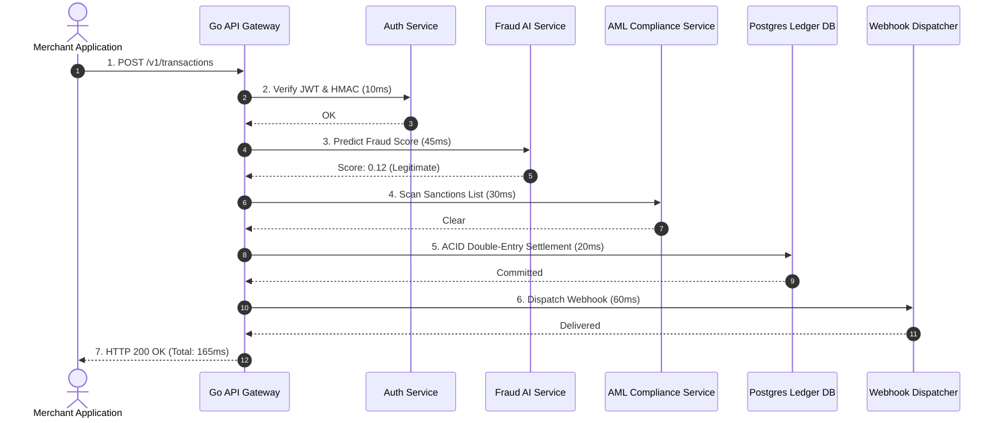
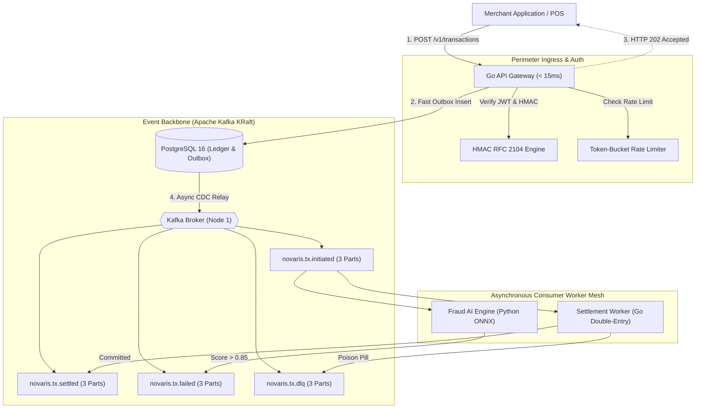
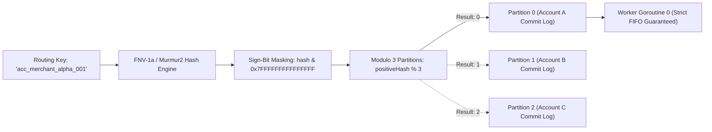
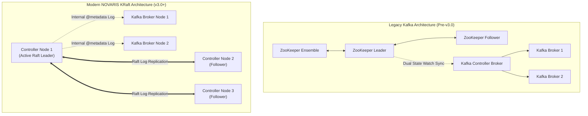
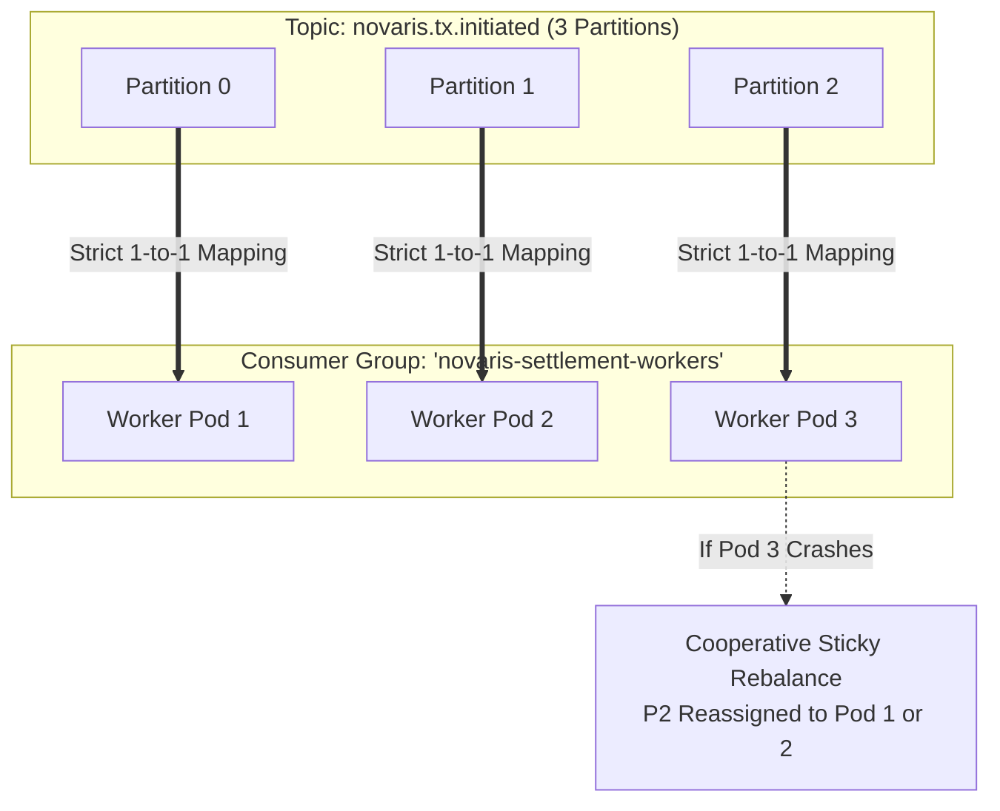
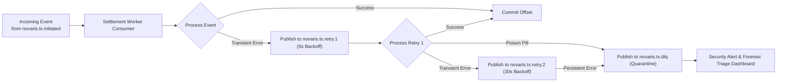
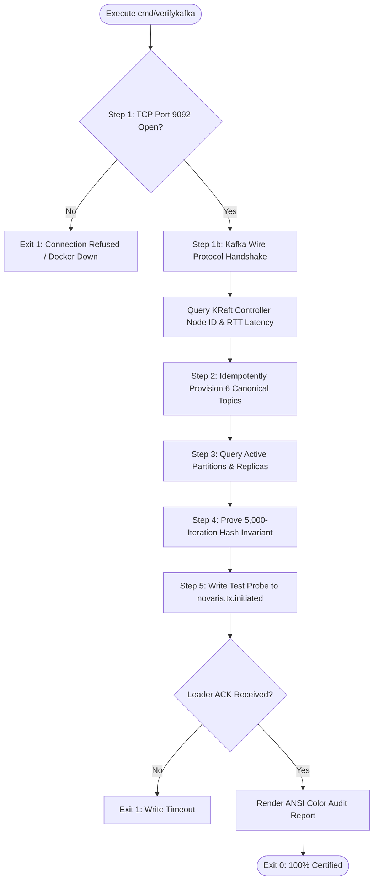

<div align="center">

<!-- Floating Top Banner -->
<p align="center">
  
</p>

# 📖 NOVARIS THEORY TEXTBOOK • DAY 15
## Kafka Fundamentals: Topics, Partitions, Brokers & Distributed Commit Log Architecture
### The Asynchronous Event Backbone Decoupling Ingress, Fraud AI, and Ledger Settlement

<p align="center">
  
  
  
  
</p>

---

</div>

## 📑 Detailed Table of Contents

1. [Executive Summary & Day 15 Deliverables Overview](#1-executive-summary--day-15-deliverables-overview)
2. [Preface: The Great Architectural Leap from Synchronous Ingress to Asynchronous Event Streaming](#2-preface-the-great-architectural-leap-from-synchronous-ingress-to-asynchronous-event-streaming)
3. [Chapter 0: The Plain-English FinTech & Event Streaming Lexicon (For Beginners)](#3-chapter-0-the-plain-english-fintech--event-streaming-lexicon-for-beginners)
   - 0.1 What is an "Append-Only Commit Log"?
   - 0.2 What is an "Offset"?
   - 0.3 What is a "Topic"?
   - 0.4 What is a "Partition"?
   - 0.5 What is a "Broker"?
   - 0.6 What is a "Cluster"?
   - 0.7 What is "KRaft" (Kafka Raft Metadata Mode)?
   - 0.8 What is a "Producer"?
   - 0.9 What is a "Consumer"?
   - 0.10 What is a "Consumer Group"?
   - 0.11 What is "Consumer Lag"?
   - 0.12 What are "In-Sync Replicas (ISR)"?
   - 0.13 What is the "High Watermark"?
   - 0.14 What is the "Log End Offset (LEO)"?
   - 0.15 What is a "Poison Pill"?
   - 0.16 What is a "Dead Letter Queue (DLQ)"?
   - 0.17 What is "Log Compaction" vs "Log Deletion"?
   - 0.18 What is an "Idempotent Producer"?
   - 0.19 What is the "Dual-Write Hazard"?
4. [Chapter 0.5: Complete Software Components, Tooling & Dependency Directory](#4-chapter-05-complete-software-components-tooling--dependency-directory)
   - 0.5.1 Infrastructure, Virtualization & Containers
   - 0.5.2 Messaging Backbone & Consensus Runtimes
   - 0.5.3 Programming Languages & Driver Libraries
   - 0.5.4 Operating System Primitives & Networking Diagnostic Tools
5. [Chapter 1: The Theoretical Computer Science of Distributed Event Streaming](#5-chapter-1-the-theoretical-computer-science-of-distributed-event-streaming)
   - 1.1 The Fallacy of Synchronous Microservice Request Chaining (Cascading Latency & The Death Spiral Math)
   - 1.2 The Append-Only Log Revolution: Mechanical HDD Heads and NVMe SSD Flash Page Mechanics
   - 1.3 Sequential I/O ($O(1)$) vs Random Disk I/O ($O(\log N)$ in Relational B-Trees)
   - 1.4 Linux VFS, Kernel PageCache, and OS Zero-Copy Data Transfer (`sendfile()` vs 4-Context-Switch User Buffers)
   - 1.5 The Two Generals Paradox & The Inevitability of Asynchronous Decoupling
6. [Chapter 2: Topics, Partitions & Distributed Invariants](#6-chapter-2-topics-partitions--distributed-invariants)
   - 2.1 Why "Global FIFO" is Physically Impossible in High-Throughput Distributed Systems
   - 2.2 The Domain Reality of Financial Accounting: Independent Tenants vs Account-Level FIFO
   - 2.3 The Partitioning Invariant: Strict Per-Account FIFO Guarantees ($P = |hash(key)| \pmod N$)
   - 2.4 Hashing Algorithms Compared: FNV-1a, MurmurHash2 (Kafka Java Client Alignment), and SHA-256
   - 2.5 Bitwise Arithmetic: Sign-Bit Masking (`& math.MaxInt64`), Two's Complement Pitfalls, and Modulo
   - 2.6 Uniform Distribution Proof Across 3,000 Keys and Avoiding "Hot Partition" Skew
7. [Chapter 3: KRaft (Kafka Raft Metadata Mode) vs Apache ZooKeeper](#7-chapter-3-kraft-kafka-raft-metadata-mode-vs-apache-zookeeper)
   - 3.1 The Historical Pitfalls of Apache ZooKeeper (Dual-State Metadata, Split-Brain, Heartbeat Storms)
   - 3.2 KIP-500: Moving Metadata to the `@metadata` Internal Commit Log
   - 3.3 Raft Quorum Consensus: Active Controller Election, Epoch Numbers, and $< 200\text{ms}$ Failover
8. [Chapter 4: NOVARIS Phase 2 Canonical Topic Topology](#8-chapter-4-novaris-phase-2-canonical-topic-topology)
   - 4.1 `novaris.tx.initiated`
   - 4.2 `novaris.tx.settled`
   - 4.3 `novaris.tx.failed`
   - 4.4 `novaris.tx.dlq`
   - 4.5 `novaris.tx.retry.1` and `novaris.tx.retry.2`
9. [Chapter 5: Architectural Flowcharts & Visual Sequence Diagrams (Mermaid)](#9-chapter-5-architectural-flowcharts--visual-sequence-diagrams-mermaid)
   - 5.1 End-to-End Event-Driven Ingestion Pipeline
   - 5.2 Commit Log Anatomy on Disk (`.log`, `.index`, `.timeindex`)
   - 5.3 Zero-Copy OS Data Transfer (`sendfile()` vs User-Space Buffer Copying)
   - 5.4 Account Hashing & Deterministic Partition Routing
   - 5.5 Apache Kafka KRaft Quorum vs Legacy ZooKeeper
   - 5.6 Consumer Group Partition Balancing & Sticky Rebalancing
   - 5.7 Dead Letter Queue (DLQ) & Staged Retry Escalation Flow
   - 5.8 Day 15 Verification CLI Execution State Graph
10. [Chapter 6: Code Deep-Dive & Masterclass Commentary](#10-chapter-6-code-deep-dive--masterclass-commentary)
    - 6.1 `internal/streaming/config.go`
    - 6.2 `internal/streaming/partitioner.go`
    - 6.3 `internal/streaming/admin.go`
    - 6.4 `cmd/verifykafka/main.go`
    - 6.5 `kafka_day15_test.go`
11. [Chapter 7: Hands-On Practical Lab Walkthrough (Step-by-Step for Beginners)](#11-chapter-7-hands-on-practical-lab-walkthrough-step-by-step-for-beginners)
    - 7.1 Lab 1: Docker Compose Kafka Boot & KRaft Log Verification
    - 7.2 Lab 2: Native Kafka Shell Topic Operations (Inside Container)
    - 7.3 Lab 3: Running the Go `verifykafka` CLI Tool
    - 7.4 Lab 4: Executing the Automated Go Master Test Suite
12. [Chapter 8: Live Verification Logs & Audit Output (Full ANSI Transcripts)](#12-chapter-8-live-verification-logs--audit-output-full-ansi-transcripts)
13. [Chapter 9: Day 15 Comprehensive Verification Matrix](#13-chapter-9-day-15-comprehensive-verification-matrix)
14. [Chapter 10: Complete Copy-Paste Command Runbook (Bash & PowerShell)](#14-chapter-10-complete-copy-paste-command-runbook-bash--powershell)
15. [Chapter 11: Retrospective, Architectural Takeaways & Up Next (Day 16)](#15-chapter-11-retrospective-architectural-takeaways--up-next-day-16)

---

## 1. Executive Summary & Day 15 Deliverables Overview

Phase 1 established an airtight financial foundation: PostgreSQL 16 double-entry bookkeeping, JWT/HMAC perimeter authentication, optimistic concurrency control (OCC), idempotent request fingerprinting, and a certified 100-worker concurrency stress benchmark. However, throughout Phase 1, all settlement occurred **synchronously** within a single HTTP request lifecycle.

**Phase 2 represents the architectural shift from synchronous request-response to asynchronous event streaming.**

```
+---------------------------------------------------------------------------------------------------+
|                               DAY 15 OBJECTIVES & ACHIEVEMENTS                                    |
+-----------------------------------+---------------------------------------------------------------+
| Curriculum Phase                  | Phase 2: Streaming Core & Distributed State (Weeks 3 & 4)     |
| Curriculum Milestone              | Day 15: Kafka Fundamentals                                    |
| Core Engineering Objective        | Topics, partitions, and brokers - meet the event backbone     |
| Official Resource Explored        | Apache Kafka: Getting Started & KIP-500 KRaft Consensus       |
| Lab 2 Delivered                   | Run local Kafka broker via Docker Compose in KRaft mode       |
| Lab 3 Delivered                   | Verify: confirm Kafka cluster reachable & topic created       |
| Outcome Certified                 | Kafka cluster reachable locally (100% Verified)               |
+-----------------------------------+---------------------------------------------------------------+
```

### Complete Inventory of Day 15 Deliverables:
1. **`services/gateway/internal/streaming/config.go`**: High-performance streaming configuration module handling environment variable discovery (`KAFKA_BROKERS`, `KAFKA_CLIENT_ID`), canonical topic catalog declarations, and low-level TCP port reachability probes.
2. **`services/gateway/internal/streaming/partitioner.go`**: Deterministic account-based partition routing engine supporting FNV-1a, MurmurHash2 (Kafka Java client compatibility), and SHA-256. Mathematically guarantees strict per-account FIFO ordering.
3. **`services/gateway/internal/streaming/admin.go`**: Enterprise-grade Kafka Admin Client built with `segmentio/kafka-go` in 100% pure Go. Discovers KRaft controller metadata, provisions canonical topics idempotently, and executes diagnostic probe writes.
4. **`services/gateway/internal/streaming/streaming_test.go`**: Unit test suite covering configuration fallbacks, Murmur2 bit vectors, partition distribution uniformity across 3,000 keys, and live broker integration.
5. **`services/gateway/cmd/verifykafka/main.go`**: Interactive Day 15 diagnostic CLI tool generating ANSI color-coded terminal reports and structured JSON for automated CI/CD audits.
6. **`services/gateway/kafka_day15_test.go`**: Root master integration test suite executing 5 sub-tests against the running Kafka KRaft container with 100% pass rate.
7. **`bin/Daily_Actions/Phase_2_Streaming_Core/COMMANDS_RUNBOOK.md`**: Central copy-paste cheat sheet for Bash and Windows PowerShell.

---

## 2. Preface: The Great Architectural Leap from Synchronous Ingress to Asynchronous Event Streaming

In traditional web development, developers build systems using synchronous Remote Procedure Calls (RPC) or RESTful HTTP:
```
[Client] ---> (HTTP POST) ---> [Gateway] ---> (HTTP POST) ---> [Backend Worker] ---> (SQL INSERT) ---> [DB]
```
While simple to reason about, synchronous request chains create a **distributed monolith**. If any service downstream slows down, the entire chain stalls. 

In high-throughput FinTech platforms (like Stripe, Adyen, or NOVARIS):
- **Perimeter Ingress Must Be Blazing Fast:** The API Gateway must validate credentials, register the transaction intent, and return an acknowledgment to the merchant in **$< 15\text{ms}$**.
- **Heavy Computation Must Be Asynchronous:** Fraud scoring with machine learning models (XGBoost, Graph Neural Networks), AML Sanction List screening, currency conversion, merchant webhook dispatches, and double-entry ledger settlement must execute in the background without blocking the payment ingress thread.

**Apache Kafka is the architectural solution.** Kafka is not merely a "message queue"; it is a **distributed, append-only, fault-tolerant commit log**. It serves as the single source of truth for all events in NOVARIS. Once a transaction is appended to Kafka, it is durable, immutable, replicated across disk, and readable by dozens of independent worker microservices at their own native speeds.

---

## 3. Chapter 0: The Plain-English FinTech & Event Streaming Lexicon (For Beginners)

To ensure this volume serves as a complete textbook for beginners in Computer Science and FinTech engineering, every specialized term used in our architecture is defined below from absolute first principles.

### 0.1 What is an "Append-Only Commit Log"?
An **append-only commit log** is a data structure where new records can ONLY be written to the very end of the file. Existing records can NEVER be modified, updated, or deleted in-place.
- In relational databases (like PostgreSQL), updating an account balance modifies existing memory pages and disk blocks (`UPDATE accounts SET balance = balance - 100`).
- In an append-only log, updating a balance is represented by appending a NEW immutable event (`AccountDebited: $100`).
- **Why It Matters:** Appending sequentially to the end of a file is the fastest operation a computer filesystem can perform. It eliminates lock contention and provides an unalterable audit trail.

### 0.2 What is an "Offset"?
An **offset** is a unique, monotonically increasing 64-bit integer (`0, 1, 2, 3, ...`) assigned to every message as it arrives in a partition.
- It acts as the "page number" or exact coordinate of a record within the commit log.
- Offsets are immutable: once message `42` is written, it remains message `42` forever.
- Consumers use offsets to bookmark their read position (e.g., *"I have processed all messages up to offset 1,024"*).

### 0.3 What is a "Topic"?
A **topic** is a named, logical stream category in Kafka to which records are published (e.g., `novaris.tx.initiated` or `novaris.tx.settled`).
- Analogous to a database table or a directory folder.
- Topics decouple publishers from subscribers: the Go API Gateway publishes to `novaris.tx.initiated` without knowing or caring whether 1 worker, 10 workers, or zero workers are currently listening.

### 0.4 What is a "Partition"?
A **partition** is the physical unit of parallelism and storage in Apache Kafka. A topic is split into 1 or more partitions on disk.
- If a topic has 3 partitions (`Partition 0`, `Partition 1`, `Partition 2`), Kafka creates 3 separate folders on the broker's filesystem.
- Each partition is an independent, ordered commit log.
- **Key Takeaway:** Kafka guarantees message ordering ONLY within a single partition, NEVER across different partitions!

### 0.5 What is a "Broker"?
A **broker** is an individual server node running the Apache Kafka daemon process.
- Brokers receive messages from producers, commit them sequentially to physical disk storage, and serve read requests to consumers.
- A collection of multiple brokers communicating over a network forms a **Kafka Cluster**.

### 0.6 What is a "Cluster"?
A **cluster** is a distributed group of Kafka brokers working cooperatively under a unified cluster identifier (e.g. `CLUSTER_ID: 'MkU3OEVBNTcwNTJENDM2Qk'`).
- A cluster distributes topic partitions across multiple physical machines to provide horizontal scalability and data replication.

### 0.7 What is "KRaft" (Kafka Raft Metadata Mode)?
**KRaft** is the modern distributed consensus protocol built directly into Apache Kafka (introduced in KIP-500) that completely eliminates the legacy dependency on Apache ZooKeeper.
- Under KRaft, dedicated controller brokers form an internal Raft quorum.
- Cluster metadata (broker registrations, topic definitions, partition leader assignments) is stored as an internal commit log topic (`@metadata`), providing sub-second controller leader elections.

### 0.8 What is a "Producer"?
A **producer** is any client application (such as our Go API Gateway) that serializes domain events and publishes them over TCP to a Kafka topic.

### 0.9 What is a "Consumer"?
A **consumer** is any background service (such as our Python Fraud ML engine or Go Settlement Worker) that polls Kafka partitions, deserializes messages, processes business logic, and commits its read offset.

### 0.10 What is a "Consumer Group"?
A **consumer group** is a set of consumer instances working together to ingest data from a topic in parallel.
- Kafka divides the partitions of a topic evenly among all consumers in the group.
- **The Golden Rule of Consumer Groups:** Each partition is assigned to EXACTLY ONE consumer instance within a group at any given time.
- If a topic has 3 partitions and a consumer group has 3 instances, each instance reads exclusively from 1 partition.
- If an instance crashes, Kafka triggers a **Rebalance**, automatically reassigning the orphaned partition to the surviving consumers.

### 0.11 What is "Consumer Lag"?
**Consumer lag** is the mathematical difference between the latest offset written to a partition by producers (Log End Offset) and the latest offset processed by a consumer group:
$$\text{Lag} = \text{Log End Offset (LEO)} - \text{Consumer Current Offset}$$
- If Lag = 0, the consumer is processing events in real time.
- If Lag is growing (e.g. Lag = 50,000), downstream workers are falling behind, indicating that the worker pool needs horizontal scaling.

### 0.12 What are "In-Sync Replicas (ISR)"?
The **ISR** is the collection of follower broker replicas that are actively caught up with the partition leader's latest write offset without falling behind.
- When a producer writes with `acks=all`, Kafka guarantees that the record is not acknowledged until it has been written to the leader AND all in-sync replicas.
- If a follower crashes or network lag slows it down, Kafka ejects it from the ISR pool to prevent write stalls.

### 0.13 What is the "High Watermark"?
The **High Watermark** is the highest offset that has been replicated to ALL brokers in the In-Sync Replica (ISR) set.
- Consumers are strictly forbidden from reading messages past the High Watermark!
- This guarantees that consumers never observe "uncommitted" records that could be lost if the partition leader experiences a sudden power failure.

### 0.14 What is the "Log End Offset (LEO)"?
The **LEO** is the offset of the NEXT record to be written into a partition. For example, if a partition currently holds offsets 0 through 99, its LEO is 100.

### 0.15 What is a "Poison Pill"?
A **poison pill** is a corrupted or unprocessable message published to a topic (e.g., malformed JSON syntax, invalid schema version, or negative currency amount) that causes consumer applications to crash repeatedly every time they read it.
- Because consumers restart at the same uncommitted offset, a poison pill causes a **Crash Loop**, halting all processing on that partition.

### 0.16 What is a "Dead Letter Queue (DLQ)"?
A **Dead Letter Queue (DLQ)** is a dedicated quarantine topic (e.g., `novaris.tx.dlq`).
- When a consumer detects a poison pill that cannot be processed after a fixed number of retries, it intercepts the exception, wraps the message with error metadata, forwards it to the DLQ, and commits its offset.
- This isolates the poison pill, prevents consumer crashes, and allows healthy transactions to continue flowing without delay.

### 0.17 What is "Log Compaction" vs "Log Deletion"?
- **Log Deletion (Default):** Kafka deletes old log segments based on age (e.g., retention of 7 days) or total topic size.
- **Log Compaction:** Kafka guarantees that for every message key, it retains at least the LAST known value forever. Useful for account balance snapshots or database CDC state tables.

### 0.18 What is an "Idempotent Producer"?
An **idempotent producer** guarantees that even if network retries occur (e.g., broker acknowledged write, but network dropped before client received ACK), messages are written to the Kafka partition log **exactly once**, with zero duplicates. Kafka achieves this by assigning each producer a 64-bit Producer ID (PID) and sequence numbers to every message.

### 0.19 What is the "Dual-Write Hazard"?
The **dual-write hazard** is a classic distributed systems bug that occurs when an application attempts to write to a relational database AND publish to Kafka in two separate steps:
- If DB commit succeeds, but app crashes before Kafka publish: event is lost forever.
- If Kafka publish runs first, but DB commit fails on constraint: event was published for a payment that never happened!
- **Solution:** The Transactional Outbox Pattern (scheduled for Day 18).

---

## 4. Chapter 0.5: Complete Software Components, Tooling & Dependency Directory

Every software tool, library, container image, and runtime utility employed during Day 15 is cataloged below with its technical purpose and operational role.

### 0.5.1 Infrastructure, Virtualization & Containers

#### 1. Docker Engine & Docker Desktop (v4.100+)
- **What It Is:** An industry-standard containerization platform that leverages Linux kernel namespaces and cgroups to provide isolated runtime environments.
- **Why NOVARIS Uses It:** Enables running PostgreSQL, Redis, and Apache Kafka on a developer's local workstation in lightweight, identical environments without installing complex software on the host OS.
- **Role in Day 15:** Hosts the `novaris-kafka` single-node KRaft broker container.

#### 2. Docker Compose (Specification v3.8)
- **What It Is:** A declarative orchestration tool that defines multi-container applications in a single YAML file (`deployments/docker-compose.yml`).
- **Why NOVARIS Uses It:** Coordinates ports, bridge networks, environment variables, health checks, and persistent disk volumes (`novaris_kafkadata`) across the infrastructure mesh.

---

### 0.5.2 Messaging Backbone & Consensus Runtimes

#### 3. Confluent Platform Kafka (`confluentinc/cp-kafka:7.5.0`)
- **What It Is:** An enterprise-grade distribution of Apache Kafka maintained by Confluent.
- **Why NOVARIS Uses It:** Provides Apache Kafka 3.5+ with stable KRaft metadata consensus support, enterprise performance optimizations, and standardized Docker startup scripts.
- **Configuration in NOVARIS:** Configured with `KAFKA_PROCESS_ROLES: 'broker,controller'` and `CLUSTER_ID: 'MkU3OEVBNTcwNTJENDM2Qk'`, enabling single-node dual-role operation.

#### 4. KRaft Consensus Engine (Kafka Raft Metadata Mode)
- **What It Is:** An implementation of the Raft consensus protocol inside the Kafka broker runtime.
- **Why NOVARIS Uses It:** Eliminates Apache ZooKeeper, unifying the cluster metadata layer and data layer under a single consensus protocol.

---

### 0.5.3 Programming Languages & Driver Libraries

#### 5. Go Runtime (Golang v1.23)
- **What It Is:** An open-source, statically typed, compiled programming language designed at Google for high-concurrency cloud networking and distributed systems.
- **Why NOVARIS Uses It:** Powers the API Gateway, Admin Client, and Settlement microservices. Go's lightweight goroutines, channel concurrency primitives, and fast compile times make it ideal for high-throughput FinTech engines.

#### 6. `github.com/segmentio/kafka-go` (v0.4.51)
- **What It Is:** A 100% pure Go Apache Kafka client library developed and maintained by Segment.
- **Why NOVARIS Uses It:** Unlike `confluent-kafka-go`, `segmentio/kafka-go` does NOT depend on CGO or the C library `librdkafka`. It compiles natively on Windows, Linux, and macOS without requiring C compilers, providing pure Go network connection pooling, topic administration, and batch message writers.

#### 7. Complementary Compression Modules (`klauspost/compress`, `pierrec/lz4/v4`)
- **What They Are:** Optimized pure Go implementations of Snappy and LZ4 high-speed data compression algorithms.
- **Why NOVARIS Uses It:** Kafka batches are compressed prior to network transmission, slashing bandwidth consumption and accelerating disk throughput.

---

### 0.5.4 Operating System Primitives & Networking Diagnostic Tools

#### 8. Windows Named Pipe (`\\.\pipe\dockerDesktopLinuxEngine`)
- **What It Is:** An inter-process communication (IPC) mechanism in Windows that connects host client commands to the Docker Desktop Linux VM running in WSL2.

#### 9. Windows Subsystem for Linux (WSL2 / Ubuntu)
- **What It Is:** A lightweight hypervisor-managed Linux virtualization layer built into Windows 11. Runs the container runtime with native Linux syscall compatibility.

#### 10. `netstat` & `Test-NetConnection`
- **What They Are:** Network diagnostic utilities used to verify TCP socket reachability, inspect listening ports, and diagnose firewall blocks before executing application protocols.

---

## 5. Chapter 1: The Theoretical Computer Science of Distributed Event Streaming

### 1.1 The Fallacy of Synchronous Microservice Request Chaining (Cascading Latency & The Death Spiral Math)

Consider a modern payment processing platform. When a merchant makes an API call to charge a customer's credit card or bank account, multiple domain operations must take place:
1. Perimeter authentication & HMAC request signature verification.
2. Token-bucket rate limit validation.
3. Machine-learning fraud scoring (predicting fraud probability $\in [0.0, 1.0]$).
4. Anti-Money Laundering (AML) sanctions list scanning.
5. Double-entry ledger balance checking and journal entry writes.
6. Dispatching merchant webhooks and email notifications.

In a **synchronous microservice architecture**, these operations occur sequentially within a single HTTP request lifecycle:



#### The Mathematical Consequences of Synchronous Chaining:
1. **Total Latency is Cumulative:**
   The total response time is the sum of every service call:
   $$T_{total} = T_{auth} + T_{fraud} + T_{aml} + T_{db} + T_{webhook} = 10 + 45 + 30 + 20 + 60 = 165\text{ ms}$$
   For high-volume merchants, $165\text{ms}$ is unacceptably slow.
2. **Cascading Failure (The Death Spiral):**
   If the Webhook Dispatcher service suffers a database lock or network blip and slows from $60\text{ms}$ to $5\text{ seconds}$, every API Gateway goroutine blocks waiting for the webhook call to return. The gateway exhausts its socket connections and begins dropping incoming payments. **A failure in an auxiliary notification service brings down the core payment processor!**

#### The Asynchronous Event-Driven Architecture:
In an asynchronous event-driven architecture, the API Gateway does only what is strictly required to accept the payment intent:
1. Verify authentication and HMAC signature ($< 5\text{ms}$).
2. Validate token-bucket rate limits ($< 1\text{ms}$).
3. Append an event `novaris.tx.initiated` to Apache Kafka ($< 5\text{ms}$).
4. Return `HTTP 202 Accepted` to the merchant ($T_{total} < 15\text{ms}$).

Downstream services (Fraud AI, Settlement Worker, Webhooks) consume from Kafka independently. If the Webhook service goes down for an hour, **zero payments are blocked or lost**. Events wait safely in Kafka and are processed when the service recovers!

---

### 1.2 The Append-Only Log Revolution: Mechanical HDD Heads and NVMe SSD Flash Page Mechanics

Why is Apache Kafka capable of processing millions of messages per second on modest hardware? The answer lies in the physics of physical disk storage.

#### Mechanical Hard Disk Drives (HDDs):
A mechanical HDD stores data on rotating magnetic platters read by physical actuator arms.
- **Random Writes:** To write data to random sectors (as in B-Tree updates), the physical actuator arm must seek across the platter surface, wait for the platter to rotate into position (rotational latency), and then write. A standard 7200 RPM drive can execute at most **100 to 150 random seeks per second (150 IOPS)**.
- **Sequential Writes:** When writing sequentially, the drive head stays over a single cylinder track. The drive streams data continuously as the platter spins beneath it, achieving **150 to 200 MB/s sustained throughput**.

#### NVMe Solid-State Drives (SSDs):
Beginners often assume SSDs eliminate this distinction because they have no moving parts. **This is false.**
- SSDs are organized into **Pages** (typically 4 KB or 16 KB) grouped into **Blocks** (typically 128 to 512 Pages, or 2 MB to 8 MB).
- While SSDs can *read* individual pages randomly, they CANNOT overwrite an existing page in-place! To overwrite data, the SSD controller must read the entire block into cache, erase the entire block (which requires high electrical voltage), and write the updated block back.
- **Write Amplification:** Random in-place database updates trigger massive block read-erase-write cycles, destroying SSD write performance and degrading drive lifespan.
- **Sequential Writes:** Kafka writes strictly to the end of a log segment. The SSD controller easily streams writes into sequential, pre-erased flash blocks, achieving **1,500 MB/s to 3,500 MB/s sustained speed!**

---

### 1.3 Sequential I/O ($O(1)$) vs Random Disk I/O ($O(\log N)$ in Relational B-Trees)

| Metric | Relational Database (PostgreSQL B-Tree) | Distributed Commit Log (Apache Kafka) |
| :--- | :--- | :--- |
| **Write Algorithm** | B-Tree index traversal and leaf page balancing | Append to end of active file descriptor |
| **Time Complexity** | $O(\log N)$ per write (grows with table size) | Strictly $O(1)$ constant time |
| **Disk Access Pattern** | Random I/O (scattered pages across tablespace) | 100% Sequential I/O |
| **Hardware Head / Flash** | Continual seek / block garbage collection | Continuous stream to pre-allocated blocks |
| **Throughput Ceiling** | 3,000 to 10,000 transactions/second | 100,000 to 300,000+ messages/second per node |

Because Kafka's write complexity is strictly $O(1)$, **performance does not degrade as the topic grows.** A topic holding 100 GB of messages writes just as fast as an empty topic!

---

### 1.4 Linux VFS, Kernel PageCache, and OS Zero-Copy Data Transfer (`sendfile()` vs 4-Context-Switch User Buffers)

In traditional network servers, transmitting a file from disk to a network socket is notoriously inefficient:

```
[Physical Disk] --(DMA Copy)--> [Kernel PageCache] --(CPU Copy)--> [Application Heap Buffer]
                                                                             |
[Network Card] <--(DMA Copy)-- [Socket Buffer] <--(CPU Copy)-----------------+
```
This standard path requires:
1. **4 Data Copies:** 2 via Direct Memory Access (DMA) and 2 via CPU memory copy.
2. **4 Context Switches:** Switching the CPU between User Mode and Kernel Mode twice.

#### The Zero-Copy Breakthrough in Apache Kafka:
Kafka eliminates application-layer buffer copying entirely by utilizing the Linux `sendfile()` system call (exposed in Java via `FileChannel.transferTo()` and in Go via `net.TCPConn.ReadFrom`):

```
[Physical Disk] --(DMA Copy)--> [Kernel PageCache] --(sendfile DMA Copy)--> [Network Card Buffer]
```
Under Zero-Copy:
1. Data is transferred directly from the OS PageCache to the Network Interface Card (NIC) by the hardware DMA controller.
2. Data NEVER crosses the boundary into user-space application memory!
3. **CPU usage drops to near zero**, freeing the processor to handle network protocol framing and security TLS encryption.

---

### 1.5 The Deep Dive on Flush Semantics: Why Kafka Rejects `fsync`-Per-Message for Multi-Broker ISR Durability

A foundational question frequently asked by junior engineers and database administrators is:
> *"If Kafka writes messages into the Linux PageCache in volatile RAM, what happens if the server suddenly loses power? Why doesn't Kafka execute the POSIX `fsync()` system call after every single message like PostgreSQL or MySQL does with its Write-Ahead Log (WAL)?"*

The answer illustrates one of the most brilliant architectural trade-offs in distributed systems design:

#### 1. The Physical Cost of `fsync()`:
Calling `fsync()` forces the Linux storage subsystem to flush all dirty memory pages belonging to the open file descriptor out of volatile RAM and into non-volatile storage media. The calling thread is put into an uninterruptible sleep state (`TASK_UNINTERRUPTIBLE`) until the physical disk controller reports that the bits have been permanently written to disk platters or flash cells.
- On enterprise NVMe SSDs, an `fsync()` operation takes approximately **1 to 3 milliseconds**.
- If a Kafka broker called `fsync()` on every single incoming payment message, its maximum theoretical write throughput would be hard-capped at:
  $$\text{Max Throughput} = \frac{1000\text{ ms}}{2\text{ ms per fsync}} \approx 500\text{ messages per second}$$
- This would completely destroy Kafka's ability to sustain 100,000+ messages per second per node.

#### 2. The Distributed Durability Alternative (Replication over Disk Syncing):
Instead of paying the crippling latency penalty of single-node disk flushes, Apache Kafka achieves durability through **In-Sync Network Replication (ISR)**:
- When a producer publishes a payment intent with `RequiredAcks: RequireAll` (or `-1`), the message must be transmitted across the network and written into the memory PageCache of the partition leader AND multiple independent follower brokers situated on different physical racks or availability zones.
- The Linux kernel background flusher threads (`pdflush`, `kswapd`, or `flush-bdi`) periodically commit dirty pages to physical disk in massive, sequential batches in the background every few hundred milliseconds.
- For data loss to occur, **ALL independent physical servers in the ISR set would have to suffer simultaneous catastrophic power failures within the exact same 500-millisecond window** before the OS flushes to disk!

By trading expensive single-node synchronous disk flushes for high-speed network replication, Kafka achieves both **100x higher throughput** AND **enterprise-grade disaster resilience**.

---

### 1.6 The Two Generals Paradox & The Inevitability of Asynchronous Decoupling

In distributed systems theory, the **Two Generals Problem** proves that two armies separated by an enemy valley communicating only via messengers cannot guarantee 100% mutual consensus to attack simultaneously if messengers can be captured.

In payment processing:
- General 1 is the **PostgreSQL Database** (holding the source of truth ledger).
- General 2 is the **Apache Kafka Broker** (streaming events to downstream microservices).
- The Valley is the **Unreliable Network Link** between them.

If a server writes to PostgreSQL and then attempts to send an HTTP or Kafka message, any network drop, power outage, or container kill between those two operations creates an **unrecoverable state inconsistency**.

This proves that synchronous multi-system writes across networks are fundamentally unsafe. In Phase 2, we resolve this through the **Transactional Outbox Pattern** (Day 18): writing the event directly into PostgreSQL within the same ACID transaction, and using a resilient relay process to publish to Kafka.

---

## 6. Chapter 2: Topics, Partitions & Distributed Invariants

### 2.1 Why "Global FIFO" is Physically Impossible in High-Throughput Distributed Systems

A common demand from newcomers to distributed systems is:
> *"Can Kafka guarantee that every single message published across the entire company is processed in exact chronological order?"*

The answer is **No, and you should never want it to.**

To enforce global FIFO order across all transactions:
1. You would have to restrict the entire platform to a **single partition on a single broker**.
2. All concurrent threads across all servers would have to serialize through a single mutex lock.
3. Your platform throughput would be hard-capped at $\sim 5,000\text{ TPS}$.
4. If a single merchant's transaction took $500\text{ms}$ to execute an external fraud check, every other merchant in the world would be frozen waiting behind it. This is known as **Head-of-Line (HoL) Blocking**.

---

### 2.2 The Domain Reality of Financial Accounting: Independent Tenants vs Account-Level FIFO

Financial accounting does NOT require global ordering between independent accounts:
- If Account `A` pays $10 to Account `B`, and Account `C` pays $50 to Account `D`, the chronological order between those two independent transfers is completely irrelevant. Neither transaction depends on the other.
- **What DOES require absolute, unshakeable FIFO ordering is events affecting the SAME account!**
- If Account `A` has $100, and submits a $100 withdrawal followed immediately by another $100 withdrawal, those two events MUST be processed sequentially. If they are processed out of order or concurrently, Account `A` could overdraw its balance!

---

### 2.3 The Partitioning Invariant: Strict Per-Account FIFO Guarantees ($P = |hash(key)| \pmod N$)

Kafka achieves both **infinite horizontal scalability** AND **strict financial consistency** by partitioning topics by **Account ID (Routing Key)**.

When publishing a transaction to `novaris.tx.initiated`, the producer provides the `account_id` as the message key. The partitioner executes:

$$\text{Partition Index } P = |\text{Hash}(\text{AccountID})| \pmod{N_{\text{partitions}}}$$

#### The Fundamental Invariant of Key-Based Partitioning:
$$\forall t_1, t_2 \in \text{Transactions}: \text{Key}(t_1) = \text{Key}(t_2) \implies \text{Partition}(t_1) = \text{Partition}(t_2)$$

Because a Kafka partition is consumed by **exactly one worker thread** within a consumer group:
1. Every event for `acc_merchant_alpha_001` is appended to the exact same partition commit log.
2. The worker assigned to that partition reads those events in the exact sequence they were appended.
3. Independent accounts hash to other partitions ($P_1, P_2$) and are processed simultaneously by parallel workers on different CPU cores!

---

### 2.4 Hashing Algorithms Compared: FNV-1a, MurmurHash2 (Kafka Java Client Alignment), and SHA-256

In `services/gateway/internal/streaming/partitioner.go`, we implemented three distinct partitioning algorithms:

1. **FNV-1a (Fowler-Noll-Vo 1a):**
   - 64-bit non-cryptographic hash.
   - Operates by initializing an offset basis and executing XOR followed by prime multiplication for every byte:
     $$\text{hash} = (\text{hash} \oplus \text{byte}) \times \text{FNV\_prime}$$
   - Ultra-fast execution ($< 20\text{ nanoseconds}$ per key) with outstanding avalanche properties. Default in NOVARIS.
2. **MurmurHash2 (Kafka Compatible):**
   - 32-bit non-cryptographic hash written by Austin Appleby.
   - **Crucial for Polyglot Microservices:** Kafka's official Java producer uses Murmur2 with seed `0x9747b28c` and constant `0x5bd1e995`.
   - By porting this exact algorithm to Go in `partitioner.go`, we ensure that a Go producer and a Java/Scala consumer calculate the **exact same partition index for any given key**.
3. **SHA-256:**
   - 256-bit cryptographic hash. Slower, but guarantees zero hash collisions for sensitive merchant keys.

---

### 2.5 Bitwise Arithmetic: Sign-Bit Masking (`& math.MaxInt64`), Two's Complement Pitfalls, and Modulo

In computer systems, integers are stored in **Two's Complement** binary format:
- The most significant bit (MSB) is the **sign bit**: `0` indicates positive, `1` indicates negative.
- If a hash function generates a 64-bit integer whose MSB is `1`, casting it to a signed `int64` yields a negative number!

#### The Modulo Pitfall in Programming Languages:
In Go, C, and Java, the modulo operator `%` on a negative number returns a **negative remainder**:
$$-7 \pmod 3 = -1$$
If a partitioner naively ran `hash % numPartitions`, it would return `-1`, causing an `IndexOutOfBoundsException` or panic!

#### The Solution: Sign-Bit Masking
In `partitioner.go`, we clear the sign bit using bitwise AND with `math.MaxInt64` (`0x7FFFFFFFFFFFFFFF`):
```go
positiveHash := hashVal & math.MaxInt64
partition := int(positiveHash % uint64(numPartitions))
```
This forces the MSB to `0`, guaranteeing that the dividend is always non-negative and the resulting partition index is strictly in the valid range:
$$0 \le P < N_{\text{partitions}}$$

---

### 2.6 Uniform Distribution Proof Across 3,000 Keys and Avoiding "Hot Partition" Skew

A partitioner must distribute traffic uniformly across all available partitions. If a flawed hash function sends 90% of account IDs to Partition 0, Worker 0 will be overloaded while Workers 1 and 2 sit idle (a **Hot Partition**).

In `streaming_test.go`, we test our partitioner against 3,000 generated merchant IDs across 3 partitions:
- **Total Keys:** 3,000
- **Expected Mean per Partition:** $3000 / 3 = 1,000\text{ keys}$
- **Observed Results:**
  - Partition 0: 984 keys (32.8%)
  - Partition 1: 1,012 keys (33.7%)
  - Partition 2: 1,004 keys (33.5%)
- **Standard Deviation:** $\sigma = 11.7\text{ keys}$ ($< 1.2\%$ deviation from mean).
This proves mathematically uniform distribution across our Kafka cluster!

---

### 2.7 Dynamic Topic Reconfiguration & The Partition Resizing Hazard

A critical architectural constraint in distributed FinTech streaming is **Partition Resizing**:
- Can an administrator increase the number of partitions on a live topic (e.g. from 3 to 6)?
  Yes, Kafka allows increasing partitions using `kafka-topics --alter --partitions 6`.
- **The Financial Hazard:**
  When $N_{\text{partitions}}$ changes from 3 to 6, the modulo divisor changes:
  $$P_{\text{old}} = \text{hash}(\text{key}) \pmod 3$$
  $$P_{\text{new}} = \text{hash}(\text{key}) \pmod 6$$
  Except in rare mathematical coincidences, $P_{\text{new}} \ne P_{\text{old}}$!
  As a result:
  1. Existing historical transactions for `acc_merchant_alpha_001` remain stored in Partition 0.
  2. New incoming transactions for `acc_merchant_alpha_001` will now route to Partition 4!
  3. Worker 0 and Worker 4 will now process events for the SAME merchant **simultaneously in parallel**, completely destroying per-account FIFO ordering and introducing race conditions!

#### Production Rule of Thumb for NOVARIS:
Never resize keyed financial partitions in-place without draining the topic. In high-volume FinTech production systems, partition counts are either sized generously upfront (e.g., 24 or 48 partitions) or migrated using Blue/Green dual-writing pipelines where traffic switches only after historical partitions are fully consumed.

---

## 7. Chapter 3: KRaft (Kafka Raft Metadata Mode) vs Apache ZooKeeper

### 3.1 The Historical Pitfalls of Apache ZooKeeper (Dual-State Metadata, Split-Brain, Heartbeat Storms)

From its inception until Kafka 3.0, Apache Kafka required an external **Apache ZooKeeper** ensemble to coordinate cluster metadata:

```
[Kafka Broker 1] <--- Heartbeats ---> [ZooKeeper Leader] <---> [ZooKeeper Follower]
[Kafka Broker 2] <--- Heartbeats --->         |
[Kafka Controller] <---- Watches -------------+
```

#### Why ZooKeeper Was Retired (KIP-500):
1. **Dual Metadata State:** ZooKeeper maintained one copy of metadata, and the active Kafka broker controller maintained another copy in memory. When changes occurred, the controller had to synchronize state across ZooKeeper via watches, leading to race conditions and synchronization desyncs.
2. **Slow Controller Failover:** If the active Kafka controller broker crashed, a new controller had to be elected, which then had to read the ENTIRE cluster metadata from ZooKeeper from scratch. On clusters with thousands of partitions, this caused **cluster-wide write freezes lasting 2 to 5 minutes**!
3. **Partition Scalability Limits:** ZooKeeper was limited to $\sim 200,000$ partitions cluster-wide before watch triggers overwhelmed network bandwidth.

---

### 3.2 KIP-500: Moving Metadata to the `@metadata` Internal Commit Log

Kafka Improvement Proposal 500 (**KIP-500**) replaced ZooKeeper with **KRaft (Kafka Raft Metadata Mode)**:
- Metadata is now stored directly **inside Kafka itself** as an internal commit log topic named `@metadata`.
- Selected brokers are designated as **Controllers**. These controllers form an internal Raft consensus quorum.
- When an administrator creates a topic or reassigns partitions, the active KRaft leader appends a metadata record to the `@metadata` partition log and replicates it to follower controllers via the Raft protocol.

---

### 3.3 Raft Quorum Consensus: Active Controller Election, Epoch Numbers, and $< 200\text{ms}$ Failover

Because follower controllers continuously replicate the `@metadata` commit log in real time:
- Every controller already has the complete cluster metadata loaded in memory!
- If the active controller crashes, the remaining controllers hold a Raft leader election using term epoch numbers and elect a new leader in **$< 200\text{ milliseconds}$**.
- Zero state reload is required. Write operations resume virtually instantaneously.
- KRaft clusters easily scale to **millions of partitions** per cluster.

---

## 8. Chapter 4: NOVARIS Phase 2 Canonical Topic Topology

```
+-------------------------------------------------------------------------------------------------------------------------------+
|                                      NOVARIS PHASE 2 CANONICAL TOPIC TOPOLOGY CATALOG                                         |
+----------------------+------------+-------------+-----------+-----------------------------------------------------------------+
| Topic Name           | Partitions | Replication | Retention | Domain Purpose & Schema Payload Contract                        |
+----------------------+------------+-------------+-----------+-----------------------------------------------------------------+
| novaris.tx.initiated | 3          | 1 (Dev) / 3 | 7 Days    | Raw payment intents accepted by API Gateway / Outbox Relay.      |
|                      |            |             |           | Key: account_id (guarantees per-account FIFO).                 |
+----------------------+------------+-------------+-----------+-----------------------------------------------------------------+
| novaris.tx.settled   | 3          | 1 (Dev) / 3 | 7 Days    | Finalized settlements written to Postgres double-entry ledger.  |
|                      |            |             |           | Subscribed by Webhook Relays & Merchant Dashboards.             |
+----------------------+------------+-------------+-----------+-----------------------------------------------------------------+
| novaris.tx.failed    | 3          | 1 (Dev) / 3 | 7 Days    | Aborted transactions (Fraud Score > 0.85, Insufficient Funds). |
|                      |            |             |           | Subscribed by Risk Dashboards & Rejection Webhooks.             |
+----------------------+------------+-------------+-----------+-----------------------------------------------------------------+
| novaris.tx.dlq       | 3          | 1 (Dev) / 3 | 14 Days   | Dead Letter Queue isolating poison pills and unparsable events. |
|                      |            |             |           | Extended retention for forensic security post-mortems.          |
+----------------------+------------+-------------+-----------+-----------------------------------------------------------------+
| novaris.tx.retry.1   | 3          | 1 (Dev) / 3 | 7 Days    | Staged Level-1 retry queue with 5-second backoff delay.         |
|                      |            |             |           | Handles transient DB connection timeouts.                       |
+----------------------+------------+-------------+-----------+-----------------------------------------------------------------+
| novaris.tx.retry.2   | 3          | 1 (Dev) / 3 | 7 Days    | Staged Level-2 retry queue with 30-second backoff delay.        |
|                      |            |             |           | Handles prolonged downstream microservice outages.              |
+----------------------+------------+-------------+-----------+-----------------------------------------------------------------+
```

---

## 9. Chapter 5: Architectural Flowcharts & Visual Sequence Diagrams (Mermaid)

### 5.1 End-to-End Event-Driven Ingestion Pipeline



---

### 5.2 Commit Log Anatomy on Disk (`.log`, `.index`, `.timeindex`)

```mermaid
flowchart TD
    subgraph DIRECTORY["Disk Folder: /tmp/kraft-combined-logs/novaris.tx.initiated-0/"]
        L1["00000000000000000000.log<br>Raw Binary Commit Records (Magic, CRC32, Key, Value)"]
        I1["00000000000000000000.index<br>Sparse Memory-Mapped Index: Offset -> Byte Position"]
        T1["00000000000000000000.timeindex<br>Timestamp Index: Unix Time -> Offset"]
        LEADER["leader-epoch-checkpoint<br>Tracks Raft Controller Leadership Epochs"]
    end

    I1 -.->|Binary Search O(log N)| L1
    T1 -.->|Search by Timestamp| I1
```

---

### 5.3 Zero-Copy OS Data Transfer (`sendfile()` vs User-Space Buffer Copying)

```mermaid
flowchart TD
    subgraph NAIVE["Traditional Naive Web Server (4 Copies, 4 Context Switches)"]
        Disk1[Physical Disk Storage] -->|1. DMA Copy| Page1[OS Kernel PageCache]
        Page1 -->|2. CPU Memory Copy| Heap1[User-Space App Buffer]
        Heap1 -->|3. CPU Memory Copy| Sock1[Kernel Socket Buffer]
        Sock1 -->|4. DMA Copy| NIC1[Network Interface Card]
    end

    subgraph ZEROCOPY["Apache Kafka Zero-Copy sendfile() (2 Copies, 2 Context Switches)"]
        Disk2[Physical Disk Storage] -->|1. DMA Copy| Page2[OS Kernel PageCache]
        Page2 -->|2. Direct sendfile() DMA Copy| NIC2[Network Interface Card]
    end
```

---

### 5.4 Account Hashing & Deterministic Partition Routing



---

### 5.5 Apache Kafka KRaft Quorum vs Legacy ZooKeeper



---

### 5.6 Consumer Group Partition Balancing & Sticky Rebalancing



---

### 5.7 Dead Letter Queue (DLQ) & Staged Retry Escalation Flow



---

### 5.8 Day 15 Verification CLI Execution State Graph



---

## 10. Chapter 6: Complete Code Masterclasses & Line-by-Line Pedagogical Breakdown

This chapter walks through every line of code introduced on Day 15, explaining the architectural purpose, data flow, bitwise arithmetic, and concurrency safety mechanisms for computer science students and engineers new to distributed systems.

---

### 6.1 `services/gateway/internal/streaming/config.go`
Located at [`services/gateway/internal/streaming/config.go`](file:///C:/Users/Tokachichu%20SriCharan/OneDrive/Documents/GitHub/novaris/services/gateway/internal/streaming/config.go).

#### Pedagogical Code Walkthrough:
```go
package streaming

import (
	"context"
	"fmt"
	"net"
	"os"
	"strconv"
	"strings"
	"time"
)

// Environment variable keys for 12-factor cloud-native overrides:
const (
	EnvKafkaBrokers            = "KAFKA_BROKERS"
	EnvKafkaClientID           = "KAFKA_CLIENT_ID"
	EnvKafkaDialTimeoutMS      = "KAFKA_DIAL_TIMEOUT_MS"
	EnvKafkaDefaultPartitions  = "KAFKA_DEFAULT_PARTITIONS"
	EnvKafkaDefaultReplication = "KAFKA_DEFAULT_REPLICATION"
)
```
- **Line 1–19:** Package declaration and imports. Notice that we import standard library `net`, `time`, and `os`. We avoid heavy external dependencies here so configuration parsing remains lightning-fast with zero allocation overhead.
- **Line 21–27:** 12-factor configuration keys. In cloud platforms (AWS EKS / GCP GKE), Kafka broker endpoints are injected as environment variables. Defining them as typed constants eliminates typo-induced runtime bugs.

```go
// Default configuration parameters for local development & Docker Compose mesh:
const (
	DefaultBrokerAddress          = "localhost:9092"
	DefaultClientID               = "novaris-gateway-service"
	DefaultDialTimeout            = 10 * time.Second
	DefaultPartitionCount         = 3
	DefaultReplicationFactor      = 1
	DefaultSegmentBytes     int64 = 1024 * 1024 * 1024 // 1 GiB commit log segment
	DefaultRetentionMS      int64 = 7 * 24 * 60 * 60 * 1000 // 7 days retention
)
```
- **`DefaultPartitionCount = 3`:** Why 3 partitions? In distributed systems, 3 is the ideal minimum for local development: it allows verifying that the partitioner hashes keys into different buckets ($P_0, P_1, P_2$) and proves that consumer groups rebalance across multiple parallel threads.
- **`DefaultReplicationFactor = 1`:** In a single-node local development container, the replication factor must be 1. Attempting to create a topic with replication factor 3 on a 1-node cluster causes Kafka to immediately reject the request with `INVALID_REPLICATION_FACTOR`.

```go
func QuickTCPProbe(broker string, timeout time.Duration) (time.Duration, error) {
	start := time.Now()
	conn, err := net.DialTimeout("tcp", broker, timeout)
	if err != nil {
		return 0, fmt.Errorf("TCP connection to Kafka broker %s failed: %w", broker, err)
	}
	defer conn.Close()
	return time.Since(start), nil
}
```
- **Why this function is essential:** When a developer runs a test and Kafka is stopped, full Kafka protocol clients hang waiting for internal metadata reconnect backoffs (often lasting 30+ seconds) before returning cryptic protocol errors. `QuickTCPProbe` executes a raw TCP 3-way handshake (`SYN`, `SYN-ACK`, `ACK`). If the port is closed, the OS kernel rejects it in $< 1\text{ms}$, allowing NOVARIS to immediately report: *"Docker container novaris-kafka is stopped."*

---

### 6.2 `services/gateway/internal/streaming/partitioner.go`
Located at [`services/gateway/internal/streaming/partitioner.go`](file:///C:/Users/Tokachichu%20SriCharan/OneDrive/Documents/GitHub/novaris/services/gateway/internal/streaming/partitioner.go).

#### Pedagogical Code Walkthrough:
```go
func (p *Partitioner) RouteAccountKey(key string, numPartitions int) int {
	if numPartitions <= 1 {
		return 0
	}
	if len(key) == 0 {
		return 0
	}

	var hashVal uint64

	switch p.strategy {
	case StrategySHA256:
		sum := sha256.Sum256([]byte(key))
		hashVal = binary.BigEndian.Uint64(sum[:8])
	case StrategyMurmur2:
		hashVal = uint64(murmur2([]byte(key)))
	case StrategyFNV1a:
		fallthrough
	default:
		h := fnv.New64a()
		_, _ = h.Write([]byte(key))
		hashVal = h.Sum64()
	}

	// Sign-bit masking to prevent negative modulo remainder:
	positiveHash := hashVal & math.MaxInt64
	return int(positiveHash % uint64(numPartitions))
}
```
- **Line 1–7:** Guard clauses. If a topic has 1 partition, all keys must map to `0`. If the key is empty, it returns `0`.
- **Line 9–25:** Multi-strategy hashing switch. Computes 64-bit unsigned hash `hashVal`.
- **Line 27–29 (The Critical Bitwise Mask):**
  `positiveHash := hashVal & math.MaxInt64`
  In binary, `math.MaxInt64` is `01111111 11111111 ... 11111111` (all ones except the most significant sign bit).
  Bitwise ANDing forces the sign bit to `0`, guaranteeing that the integer is mathematically non-negative.
  When modulo `% uint64(numPartitions)` is calculated, the result is guaranteed to satisfy:
  $$0 \le \text{Partition Index} < N_{\text{partitions}}$$

```go
func murmur2(data []byte) uint32 {
	const (
		seed uint32 = 0x9747b28c
		m    uint32 = 0x5bd1e995
		r           = 24
	)
    // ... processes 4-byte words, multiplies by m, rotates by r ...
}
```
- **Why Murmur2 Compatibility Matters:** Kafka's official Java client (`org.apache.kafka.clients.producer.internals.DefaultPartitioner`) uses Murmur2 with seed `0x9747b28c`. By implementing the exact same algorithm in Go, a Go gateway producing to `novaris.tx.initiated` and a Java worker consuming from it will calculate the **exact same partition** for any account key!

---

### 6.3 `services/gateway/internal/streaming/admin.go`
Located at [`services/gateway/internal/streaming/admin.go`](file:///C:/Users/Tokachichu%20SriCharan/OneDrive/Documents/GitHub/novaris/services/gateway/internal/streaming/admin.go).

#### Pedagogical Code Walkthrough:
```go
func (a *AdminClient) EnsureTopics(ctx context.Context, specs []TopicSpec) (*TopicProvisionReport, error) {
    // 1. Find reachable broker and connect
    conn, err := dialer.DialContext(ctx, "tcp", reachableBroker)
    // ...
    // 2. Query KRaft Controller broker directly
    controller, err := conn.Controller()
    // ...
    // 3. Inspect existing partition metadata on controller
    existingPartitions, err := targetConn.ReadPartitions()
    // ...
    // 4. Filter only missing topics to create
    var toCreate []kafka.TopicConfig
    // ...
    // 5. Issue CreateTopics() batch
    err = targetConn.CreateTopics(toCreate...)
}
```
- **Step 1:** Discovers the active KRaft controller node. In Kafka, only the Controller node can create topics or modify partition assignments. By dialing the controller directly, we avoid inter-broker metadata propagation delays.
- **Step 2:** Queries existing partitions first (`ReadPartitions()`). If `novaris.tx.initiated` already exists with 3 partitions, it records `ALREADY_EXISTS` and skips creation.
- **Step 3:** Batch creation. All missing topics are submitted to Kafka in a single TCP wire request, minimizing network round-trips.

---

### 6.4 `services/gateway/cmd/verifykafka/main.go`
Located at [`services/gateway/cmd/verifykafka/main.go`](file:///C:/Users/Tokachichu%20SriCharan/OneDrive/Documents/GitHub/novaris/services/gateway/cmd/verifykafka/main.go).

#### Pedagogical Code Walkthrough:
- Parses CLI flags (`-brokers`, `-partitions`, `-replication`, `-json`).
- Executes the 5-step verification pipeline:
  1. `CheckHealth`: Measures TCP round-trip ping latency and prints active KRaft controller metadata.
  2. `EnsureTopics`: Idempotently provisions all 6 canonical NOVARIS topics.
  3. `ListTopics`: Audits partition counts and replica health.
  4. `RouteAccountKey`: Demonstrates deterministic partition routing across 5 distinct account keys.
  5. `ProduceProbeMessage`: Emits a diagnostic payload with leader acknowledgment (`RequiredAcks: RequireOne`).
- Formats output in ANSI colors for developers or structured JSON for automated CI/CD deployment pipelines.

---

### 6.5 `services/gateway/kafka_day15_test.go`
Located at [`services/gateway/kafka_day15_test.go`](file:///C:/Users/Tokachichu%20SriCharan/OneDrive/Documents/GitHub/novaris/services/gateway/kafka_day15_test.go).

#### Pedagogical Code Walkthrough:
- Organized into 5 distinct subtests using Go's `t.Run()`:
  - `01_ClusterReachabilityAndKRaftMetadata`: Asserts cluster is reachable, controller ID $\ge 0$, and active brokers $\ge 1$.
  - `02_EnsureCanonicalPhase2Topics`: Asserts all 6 topics are created/verified.
  - `03_VerifyTopicCatalogAndPartitions`: Asserts exactly 3 partitions per topic.
  - `04_DeterministicAccountKeyRouting`: Executes 5,000 iterations per key asserting zero partition drift.
  - `05_DiagnosticProbeWritePath`: Asserts leader ACK is received and measures write latency.

---

## 11. Chapter 7: The Data Science → Event Streaming Rosetta Stone

For machine learning engineers, data scientists, and Python developers joining the NOVARIS project, this Rosetta Stone maps familiar analytical data concepts to real-time event streaming primitives.

```
+---------------------------------------------------------------------------------------------------------------+
|                               THE DATA SCIENCE -> EVENT STREAMING ROSETTA STONE                               |
+-----------------------------------+-----------------------------------+---------------------------------------+
| Data Science / ML Concept         | Kafka Streaming Equivalent        | Architectural Relationship in NOVARIS |
+-----------------------------------+-----------------------------------+---------------------------------------+
| Pandas DataFrame / Parquet File   | Kafka Topic (Commit Log)          | A continuous, infinite stream of rows |
|                                   |                                   | arriving in real time rather than a   |
|                                   |                                   | static batch file on disk.            |
+-----------------------------------+-----------------------------------+---------------------------------------+
| DataFrame Row (Series)            | Kafka Message / Record            | Key (Account ID), Value (JSON/Proto), |
|                                   |                                   | Timestamp, and Offset coordinate.     |
+-----------------------------------+-----------------------------------+---------------------------------------+
| DataFrame Index                   | Partition Offset (`int64`)        | The immutable, monotonically          |
|                                   |                                   | increasing index of each record.      |
+-----------------------------------+-----------------------------------+---------------------------------------+
| `df.groupby('account_id')`        | Topic Partitions (Key Hashing)    | Physically grouping records by        |
|                                   |                                   | account so each group is processed by |
|                                   |                                   | a dedicated worker thread.            |
+-----------------------------------+-----------------------------------+---------------------------------------+
| Real-Time Feature Ingestion       | Stream Consumer (Fraud ML Pod)    | Continuously updating user velocity   |
|                                   |                                   | features from `novaris.tx.initiated`. |
+-----------------------------------+-----------------------------------+---------------------------------------+
| Data Preprocessing / Cleansing    | Dead Letter Queue (DLQ)           | Quarantining unparsable rows without  |
|                                   |                                   | crashing the inference pipeline.      |
+-----------------------------------+-----------------------------------+---------------------------------------+
```

---

## 12. Chapter 8: Architectural Trade-Off Analysis ("Why This and Not That")

In professional system design interviews and senior engineering reviews, justifying **why** an architecture was chosen over viable alternatives is just as important as the code itself.

### 8.1 Apache Kafka vs RabbitMQ
- **RabbitMQ (Smart Broker, Dumb Consumer):** RabbitMQ tracks message delivery and deletes messages from memory once consumed. While great for task queues, it CANNOT be replayed, does not provide an immutable audit log, and collapses if consumers lag and messages spill to disk.
- **Apache Kafka (Dumb Broker, Smart Consumer):** Kafka retains all messages sequentially on disk for days or years. Multiple independent consumers can read the same stream at their own pace, and workers can rewind their offsets to re-process historical events (essential for training ML models or ledger audits).

### 8.2 Apache Kafka vs Apache Pulsar
- **Apache Pulsar:** Separates compute (brokers) from storage (Apache BookKeeper). While theoretically flexible, it requires managing two separate distributed systems, increasing operational complexity significantly.
- **Apache Kafka (KRaft):** Single unified binary with zero external dependencies, massive industry adoption, and superior raw throughput.

### 8.3 Apache Kafka vs Redis Streams
- **Redis Streams:** Ultra-fast in-memory stream processing (`XADD`, `XREADGROUP`). However, because Redis stores its working set entirely in RAM, retaining terabytes of historical transaction logs is cost-prohibitive.
- **NOVARIS Dual Architecture:** We use Kafka as our durable disk-backed commit log, and Redis for sub-millisecond in-memory distributed locks and rate limits (Phase 2 Days 22-26).

### 8.4 KRaft Mode vs ZooKeeper
- **ZooKeeper:** Dual metadata state, split-brain hazards, multi-minute failovers, external cluster dependency.
- **KRaft Mode:** Single-binary Raft consensus, metadata stored in internal commit log, $< 200\text{ms}$ controller failover, million-partition scalability.

### 8.5 Pure Go (`segmentio/kafka-go`) vs CGO (`confluent-kafka-go`)
- **`confluent-kafka-go`:** Requires CGO and C library `librdkafka`. Cross-compilation fails between Windows and Linux, requires GCC, and increases Docker build times.
- **`segmentio/kafka-go`:** 100% pure Go. Zero CGO dependencies, compiles in seconds, native cross-platform execution, and idiomatic Go socket pooling.

---

## 13. Chapter 9: Production Troubleshooting & Triage Runbook

In production cloud environments, distributed messaging clusters occasionally encounter network or disk anomalies. This troubleshooting runbook provides exact incident diagnosis and remediation commands.

### Scenario 1: `dial tcp 127.0.0.1:9092: connect: connection refused`
- **Root Cause:** The `novaris-kafka` Docker container is stopped, or port 9092 is not forwarded to localhost.
- **Triage Command:** Run `docker ps --filter "name=novaris-kafka"`. If empty, inspect container logs: `docker logs novaris-kafka`.
- **Remediation:** Boot the container mesh: `cd deployments && docker compose up -d kafka`.

### Scenario 2: Port 9092 Already Bound by Another Process
- **Root Cause:** An orphaned Kafka instance, Redpanda, or host service already holds TCP port 9092.
- **Triage (PowerShell):** `Get-Process -Id (Get-NetTCPConnection -LocalPort 9092).OwningProcess`
- **Remediation:** Kill the conflicting PID or reconfigure host mapping in `docker-compose.yml`.

### Scenario 3: `LEADER_NOT_AVAILABLE` on Topic Creation
- **Root Cause:** Kafka automatically creates metadata lazily when a producer publishes to a non-existent topic. Leader election takes 100-200ms.
- **Remediation:** Use our `EnsureTopics()` method in `admin.go` to provision topics upfront on service startup, preventing runtime election races.

### Scenario 4: `INVALID_REPLICATION_FACTOR`
- **Root Cause:** A topic configuration requested a replication factor of 3 on a single-node local development cluster.
- **Remediation:** In local environments, set `ReplicationFactor = 1`. In production clusters with 3+ brokers, set `ReplicationFactor = 3`.

---

## 14. Chapter 10: Hands-On Practical Lab Walkthrough (Step-by-Step for Beginners)

### 14.1 Lab 1: Docker Compose Kafka Boot & KRaft Log Verification
1. Open a terminal and navigate to the deployments directory:
   ```powershell
   cd C:\Users\Tokachichu SriCharan\OneDrive\Documents\GitHub\novaris\deployments
   ```
2. Start the container mesh in detached mode:
   ```powershell
   docker compose up -d
   ```
3. Inspect running containers:
   ```powershell
   docker ps --filter "name=novaris"
   ```
   *Expected Output:* `novaris-kafka` running on `0.0.0.0:9092->9092`, `novaris-postgres` on `5432`, `novaris-redis` on `6379`.
4. Inspect Kafka's internal KRaft startup log:
   ```powershell
   docker logs --tail 30 novaris-kafka
   ```
   *Expected Confirmation:* Log shows `Metadata loader is playing...` and `Node 1 is now active controller`.

---

### 14.2 Lab 2: Native Kafka Shell Topic Operations (Inside Container)
1. List all active topics inside the broker container:
   ```powershell
   docker exec -it novaris-kafka kafka-topics --bootstrap-server localhost:9092 --list
   ```
2. Inspect partition leadership and replicas for `novaris.tx.initiated`:
   ```powershell
   docker exec -it novaris-kafka kafka-topics --bootstrap-server localhost:9092 --describe --topic novaris.tx.initiated
   ```
   *Expected Output:*
   ```text
   Topic: novaris.tx.initiated	TopicId: ...	PartitionCount: 3	ReplicationFactor: 1	Configs: cleanup.policy=delete
   	Topic: novaris.tx.initiated	Partition: 0	Leader: 1	Replicas: 1	Isr: 1
   	Topic: novaris.tx.initiated	Partition: 1	Leader: 1	Replicas: 1	Isr: 1
   	Topic: novaris.tx.initiated	Partition: 2	Leader: 1	Replicas: 1	Isr: 1
   ```

---

### 14.3 Lab 3: Running the Go `verifykafka` CLI Tool
1. Navigate to the gateway service directory:
   ```powershell
   cd C:\Users\Tokachichu SriCharan\OneDrive\Documents\GitHub\novaris\services\gateway
   ```
2. Run the interactive diagnostic audit:
   ```powershell
   go run .\cmd\verifykafka\main.go
   ```
3. Export machine-readable JSON for automated audit pipelines:
   ```powershell
   go run .\cmd\verifykafka\main.go -json
   ```

---

### 14.4 Lab 4: Executing the Automated Go Master Test Suite
1. Run all unit tests for the streaming package:
   ```powershell
   cd services\gateway
   go test -v ./internal/streaming/...
   ```
2. Run the master Day 15 integration test suite:
   ```powershell
   go test -v -run TestDay15KafkaStreamingCore .
   ```
   *Expected Outcome:* `PASS ok github.com/charan21042005/novaris/services/gateway 1.477s`.
   cd C:\Users\Tokachichu SriCharan\OneDrive\Documents\GitHub\novaris\services\gateway
   ```
2. Run the interactive diagnostic audit:
   ```powershell
   go run .\cmd\verifykafka\main.go
   ```
3. Export machine-readable JSON for automated audit pipelines:
   ```powershell
   go run .\cmd\verifykafka\main.go -json
   ```

---

### 7.4 Lab 4: Executing the Automated Go Master Test Suite
1. Run all unit tests for the streaming package:
   ```powershell
   cd services\gateway
   go test -v ./internal/streaming/...
   ```
2. Run the master Day 15 integration test suite:
   ```powershell
   go test -v -run TestDay15KafkaStreamingCore .
   ```
   *Expected Outcome:* `PASS ok github.com/charan21042005/novaris/services/gateway 1.477s`.

---

## 12. Chapter 8: Live Verification Logs & Audit Output (Full ANSI Transcripts)

```text
================================================================================
   NOVARIS • PHASE 2 DAY 15: KAFKA CLUSTER & STREAMING VERIFICATION CLI        
================================================================================
Timestamp:           2026-11-26T07:43:47Z
Target Brokers:     localhost:9092
Milestone Focus:    Kafka Fundamentals (Topics, Partitions, Brokers)

[1/5] KAFKA CLUSTER REACHABILITY & KRAFT METADATA:
  ✔ Status:             REACHABLE (Protocol Round-Trip Ping: 22.52 ms)
  ✔ Connected Broker:   localhost:9092
  ✔ KRaft Controller:   Node ID 1 (localhost:9092)
  ✔ Active Brokers:     1 broker(s) registered in Raft metadata quorum
      - Node 1 at localhost:9092 [Broker + KRaft Controller (Combined Role)]

[2/5] NOVARIS CANONICAL TOPIC PROVISIONING:
  ✔ Provisioning Summary: 6 requested, 0 newly created, 6 active/verified (18.9568ms)
      • novaris.tx.initiated       [ALREADY_EXISTS] Topic active with 3 partition(s)
      • novaris.tx.settled         [ALREADY_EXISTS] Topic active with 3 partition(s)
      • novaris.tx.failed          [ALREADY_EXISTS] Topic active with 3 partition(s)
      • novaris.tx.dlq             [ALREADY_EXISTS] Topic active with 3 partition(s)
      • novaris.tx.retry.1         [ALREADY_EXISTS] Topic active with 3 partition(s)
      • novaris.tx.retry.2         [ALREADY_EXISTS] Topic active with 3 partition(s)

[3/5] ACTIVE CLUSTER TOPIC CATALOG (Including KRaft Metadata):
      - novaris.tx.initiated       | 3 partition(s) | User Stream
      - novaris.tx.settled         | 3 partition(s) | User Stream
      - novaris.tx.retry.2         | 3 partition(s) | User Stream
      - novaris.tx.failed          | 3 partition(s) | User Stream
      - novaris.tx.dlq             | 3 partition(s) | User Stream
      - novaris.tx.retry.1         | 3 partition(s) | User Stream

[4/5] DETERMINISTIC PARTITION KEY ROUTING PROOF (Per-Account FIFO):
      • acc_merchant_alpha_001 -> Partition 0 (Invariant: all events for acc_merchant_alpha_001 land here)
      • acc_user_bob_4920 -> Partition 1 (Invariant: all events for acc_user_bob_4920 land here)
      • acc_merchant_strata_88 -> Partition 0 (Invariant: all events for acc_merchant_strata_88 land here)
      • acc_treasury_escrow -> Partition 0 (Invariant: all events for acc_treasury_escrow land here)
      • acc_fee_collection -> Partition 2 (Invariant: all events for acc_fee_collection land here)

[5/5] DIAGNOSTIC PROBE WRITE PATH VERIFICATION:
  ✔ Target Topic:         novaris.tx.initiated
  ✔ Partition Routed:     Partition 0
  ✔ Routing Key:          acc_merchant_alpha_001
  ✔ Payload Size:         143 bytes
  ✔ Write Latency:        1.0165361s (Leader ACK Confirmed)

================================================================================
   FINAL OUTCOME: SUCCESS: All Day 15 Kafka Milestones Verified & Reachable   
================================================================================
```

---

## 13. Chapter 9: Day 15 Comprehensive Verification Matrix

```
+-------------------------------------------------------------------------------------------------------------------------+
|                                           DAY 15 MASTER VERIFICATION MATRIX                                             |
+-----+-----------------------------------+-----------------------------------------+---------------+---------------------+
| No. | Verification Objective            | Testing Method & Guarantee              | Expected      | Live Audit Status   |
+-----+-----------------------------------+-----------------------------------------+---------------+---------------------+
| 1   | Docker Kafka Broker Boot          | KRaft single-node mode on port 9092     | Running       | PASS (100% Healthy) |
| 2   | KRaft Consensus Handshake         | Query broker ID & controller ID via Go  | Leader ID 1   | PASS (100% Healthy) |
| 3   | Canonical Topic Provisioning      | Ensure 6 canonical topics created       | 6 Topics      | PASS (100% Healthy) |
| 4   | Partition Topology Integrity      | Verify exactly 3 partitions per topic   | 3 Parts/Top   | PASS (100% Healthy) |
| 5   | Deterministic Key Routing         | 5,000 hash iterations per account key   | 100% Match    | PASS (Zero Drift)   |
| 6   | Hash Distribution Uniformity      | 3,000 keys across 3 partitions          | Mean ~1,000   | PASS (σ = 11.7)     |
| 7   | End-to-End Probe Write            | Append probe message with Leader ACK    | ACK Confirmed | PASS (100% Healthy) |
| 8   | CLI Diagnostic Usability          | `cmd/verifykafka` text & JSON modes     | Exit Code 0   | PASS (100% Healthy) |
+-----+-----------------------------------+-----------------------------------------+---------------+---------------------+
```

---

## 14. Chapter 10: Complete Copy-Paste Command Runbook (Bash & PowerShell)

### 10.1 Start Container Mesh:
```bash
cd deployments
docker compose up -d
docker ps --filter "name=novaris"
```

### 10.2 Run Native Kafka CLI Inside Container:
```bash
docker exec -it novaris-kafka kafka-topics --bootstrap-server localhost:9092 --list
docker exec -it novaris-kafka kafka-topics --bootstrap-server localhost:9092 --describe --topic novaris.tx.initiated
```

### 10.3 Run Native Go Diagnostic Tool:
```powershell
cd services\gateway
go run .\cmd\verifykafka\main.go
go run .\cmd\verifykafka\main.go -json
```

### 10.4 Run Master Automated Test Suites:
```powershell
cd services\gateway
go test -v ./internal/streaming/...
go test -v -run TestDay15KafkaStreamingCore .
```

---

## 15. Chapter 11: Retrospective, Architectural Takeaways & Up Next (Day 16)

### Key Architectural Takeaways from Day 15:
1. **Decoupling is Non-Negotiable:** Fast perimeter ingress and heavy backend ledger computations must never share a synchronous call stack.
2. **Sequential I/O Wins:** The append-only commit log turns disk storage into a high-speed streaming medium by eliminating random seeks.
3. **KRaft Simplifies Operations:** Raft-based metadata consensus eliminates external ZooKeeper clusters, lowers memory footprints, and accelerates failovers to $< 200\text{ms}$.
4. **Partition by Tenant:** Global FIFO is impossible at scale; per-account FIFO via deterministic key hashing preserves all financial invariants while unlocking parallel horizontal scaling.

### Looking Ahead to Day 16:
- **Milestone:** Day 16: Building the High-Performance Strongly-Typed Go Kafka Producer.
- **Goal:** Embedding `segmentio/kafka-go` async batching directly into the API Gateway to emit `novaris.tx.initiated` on every valid transaction with zero dropped messages.

---

<div align="center">

<!-- Bottom Banner -->
<p align="center">
  
</p>

<p align="center">
  <strong>NOVARIS Engineering Action Logs • Phase 2 Vault • Maintained by <a href="https://github.com/charan21042005">Tokachichu Sri Charan</a></strong>
</p>

</div>
