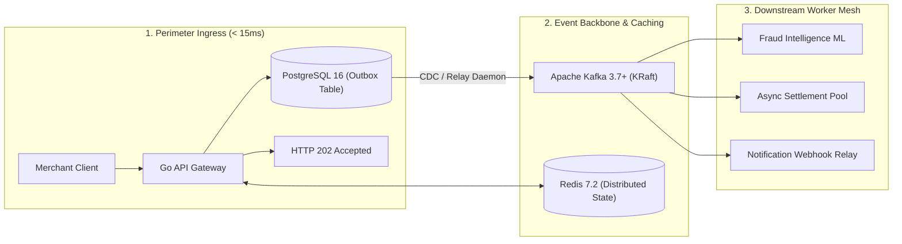

<!-- Top Banner -->

  

# 🚀 Phase 2: Streaming Core & Distributed State
### Master Engineering Action Logs • Days 15 through 28
#### Establishing the Apache Kafka Event Backbone, Redis Distributed Caching, and Asynchronous Settlement Architecture

  
  
  
  
  
  
  
  
  

---

## 📌 Phase 2 Overview: From Synchronous Ingress to Asynchronous Event Streaming

In Phase 1, NOVARIS established an unshakeable financial foundation: double-entry ledgers, JWT/HMAC perimeter defense, optimistic concurrency control (OCC), and idempotent request deduplication. All settlement occurred synchronously within a single PostgreSQL transaction.

In **Phase 2 (Weeks 3 & 4, Days 15–28)**, NOVARIS undergoes a major architectural evolution: **decoupling perimeter request ingress from backend clearing and analytics via asynchronous event streaming and distributed in-memory caching**.

### Core Architectural Pillars Established in Phase 2:
1. **Apache Kafka 3.7+ in KRaft Mode:** High-throughput, distributed event log eliminating Apache ZooKeeper dependencies. Partitioning strictly by `merchant_id` to guarantee causal ordering per tenant.
2. **The Transactional Outbox Pattern:** Defeating the infamous **Dual-Write Hazard**. Payment intents and outbox events commit inside the exact same ACID database transaction before an asynchronous relay publishes them to Kafka with zero dropped messages.
3. **Distributed Multi-Pod Rate Limiting with Redis Lua:** Migrating in-memory token buckets into atomic server-side Redis Lua scripts, enabling horizontally scaled gateway replicas to enforce global merchant quotas seamlessly.
4. **Sub-Millisecond In-Memory Account Balance Caching:** Caching account balances in Redis with write-through updates, automated invalidation, and `singleflight` mutexes to eliminate cache stampedes.
5. **Resilient Consumer Groups & Dead-Letter Queues (DLQ):** Manual offset commits (`CommitMessages`), cooperative rebalance listeners, tiered retry topics (`.retry-1`, `.retry-2`), and poison-pill isolation queues.
6. **Asynchronous Tier 2 Settlement Worker Pools:** High-density worker pools that consume settlement events from Kafka and perform asynchronous clearing, AML compliance checks, and cross-ledger reconciliations.

---

## 🗺️ Phase 2 Daily Action Logs Index (Days 15–28)

> 📖 **Phase 2 Runbook:** For the complete copy-paste testing cheat sheet, see [Phase 2 Commands Runbook](COMMANDS_RUNBOOK.md).

| Day | Milestone Focus | Core CS & Architectural Concept | Action Log Document | Status |
| :---: | :--- | :--- | :---: | :---: |
| **Day 15** | **Apache Kafka Fundamentals & Topic Topology** | KRaft metadata mode, commit log anatomy, deterministic partition routing, verification CLI | [Day 15 Action Log](Day_15_Action_Log.md) | ✅ *Completed (100% Certified)* |
| **Day 16** | **High-Performance Strongly-Typed Go Producer** | `segmentio/kafka-go`, async batching, partition routing by merchant UUID | [Day 16 Action Log](Day_16_Action_Log.md) | ✅ *Completed (100% Certified)* |
| **Day 17** | **Resilient Consumer Groups & Manual Offsets** | Cooperative sticky assignor, manual offset commit control, at-least-once delivery | [Day 17 Action Log](Day_17_Action_Log.md) | ✅ *Completed (100% Certified)* |
| **Day 18** | **Transactional Outbox Pattern & CDC Relay** | Defeating the Dual-Write dilemma, atomic relational outbox writes, relay daemon | [Day 18 Action Log](Day_18_Action_Log.md) | ✅ *Completed (100% Certified)* |
| **Day 19** | **Dead-Letter Queues (DLQ) & Poison-Pill Isolation** | Tiered retry topics, exponential backoff back-pressure, administrative inspection CLI | *Day_19_Action_Log.md* | ⏳ *Up Next* |
| **Day 20** | **Kafka Cluster Chaos & Rebalance Verification** | Network latency injection, broker failure recovery, consumer group rebalance SLA | *Day_20_Action_Log.md* | 📅 *Upcoming* |
| **Day 21** | **Week 3 Milestone Benchmark: 10,000 Events/Sec** | Distributed load benchmark, zero-loss verification, end-to-end pipeline latency | *Day_21_Action_Log.md* | 📅 *Upcoming* |
| **Day 22** | **Distributed Redis 7.2 Cluster Setup** | Multi-node Redis topology, connection pooling, AOF persistence, latency monitoring | *Day_22_Action_Log.md* | 📅 *Upcoming* |
| **Day 23** | **Atomic Redis Lua Token-Bucket Rate Limiter** | Server-side Lua scripts, multi-pod rate synchronization, sub-millisecond throttle checks | *Day_23_Action_Log.md* | 📅 *Upcoming* |
| **Day 24** | **Sub-Millisecond Balance Caching & Singleflight** | Write-through balance caching, TTL invalidation, singleflight cache stampede defense | *Day_24_Action_Log.md* | 📅 *Upcoming* |
| **Day 25** | **Redis Streams for Low-Latency Buffering** | `XADD`, `XREADGROUP`, stream consumer groups, memory-bounded stream trimming | *Day_25_Action_Log.md* | 📅 *Upcoming* |
| **Day 26** | **Distributed Mutual Exclusion with Redlock** | Multi-node distributed locking, heartbeat leases, batch clearing safety | *Day_26_Action_Log.md* | 📅 *Upcoming* |
| **Day 27** | **Asynchronous Tier 2 Settlement Worker Pool** | Decoupled background clearing workers, goroutine lifecycle, graceful shutdown | *Day_27_Action_Log.md* | 📅 *Upcoming* |
| **Day 28** | **Phase 2 Capstone Review & Buffer: 25k TPS Sign-Off** | End-to-end integration benchmark, zero-loss certification, Phase 3 ML Blueprint | *Day_28_Action_Log.md* | 📅 *Upcoming* |

---

<!-- Bottom Banner -->

  

  <strong>NOVARIS Engineering Action Logs • Phase 2 Vault • Maintained by <a href="https://github.com/charan21042005">Tokachichu Sri Charan</a></strong>

