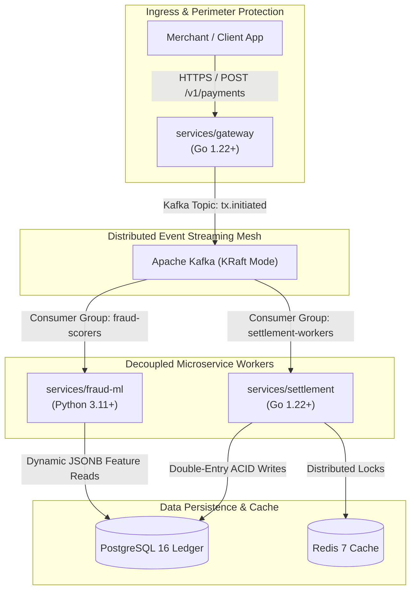

<!-- Top Banner -->

  

# ⚙️ NOVARIS • Distributed Microservices Mesh (`/services`)
### Polyglot Service Architecture for High-Throughput Payment Ingestion, Settlement & Fraud Detection

  
  
  
  
  

---

## 📌 Microservice Topology & Domain Decomposition

The **`/services`** directory houses the backend microservices comprising the NOVARIS core processing plane. Designed around domain-driven boundaries and event-driven choreography, NOVARIS separates public ingress, ledger consensus, and artificial intelligence into independently deployable and scalable services:

---

## 🗂️ Microservices Directory Map

| Service Directory | Core Runtime | Architectural Responsibilities | Roadmap Phase |
| :--- | :---: | :--- | :---: |
| **[`gateway/`](./gateway/)** | **Go 1.22+** | Public edge ingress, RFC 7519 JWT auth, RFC 2104 HMAC-SHA256 signature verification, Token-Bucket rate limiting, IETF idempotency deduplication (`idempotency_keys`), and health probing. | **Phase 1** *(Active)* |
| **[`settlement/`](./settlement/)** | **Go 1.22+** | High-density double-entry ledger settlement, transactional outbox event relaying, Redlock distributed locking, and multi-partition Kafka consumer groups. | **Phase 2 (Day 17 - Active Verified)** |
| **[`fraud-ml/`](./fraud-ml/)** | **Python 3.11+** | Real-time adaptive machine learning scoring (<15ms SLA), dynamic XGBoost/LightGBM inference, streaming feature extraction, and human-review triage. | **Phase 3** *(Weeks 7–8)* |

---

## 💡 Why a Polyglot Architecture?

In enterprise financial engineering, no single programming language is optimal for all tasks:

1. **Go for Gateway & Settlement:**
   * **Ultra-Low Latency & High Concurrency:** Go's lightweight goroutines (2KB stack vs. 1MB OS thread) and non-blocking network runtime allow a single gateway pod to handle tens of thousands of concurrent client connections with sub-millisecond overhead.
   * **Predictable Garbage Collection:** Go's sub-millisecond GC pauses prevent latency spikes that could cause payment timeouts.
   * **Type Safety & Binary Portability:** Compiles into single static binaries with zero external runtime dependencies.

2. **Python for Fraud Intelligence:**
   * **World-Class ML Ecosystem:** Native access to NumPy, Scikit-Learn, XGBoost, and PyTorch for trained decision trees and neural networks.
   * **Fast Streaming Frameworks:** Powered by `FastStream` and `asyncio` for asynchronous Kafka consumption and batch vector scoring.

---

<!-- Bottom Banner -->

  

### 🎓 NOVARIS Microservices Mesh
*Production-Grade Distributed System Architecture*

