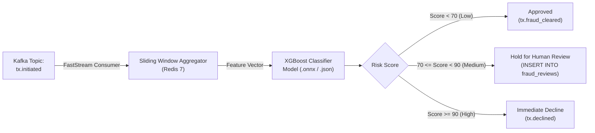

<!-- Top Banner -->

  

# 🧠 NOVARIS • Adaptive Fraud Intelligence Engine (`/services/fraud-ml`)
### Real-Time Streaming Feature Extraction, Vector Scoring & Human Review Triage

  
  
  
  
  
  

---

## 📌 Service Overview

The **Fraud Intelligence Service** operates as a real-time predictive firewall embedded in the transaction stream. For every transaction ingested by the API Gateway, this service computes dynamic behavioral features, evaluates risk using gradient-boosted decision tree ensembles, and issues verdicts before settlement finality.

### Core Architectural Responsibilities:
1. **Sub-15ms Real-Time Inference Budget:**
   * High-speed vectorized scoring allowing transactions to be triaged without exceeding the platform's sub-40ms P99 latency SLA.
2. **Dynamic Sliding-Window Features:**
   * Aggregates rolling features from Redis and PostgreSQL: 1-hour transaction velocity, geo-velocity hops (impossible travel speed), and device fingerprint drift.
3. **Point-in-Time Feature Snapshots (Day 5 Schema):**
   * Persists extracted feature vectors into `feature_snapshots.feature_data` using PostgreSQL `JSONB` for offline model re-training and drift analysis.
4. **Human-in-the-Loop Review Triage:**
   * Ambiguous transactions (e.g. risk score 70–89) automatically route to `fraud_reviews` for compliance analyst evaluation, while scores $\ge 90$ trigger instantaneous automated declines.

---

## 🌊 Streaming Architecture

> [!NOTE]
> Database preparation for this service was implemented on **Day 5** via [`migrations/002_fraud_and_features.sql`](../../migrations/002_fraud_and_features.sql). The full Python inference service and model deployment pipeline will be constructed in **Phase 3 (Weeks 7–8)** of the NOVARIS 84-day master engineering roadmap.

---

<!-- Bottom Banner -->

  

### 🎓 NOVARIS Adaptive Fraud Intelligence
*Real-Time Predictive Risk Scoring & Compliance Automation*

