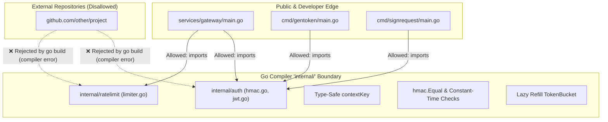

<div align="center">

<!-- Top Banner -->
<p align="center">
  
</p>

# 📦 NOVARIS Gateway Internal Engine (`/services/gateway/internal`)
### Private Architectural Modules, Security Primitives & Middleware Pipelines

<p align="center">
  
  
  
  
  
</p>

---

</div>

## 📌 The Purpose of the `internal/` Directory in Go

In the Go programming language, the `internal/` directory is **enforced by the Go compiler itself** (introduced in Go 1.4).

### The Go Compiler Encapsulation Rule:
> *An import of a path containing the element `internal` is disallowed if the importing package is outside the subtree rooted at the parent of the `internal` directory.*

### Why NOVARIS Uses `internal/`:
1. **Zero External API Leakage:** External services, third-party libraries, or other repositories cannot directly import or depend on our private cryptographic utilities, key generation algorithms, or context definitions.
2. **Encapsulation of Security Primitives:** The internal logic for verifying HMAC hashes, checking timestamp drift, and parsing JWT claims remains an implementation detail of the gateway service.
3. **Refactoring Safety:** Internal package APIs can be freely refactored without introducing breaking changes to public consumers.

---

## 🗂️ Internal Package Architecture

```
services/gateway/internal/
├── auth/                 # Cryptographic authentication & security middleware
│   ├── jwt.go            # RFC 7519 JWT verification & context claims injection
│   ├── jwt_test.go       # Table-driven unit tests for JWT pipeline
│   ├── hmac.go           # RFC 2104 HMAC-SHA256 request signing & replay defense
│   ├── hmac_test.go      # Unit tests for tampering, replay, & stream restoration
│   └── README.md         # Forensic security documentation for internal/auth
├── ratelimit/            # In-memory traffic control & token-bucket rate limiter
│   ├── limiter.go        # Zero-goroutine lazy refill algorithm & sync.RWMutex store
│   ├── limiter_test.go   # Burst, refill, multi-goroutine race tests, and HTTP 429
│   └── README.md         # Rate limiter architecture, math derivation & test guide
└── README.md             # This documentation
```

---

## 🔗 How Internal Packages Are Consumed

Internal packages are consumed exclusively by:
* The Gateway root server ([`services/gateway/main.go`](../main.go))
* The Gateway CLI suite ([`services/gateway/cmd/`](../cmd/))



---

## 🧭 Directory Index

* 👉 **[internal/auth/ README](./auth/README.md):** In-depth documentation covering JWT claims verification, HMAC payload hashing, constant-time equality comparisons, and stream restoration mechanics.
* 👉 **[internal/ratelimit/ README](./ratelimit/README.md):** In-depth documentation covering token-bucket algorithm, zero-goroutine lazy mathematical refill, thread safety, and HTTP 429 Retry-After specifications.

---

<div align="center">

<!-- Bottom Banner -->
<p align="center">
  
</p>

### 🎓 NOVARIS Architectural Engine
*Go Compiler-Enforced Internal Package Boundary*

</div>
