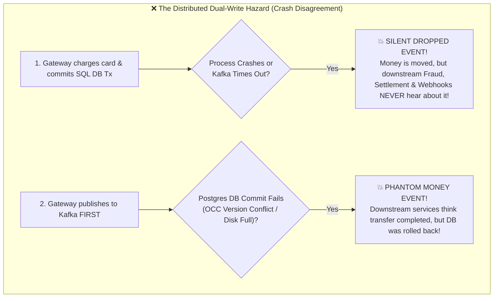
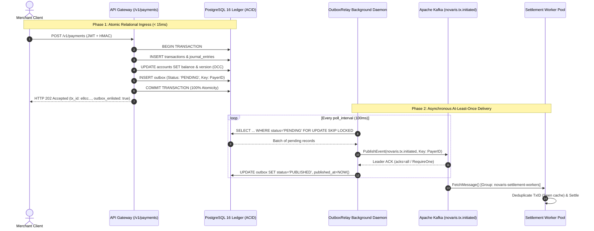

<div align="center">

<!-- Top Banner -->
<p align="center">
  
</p>

# 📬 NOVARIS Transactional Outbox Engine (`/services/gateway/internal/outbox`)
### Eliminating the Distributed Dual-Write Vulnerability via Relational Event Persistence & Asynchronous Kafka Relaying

<p align="center">
  
  
  
  
  
  
</p>

---

</div>

## 📌 Architectural Overview & The Dual-Write Dilemma

In distributed payment systems, a service must frequently update a database and publish an event to an event broker (Apache Kafka). When executed as two independent network operations, this introduces the catastrophic **Dual-Write Hazard**:



### The Transactional Outbox Pattern Solution (Day 18):
Rather than attempting distributed 2-Phase Commit (2PC) over slow XA transactions, NOVARIS leverages the **Transactional Outbox Pattern**:
1. When a transaction is settled, the business records (`transactions`, `journal_entries`, `accounts`) and an outgoing event envelope (`outbox`) are committed inside the **EXACT SAME ACID PostgreSQL database transaction**.
2. If the database transaction aborts or encounters an Optimistic Concurrency Control (OCC) collision, the outbox record is rolled back automatically. No phantom events can ever be emitted!
3. If the database commits, the outbox record is guaranteed to be durably written to PostgreSQL's Write-Ahead Log (WAL).
4. An autonomous background daemon (`OutboxRelay`) polls the `outbox` table using `FOR UPDATE SKIP LOCKED`, emits the message to Apache Kafka, and marks the record `PUBLISHED` only upon broker acknowledgment.



---

## 🗂️ Internal Package Taxonomy

```
services/gateway/internal/outbox/
├── model.go       # Domain envelope (OutboxRecord, OutboxStatus, JSON serialization)
├── repository.go  # SQLRepository (FOR UPDATE SKIP LOCKED) & hermetic MockRepository
├── relay.go       # OutboxRelay background daemon, ticker loop, and crash fault injection
├── adapter.go     # Bridge between streaming.KafkaProducer and outbox.EventPublisher
├── outbox_test.go # Comprehensive unit test suite (validation, lifecycle, crash simulation)
└── README.md      # This architectural guide
```

---

## ⚙️ Core Technical Features

### 1. Concurrency-Safe Polling via `FOR UPDATE SKIP LOCKED`
When multiple API Gateway or Relay instances run horizontally inside a Kubernetes cluster, naive polling queries like `SELECT * FROM outbox WHERE status = 'PENDING'` create severe row lock contention, deadlocks, and duplicated network publishing.

NOVARIS utilizes PostgreSQL's native `FOR UPDATE SKIP LOCKED`:
```sql
SELECT id, aggregate_type, aggregate_id, event_type, payload, status, retry_count, created_at
FROM outbox
WHERE status = 'PENDING'
ORDER BY created_at ASC
LIMIT $1
FOR UPDATE SKIP LOCKED;
```
* **Non-Blocking Scale-Out:** Pod A locks rows 1–50. When Pod B queries simultaneously, PostgreSQL automatically skips those 50 locked rows and gives Pod B rows 51–100 without waiting!
* **Zero Worker Interference:** Eliminates lock queues and distributed coordinator overhead.

### 2. Zero-Loss Fault Tolerance Across Worker Crashes (Lab L3)
What happens if the Outbox Relay worker crashes (e.g. OOM, Kubernetes pod kill, power failure) *immediately after* publishing an event to Kafka, but *before* calling `MarkPublished` in PostgreSQL?
* The outbox row remains in status `PENDING`.
* When a replacement relay worker boots up, it finds the record still marked `PENDING` and re-publishes it to Kafka.
* **Guarantee:** **At-Least-Once Delivery.** Under no failure mode is an event ever dropped or lost!
* **Deduplication:** The downstream consumer (Day 17) uses thread-safe transaction ID deduplication (`seenTxIDs` / database primary key), guaranteeing **Effectively-Once Processing**.

---

## 🧪 Testing & Verification Runbook

### Run Hermetic Unit Tests
```bash
cd services/gateway
go test -v ./internal/outbox/...
```

Expected output:
```text
=== RUN   TestOutboxModel_Validation
--- PASS: TestOutboxModel_Validation (0.00s)
=== RUN   TestMockRepository_Lifecycle
--- PASS: TestMockRepository_Lifecycle (0.00s)
=== RUN   TestOutboxRelay_HappyPath
--- PASS: TestOutboxRelay_HappyPath (0.00s)
=== RUN   TestOutboxRelay_TransientErrorAndRetry
--- PASS: TestOutboxRelay_TransientErrorAndRetry (0.00s)
=== RUN   TestOutboxRelay_SimulatedCrashZeroLoss
--- PASS: TestOutboxRelay_SimulatedCrashZeroLoss (0.00s)
=== RUN   TestOutboxRelay_Lifecycle
--- PASS: TestOutboxRelay_Lifecycle (0.02s)
PASS
```

---

<div align="center">

<!-- Bottom Banner -->
<p align="center">
  
</p>

### 🎓 NOVARIS Distributed Systems Engine
*Transactional Outbox Pattern • Dual-Write Elimination • At-Least-Once Streaming*

</div>
