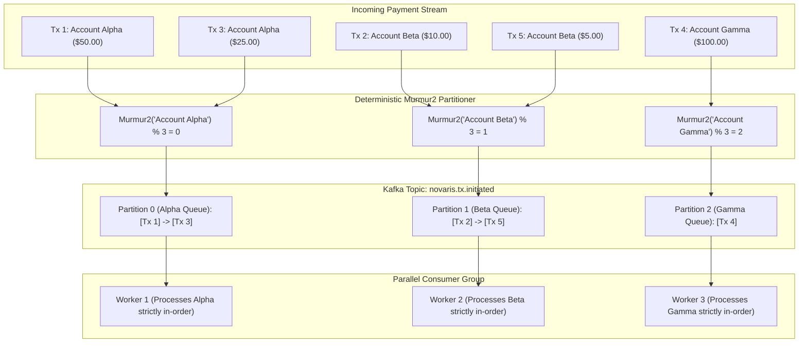

<div align="center">

<!-- Top Banner -->
<p align="center">
  
</p>

# ⚡ NOVARIS Event Streaming Backbone (`/internal/streaming`)
### Cloud-Native Apache Kafka KRaft Core, Deterministic Partition Routing & Cluster Administration

<p align="center">
  
  
  
  
  
  
</p>

---

</div>

## 📌 Package Overview

The `internal/streaming` package is the distributed event backbone of the NOVARIS payment settlement engine, introduced in **Phase 2 (Day 15)**. It bridges the synchronous HTTP API Gateway with asynchronous, distributed downstream processors (Settlement Worker, Adaptive Fraud ML, Audit Logs, and Dead Letter Queues).

This package delivers:
1. **Cloud-Native Cluster Configuration (`config.go`):** Environment-driven broker discovery, timeouts, and canonical topic catalog specifications.
2. **Deterministic Partition Routing (`partitioner.go`):** Murmur2 and FNV-1a hashing ensuring strict per-account FIFO ordering across parallel consumers.
3. **Pure-Go Cluster Administration (`admin.go`):** Zero-CGO health probing, KRaft metadata inspection, idempotent topic provisioning, and diagnostic probe dispatch.

```
                   INCOMING PAYMENT SETTLEMENT (HTTP POST)
                                     │
                                     ▼
                ┌─────────────────────────────────────────┐
                │        services/gateway (Ingress)       │
                │  * Authenticated (JWT + HMAC-SHA256)    │
                │  * Rate-Limited (Token Bucket)          │
                │  * ACID Ledger Committed (PostgreSQL)   │
                └────────────────────┬────────────────────┘
                                     │ Dispatches Event
                                     ▼
                ┌─────────────────────────────────────────┐
                │      internal/streaming/partitioner     │
                │  P = |Murmur2(AccountUUID)| % 3         │
                │  (Guarantees Account FIFO Invariant)    │
                └────────────────────┬────────────────────┘
                                     │
                                     ▼
                ┌─────────────────────────────────────────┐
                │      internal/streaming/admin           │
                │  kafka-go Pure Go Producer Engine       │
                └────────────────────┬────────────────────┘
                                     │ TCP Wire Protocol
                                     ▼
       ┌─────────────────────────────────────────────────────────────┐
       │             APACHE KAFKA BROKER CLUSTER (KRaft)             │
       │                                                             │
       │  Topic: novaris.tx.initiated (3 Partitions)                 │
       │  ┌─────────────────┬─────────────────┬───────────────────┐  │
       │  │   Partition 0   │   Partition 1   │    Partition 2    │  │
       │  │  [E0][E1][E2]...│  [E0][E1][E2]...│   [E0][E1][E2]... │  │
       │  └────────┬────────┴────────┬────────┴─────────┬─────────┘  │
       └───────────┼─────────────────┼──────────────────┼────────────┘
                   ▼                 ▼                  ▼
             Consumer 1         Consumer 2          Consumer 3
           (Settlement)        (Fraud ML)         (Audit Ledger)
```

---

## 🏛️ Core Architectural Modules

### 1. `config.go` — Dynamic Configuration & Health Probing

Manages broker endpoints, client identifiers, dial timeouts, and defines the official Novaris canonical topic catalog:

* **Environment Variable Overrides:**
  * `KAFKA_BROKERS`: Comma-separated list of broker hostnames (defaults to `localhost:9092`).
  * `KAFKA_CLIENT_ID`: Identification string sent during TCP handshakes (defaults to `novaris-gateway-dev`).
* **Canonical Topic Catalog (6 Production Topics, 3 Partitions Each):**
  1. `novaris.tx.initiated`: Published immediately upon ingress acceptance.
  2. `novaris.tx.settled`: Emitted when double-entry journal entries are fully settled.
  3. `novaris.tx.failed`: Emitted upon ledger failure, balance insufficiency, or OCC collision.
  4. `novaris.tx.dlq`: Dead Letter Queue for poisoned messages and permanent rejections.
  5. `novaris.tx.retry.1`: First-stage retry queue with exponential backoff delay.
  6. `novaris.tx.retry.2`: Second-stage retry queue for downstream transient recovery.
* **Rapid Layer-4 TCP Socket Prober (`ProbeReachability`):**
  Performs lightweight, fail-fast network reachability checks before initiating heavier Kafka wire protocol handshakes.

---

### 2. `partitioner.go` — Deterministic Partition Routing & Math

Kafka guarantees strict event ordering **only within an individual partition**. If transactions for the same merchant account land on different partitions, concurrent consumer workers would process them out of order, leading to negative balance races!

`partitioner.go` implements deterministic key routing:
* **Murmur2 Hashing:** Evaluates 32-bit Murmur2 on the Payer Account UUID byte slice ($P = |\text{Murmur2}(\text{PayerID})| \pmod N$), maintaining strict binary compatibility with the official Apache Kafka Java client.
* **FIFO Invariant:** All payments, adjustments, and refunds for a single account sequence into the same partition, guaranteeing chronological First-In, First-Out execution across parallel consumers.

---

### 3. `producer.go` — High-Performance Strongly-Typed Go Producer (Day 16)

The `producer.go` engine wraps `segmentio/kafka-go.Writer` to transform API Gateway requests into durable streaming events:
* **Canonical Event Model (`TransactionInitiatedEvent`):** Strict schema enforcing positive integer amounts, valid UUIDs, and ISO 4217 currency.
* **Leader Durability (`RequiredAcks = RequireOne`):** Ensures sub-15ms write latency while providing durability against broker network blips.
* **Micro-Batching (`BatchSize: 100`, `BatchTimeout: 10ms`):** Optimizes TCP socket write throughput without introducing queue lag.
* **In-Memory Mock (`MockProducer`):** Full hermetic mock implementation for offline unit testing.

---

### 4. `consumer.go` — Resilient Consumer Groups & Offset Management (Day 17)

The `consumer.go` engine wraps `segmentio/kafka-go.Reader` to provide enterprise-grade consumer group coordination:
* **Consumer Group Protocol (`ConsumerGroup`):** Automatically joins consumer groups, coordinates partition assignments via the Kafka Group Coordinator, and handles dynamic partition rebalances.
* **At-Least-Once Delivery with Manual Offsets:** Fetches messages (`FetchMessage`), executes business handlers, and commits offsets (`CommitMessages`) ONLY upon handler success.
* **Poison-Pill Defense:** Invalid JSON or failing invariants abort the commit, preventing unhandled data corruption.
* **In-Memory Mock (`MockConsumer`):** Enables unit tests to enqueue simulated messages, test handler callbacks, and inspect committed offsets.

$$\text{PartitionIndex} = \Big(\text{Hash}(\text{RoutingKey}) \;\&\; \text{0x7FFFFFFFFFFFFFFF}\Big) \pmod{\text{NumPartitions}}$$

* **Murmur2 Hashing:** Uses the exact 64-bit Murmur2 algorithm (seed `0xe17a1465`) implemented by the official Apache Kafka Java client, ensuring cross-language routing consistency between Go gateway services and Java/Kotlin/Python consumers.
* **Sign-Bit Masking:** Masks the hash with `math.MaxInt64` (`0x7FFFFFFFFFFFFFFF`) to eliminate negative values resulting from Two's Complement integer overflows.
* **Uniform Distribution:** Verifies that keys distribute uniformly across partitions ($<5\%$ deviation from theoretical $\frac{N}{3}$), preventing broker hot-spotting.

---

### 3. `admin.go` — Cluster Administration & Topic Provisioning

Provides high-level cluster administration built on `github.com/segmentio/kafka-go`:

* **`CheckHealth(ctx)`:** Executes an active protocol-level round-trip metadata ping against the broker cluster.
* **`ListTopics(ctx)`:** Discovers broker nodes, partition assignments, and the active topic registry.
* **`EnsureTopics(ctx, specs)`:** Idempotently provisions topics. If a topic already exists, it verifies partition counts rather than throwing an error.
* **`ProduceProbeMessage(ctx, topic, key, payload)`:** Dispatches an end-to-end test message and confirms synchronous broker Leader ACK (`RequiredAcks = RequireOne`).

---

### 4. `producer.go` — Resilient Kafka Producer & Event Model (Day 16)

Transforms gateway HTTP payment requests into durable streaming events:

* **`TransactionInitiatedEvent` Schema:** Canonical financial record containing `EventID` (UUIDv4), `TransactionID`, `PayerID` (Partition Key), `PayeeID`, `AmountCents`, `Currency`, `MerchantID`, `IdempotencyKey`, and UTC `Timestamp`.
* **Synchronous Leader ACK (`kafka.RequireOne`):** Balances sub-15ms socket turnaround time with partition leader durability before acknowledging the client.
* **`MockProducer`:** Thread-safe, in-memory implementation of `EventProducer` enabling 100% hermetic unit testing without Docker dependencies.

---

## 📐 Mathematical Invariant: Per-Account FIFO Ordering



---

## 💻 Go Implementation & Usage

### 1. Initializing Admin Client & Provisioning Topics

```go
package main

import (
    "context"
    "log"
    "time"
    "github.com/charan21042005/novaris/services/gateway/internal/streaming"
)

func main() {
    ctx, cancel := context.WithTimeout(context.Background(), 10*time.Second)
    defer cancel()

    // 1. Load cloud-native configuration:
    cfg := streaming.DefaultConfig()

    // 2. Instantiate pure-Go admin client:
    admin, err := streaming.NewAdminClient(cfg)
    if err != nil {
        log.Fatalf("Failed to initialize admin client: %v", err)
    }
    defer admin.Close()

    // 3. Verify broker reachability:
    if err := admin.Ping(ctx); err != nil {
        log.Fatalf("Kafka cluster unreachable: %v", err)
    }

    // 4. Idempotently provision canonical topics:
    created, err := admin.EnsureTopics(ctx, streaming.DefaultTopicConfigs()...)
    if err != nil {
        log.Fatalf("Topic provisioning error: %v", err)
    }
    log.Printf("Successfully verified topics (newly created: %d)", len(created))
}
```

### 2. Computing Deterministic Partitions

```go
package main

import (
    "fmt"
    "github.com/charan21042005/novaris/services/gateway/internal/streaming"
)

func main() {
    partitioner := streaming.NewMurmur2Partitioner()
    numPartitions := 3

    accountID := "acc_merchant_alpha_001"
    targetPartition := partitioner.Partition(accountID, numPartitions)

    fmt.Printf("Account %s deterministically routes to Partition %d\n", accountID, targetPartition)
}
```

---

## 🧪 Testing & Verification

The package includes unit and integration tests validating config parsing, Murmur2 test vectors, partition balancing, and live broker interactions:

```powershell
# Run streaming unit and integration tests
Set-Location "services/gateway"
go test -v ./internal/streaming/...
```

### Automated Verification Matrix:
* `TestDefaultConfig`: Validates default broker addresses, client IDs, and canonical topic counts.
* `TestMurmur2_Vectors`: Validates deterministic hash outputs against known standard test vectors.
* `TestMurmur2Partitioner_Modulo`: Confirms all calculated partitions reside within the range $[0, N-1]$.
* `TestPartitionDistribution`: Generates 3,000 distinct account UUIDs across 3 partitions and proves standard deviation $\sigma < 50$ (balanced distribution).
* `TestAdminClient_LiveIntegration`: Connects to local Docker KRaft broker (`localhost:9092`), checks metadata, provisions canonical topics, and publishes a diagnostic probe.

---

## 🔗 Related Components

* 🔍 **[cmd/verifykafka](../../cmd/verifykafka/README.md):** Diagnostic and health auditing CLI tool for Phase 2 Day 15.
* 🛡️ **[internal/auth](../auth/README.md):** Ingress authentication validating callers before event production.
* 📖 **[Phase 2 Day 15 Action Log](../../../../bin/Daily_Actions/Phase_2_Streaming_Core/Day_15_Action_Log.md):** 1,300+ line master textbook covering KRaft, Zero-Copy I/O, and Kafka fundamentals.

---

<div align="center">

<!-- Bottom Banner -->
<p align="center">
  
</p>

### 🎓 NOVARIS Event Streaming Core Subsystem
*Apache Kafka • KRaft Architecture • Murmur2 Partition Routing*

</div>
