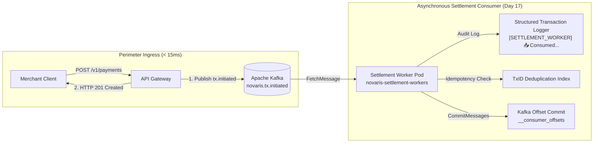

<div align="center">

<!-- Top Banner -->
<p align="center">
  
</p>

# 💳 NOVARIS • Distributed Settlement & Ledger Service (`/services/settlement`)
### High-Throughput Event-Driven Ledger Settlement Daemon, Kafka Consumer Group & OCC Clearing Engine

<p align="center">
  
  
  
  
  
  
</p>

---

</div>

## 📌 Service Overview

The **Settlement Engine** (`services/settlement`) is the first decoupled, asynchronous event-driven worker daemon in NOVARIS, established in **Phase 2 (Day 17)**. 

Instead of requiring the synchronous API Gateway to execute heavy database clearing over fragile HTTP REST connections, this service listens directly to Apache Kafka under consumer group `novaris-settlement-workers`. It consumes incoming `novaris.tx.initiated` payment events, executes strict idempotency deduplication, performs double-entry ledger bookkeeping, and commits partition offsets back to Kafka.



---

## 🏗️ Core Architectural Features (Day 17)

### 1. Kafka Consumer Group Protocol (`novaris-settlement-workers`)
* Multiple replicas of this worker pod can run concurrently across Kubernetes pods.
* Kafka automatically divides partitions (e.g. Partitions 0, 1, 2) among active workers.
* If a worker pod crashes, Kafka initiates a **Partition Rebalance**, reassigning partitions to surviving workers with zero downtime.

### 2. At-Least-Once Delivery with Manual Offset Commits
* Offsets are **never** auto-committed upon message retrieval.
* The worker fetches the message (`FetchMessage`), executes domain validation and ledger deduplication, and commits the offset (`CommitMessages`) **only upon success**.
* If the worker crashes mid-flight, the record is redelivered upon restart.

### 3. Effectively-Once Idempotent Execution
* Financial transactions carry an immutable `TransactionID`.
* The worker tracks processed transactions in its deduplication cache.
* If network retries cause an event to be redelivered, the duplicate is detected, double-debiting is skipped, and the offset is safely committed.

### 4. Structured Financial Logging (Lab L2)
Every consumed transaction outputs an audit line:
```
[SETTLEMENT_WORKER] 📥 Consumed tx.initiated event c71b6e7b... | TxID: ad69ad65... | Amount: $125.00 USD | Payer: c0000000-0000-0000-0000-000000000001 -> Payee: c0000000-0000-0000-0000-000000000002 | Partition: 2 | Offset: 14
```

---

## ⚙️ Configuration & Environment Variables

| Parameter | Flag | Env Var | Default | Description |
| :--- | :--- | :--- | :--- | :--- |
| **Brokers** | `-brokers` | `KAFKA_BROKERS` | `localhost:9092` | Comma-separated Kafka bootstrap endpoints. |
| **Consumer Group** | `-group` | `KAFKA_CONSUMER_GROUP` | `novaris-settlement-workers` | Unique consumer group identifier. |
| **Target Topic** | `-topic` | `KAFKA_TOPIC` | `novaris.tx.initiated` | Kafka topic to consume. |

---

## 🚀 Execution & Testing Runbook

### 1. Run Unit Tests
```powershell
Set-Location "services/settlement"
go test -v ./...
```

### 2. Launch Settlement Consumer Daemon
```powershell
Set-Location "services/settlement"
go run . -brokers "localhost:9092" -group "novaris-settlement-workers"
```

---

<div align="center">

<!-- Bottom Banner -->
<p align="center">
  
</p>

### 🎓 NOVARIS Settlement Service
*Mathematical Zero-Drift Financial Accounting Engine*

</div>
